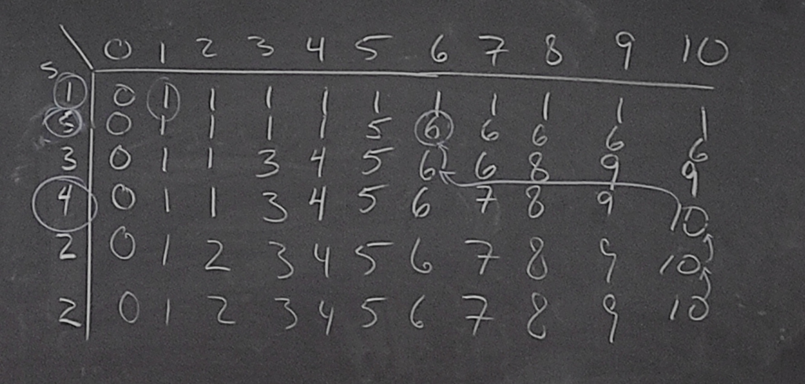

Problema:  
Abbiamo dei file $1,...,n$ di dimensione $s_1,...,s_n$ con un disco di dimensione $C$. Trovare un sottoinsieme dei file che riempie più spazio possibile del disco (numeri interi).

La ricerca con forza bruta funziona ma impiega tempo $O(2^n)$:
```
def spazio(s1,...,sn,C):
    todo
```

Un algoritmo greedy non raggiunge la soluzione ottimale ($C=30,$ grandezze$=\{16, 15, 15\}$).

La programmazione dinamica sfrutta il fatto che in problemi come questo facciamo lo stesso calcolo ma con una piccola differenza: invece di ripetere i calcoli, salviamo e riutilizziamo i calcoli già fatti.

Invece di fare calcoli simili più volte, iniziamo calcolando tutti gli spazi massimi occupati da i primi $i$ elementi per ogni grandezza da $0$ a $C$. Con $C=0$, ogni scelta riempe 0 spazio. Il resto della prima riga sarà $0$ fino a quando $C>s_1$. La seconda riga sarà 0 fino a quando non si può scrivere il file più piccolo tra il primo ed il secondo, poi il più piccolo fino a quando non c'è spazio per il più grando, poi il più grande fino a quando non ci sarà spazio per entrambi, poi entrambi.

Quindi vediamo che non possiamo continuare scrivendo riga per riga. Possiamo notare che se ad una certa cella $m[i,j]$ non possiamo usare il file $i$, allora il valore di quella cella è $m[i-1,j]$, che abbiamo già calcolato. Se invece possiamo aggiungerlo, possiamo partire dalla cella $m[i-1, j-s_i]$ contenente il massimo peso con file prima di $i$ e il peso che rimane dopo aver aggiunto $i$; anche questo l'abbiamo già calcolato.

Calcoliamo $m[i,j]$ (assumendo che abbiamo la prima riga e colonna):
```
if si <= j:
    m[i][j] = max(m[i-1][j], m[i-1][j-si]+si)
else: m[i][j] = m[i-1][j]
```

In questo modo, possiamo calcolare l'intera tabella partendo dalla prima riga e prima colonna, che sono banali da calcolare, con un doppio ciclo `for`.

```python
# 1 indexed perché si
def file(s: List, n: int = len(s), c: int):
    t = [[0] * c + 1] * n
    for j in range(c):
        if s[1] <= j: t[1][j] = s[1]
        else: t[1][j] = 0
    for i in range(2, n):
        for j in range(c):
            # partiamo dal valore già calcolato
            t[i][j] = t[i-1][j]
            # se i entra nella grandezza j
            if s[i] <= j:
                max_con_i = t[i-1][j-s[i]] + s[i]
                # e mi conviene
                if max_con_i >= t[i][j]:
                    # lo aggiungo
                    t[i][j] = max_con_i
    return t[n][c]
```

Dalla tabella calcolata in questo modo possiamo anche trovare il sottoinsieme di file: torna indietro nella colonna finchè non trovi un valore diverso, poi torna indietro di $[1, s_i]$ e ripeti, prendendo i file se il numero cambia.


