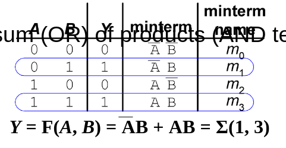
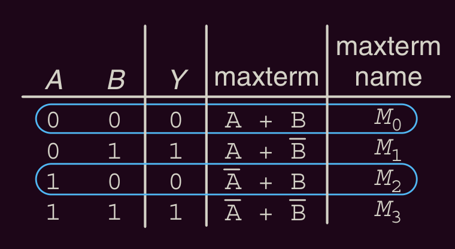
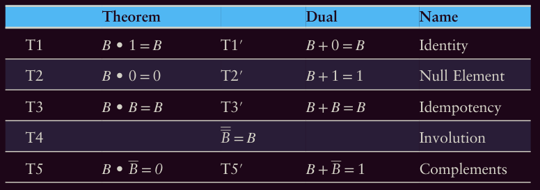
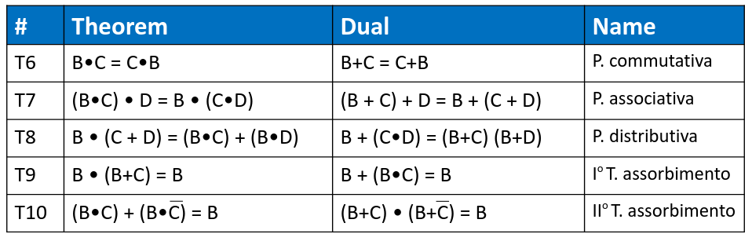
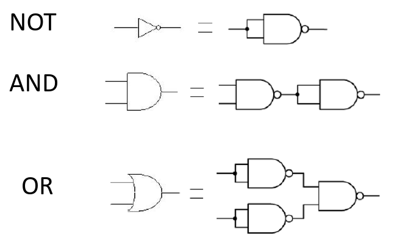
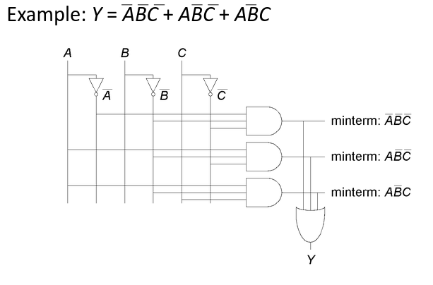
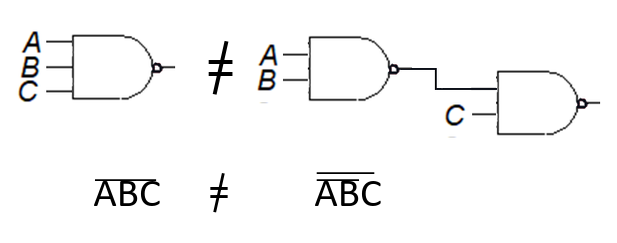
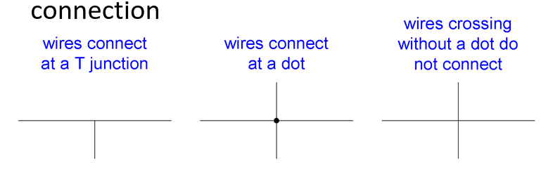
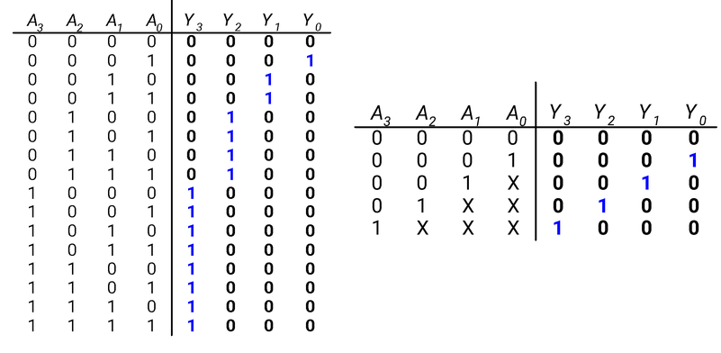
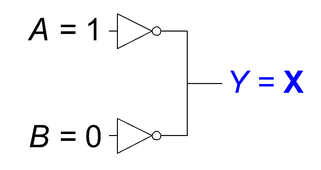

# Termini

- Literal
    Variabile o il suo complemento
- Implicante
    Prodotto di literal
- Minterm
    Prodotto che include tutte le variabili di input
- Maxterm
    Somma che include tutte le variabili di input

## SOP e POS

Ogni equazione può essere scritta in forma SOP (sum of products) e POS (product of sums)

Mettendo ogni possibile permutazione di input in tabella, si può trovare la forma SOP dell'equazione scrivendo i minterm di ogni riga e prendendo quelli che sono veri in output

Per trovare la POS, si fa l'opposto: si prende il maxterm (somma) di ogni riga *falsa*, e si fa il prodotto tra loro

# Dimostrare teoremi

Possiamo dimostrare i teoremi in due modi:
1. Induzione perfetta
    Mostra che i due lati dell'equazione sono uguali per ogni possibile input
2. Usando altri teoremi
    Manipola l'equazione usando i teoremi noti fino a che non si arriva ad un'equazione sempre vera

> [!NOTE]
> La proprietà distributiva si applica *anche per l'addizione* in algebra booleana:

# Semplificare equazioni

> Semplificare un'equazione significa ridurla al minor numero di implicanti, dove ogni implicante ha il minor numero di literals.

Oltre ad applicare i teoremi per ridurre il numero di variabili, a volte è utile applicarli per *espandere* le variabili già presenti.

> [!NOTE]
> "Raccogliere" si dice "multiplying out"

Semplificando le espressioni possiamo passare da POS a SOP e viceversa, o trasformare un'equazione qualsiasi in una SOP/POS

# Teorema di De Morgan

> Il prodotto negato di variabili è uguale alla somma delle variabili negate.

C'è anche la forma duale:
> La somma negata di variabili è ugualle al prodotto delle variabili negate.

## Bubble Pushing

È utile applicare il teorema di De Morgan nei circuiti in modo da avere le "bolle" in posizioni più convenienti

In genere si parte dall'output e si procede all'indietro fino agli input:

> [!TIP]
> Si può trasformare un'espressione in forma SOP in una POS (o viceversa) negandola due volte e applicando De Morgan.

Questo processo è utile dato che è più semplice usare NAND e NOR nei circuiti che AND e OR, quindi è sempre meglio trasformare un circuito in uno che usa le porte invertite. Questo è perché le porte NAND e NOR sono *funzionalmente complete*: bastano per realizzare **qualsiasi circuito**. Inoltre sono anche più semplici da realizzare.

# Traduzione in circuiti

Possiamo tradurre un'equazione booleana in un circuito utilizzando 2 livelli di porte logiche:

Le forme SOP si traducono facilmente in un circuito formato da sole porte NAND. Attenzione però al fatto che le porte NAND e NOR non sono associative.

*Esempio che mostra che le porte NAND non sono associative.*

## Schematiche

Nelle schematiche dei circuiti:
- Input a sinistra o sopra
- Output a destra o sotto
- Gate vanno da sinistra a destra
- Cavi dritti

Le connessioni tra cavi si rappresentano in questo modo:

A volte, per compattare la rappresentazione delle tavole di verità, possiamo usare i "don't care": se non ci interessa il valore di un input in una riga, mettiamo "x".

*Esempio dei "don't care".*

> [!WARNING]
> Il valore "x" è utilizzato anche per indicare un conflitto nel circuito: un valore che non è né 0 né 1.

Tristate buffer? Usano Z per indicare alta impedenza

I diversi componenti di un calcolatore comunicano usando un bus condiviso. Per evitare conflitti, usano l'impedenza per attivare o disattivare l'output sul bus. Per decidere chi ha autorità di scrittura si usa un circuito di priorità (l'esempio del don't care).

# Karnaugh Maps

Un altro modo per semplificare le tavole di verità, boh??

Si raggruppano i literal in qualche modo non ho capito bene

Poi se prendi gli uni adiacenti nella mappa usando l'assorbimento puoi ridurre l'equazione

Gli implicanti più grandi in una k-map sono detti *primi*.

Regole:
- Ogni 1 deve essere cerchiato
- Ogni cerchio deve contenere un numero di quadrati pari ad una potenza di due
- Ogni cerchio deve essere di grandezza massima
- Un cerchio può fare "wrap around"
- I don't care sono presi solo se convengono

Fai esercizi su questo
