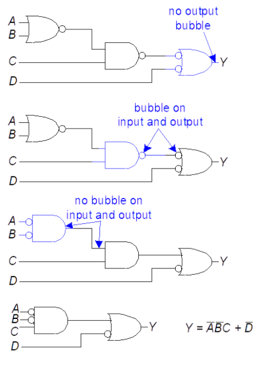

<!-- TODO: -->

# Dimostrare teoremi

Possiamo dimostrare i teoremi in due modi:
1. Induzione perfetta
    Mostra che i due lati dell'equazione sono uguali per ogni possibile input
2. Usando altri teoremi
    Manipola l'equazione usando i teoremi noti fino a che non si arriva ad un'equazione sempre vera

> [!NOTE]
> La proprietà distributiva si applica *anche per l'addizione* in algebra booleana:

# Semplificare equazioni

> Semplificare un'equazione significa ridurla al minor numero di implicanti, dove ogni implicante ha il minor numero di literals.

> [!NOTE]
> Implicante = prodotto di literals; Literal = variabile o il suo complemento

Oltre ad applicare i teoremi per ridurre il numero di variabili, a volte è utile applicarli per *espandere* le variabili già presenti.

> [!NOTE]
> "Raccogliere" si dice "multiplying out"

Semplificando le espressioni possiamo passare da POS a SOP e viceversa, o trasformare un'equazione qualsiasi in una SOP/POS

# Teorema di De Morgan

> Il prodotto negato di variabili è uguale alla somma delle variabili negate.

C'è anche la forma duale:
> La somma negata di variabili è ugualle al prodotto delle variabili negate.

## Bubble Pushing

È utile applicare il teorema di De Morgan nei circuiti in modo da avere le "bolle" in posizioni più convenienti

In genere si parte dall'output e si procede all'indietro fino agli input:

> [!TIP]
> Si può trasformare un'espressione in forma SOP in una POS (o viceversa) negandola due volte e applicando De Morgan.

Questo processo è utile dato che è più semplice usare NAND e NOR nei circuiti che AND e OR, quindi è sempre meglio trasformare un circuito in uno che usa le porte invertite. Questo è perché le porte NAND e NOR sono *funzionalmente complete*: bastano per realizzare **qualsiasi circuito**. Inoltre sono anche più semplici da realizzare.

