# Adder

Gli adder sono circuiti che calcolano la somma tra 2 bit:
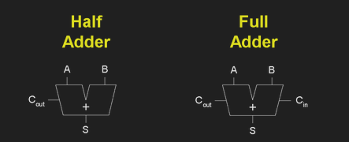

Prendono i 2 bit di input e come output hanno la somma e il riporto. Il full adder ha anche un input per il riporto.

Tabelle di verità e funzioni:
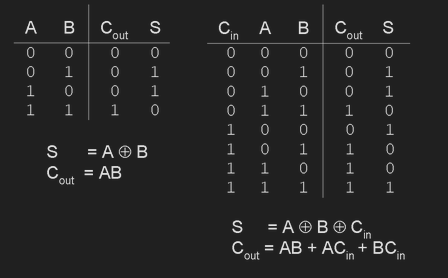

Mettendo più full adder insieme si ottiene un adder a più bit.

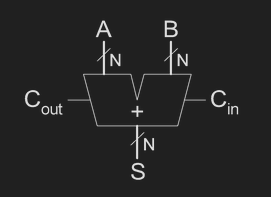

Ci sono modi diversi di creare adder multipli:
- Ripple-carry
    Lento ma semplice
- Carry-lookahead
    Veloce
- Prefix
    Più veloce

## Ripple-carry

Metti sommatori ad 1 bit in catena, il riporto si propaga per tutta la catena:
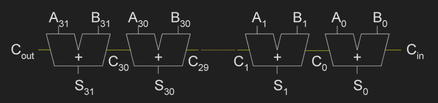

Il periodo di questo ciruito è $t_\text{ripple}=N\cdot t_\text{FA}$, con $t_\text{FA}=$ periodo di un full adder.

Il percorso critico di un full adder è il percorso del riporto, che si realizza con 4 porte logiche.

## Carry-lookahead

Questo sommatore calcola $C_\text{out}$ per blocchi di $k$ bit usando dei segnali intermedi.

La colonna $i$ produce un riporto generandolo oppure propagando un carry in. Il carry viene generato se entrambi i bit di input sono 1. Il carry viene propagato se c'è un carry in e uno dei due input è 1.

Segnali generate e propagate:
- Generate: $G_i = A_iB_i$
- Propagate: $G_i = A_i+B_i$ (equivalente ma calcola anche la somma: $A_i\oplus B_i$)

Segnale carry out: $C_i=A_iB_i + (A_i+B_i)C_{i-1} = G_i+P_iC_{i-1}$.

Con questi segnali di colonna dobbiamo poi calcolare i segnali *block propagate/generate*, che indicano se il carry viene generato da un blocco di $k$ bit o propagato dal carry in del blocco al carry out.

Il block propagate è l'and tra tutti i propagate del blocco.

Il block generate è 1 se una colonna ha il generate e tutte le successive hanno il propagate.

Quindi i segnali per un blocco con bit che vanno da $i$ a $j$ sono: $$
\begin{align}
P_{i:j} &= P_i\cdot P_{i-1}\cdot ... \cdot P_{j+1} \cdot P_j \\
G_{i:j} &= G_i+P_i(G_{i-1}+P_{i-1}(G_{i-2}+P...(G_{j+1}+P_{j+1}G_j)...) \\
C_i &= G_{i:j}+P_{i:j}C_{j-1}
\end{align}
$$

Un sommatore carry-lookahead a 32 bit:
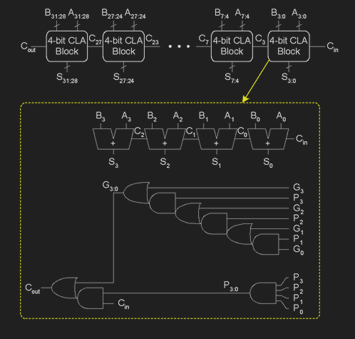

Il percorso critico di questo è: 8 porte logiche per il primo blocco, poi *solo 2* per ogni altro blocco (tranne l'ultimo?).

Questo tipo di adder è più efficiente del ripple per somme con bit $\geq 16$.

## Prefix adder

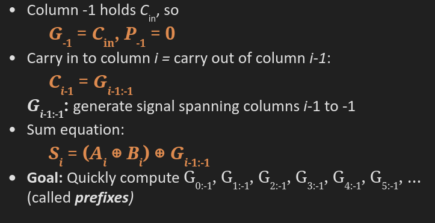

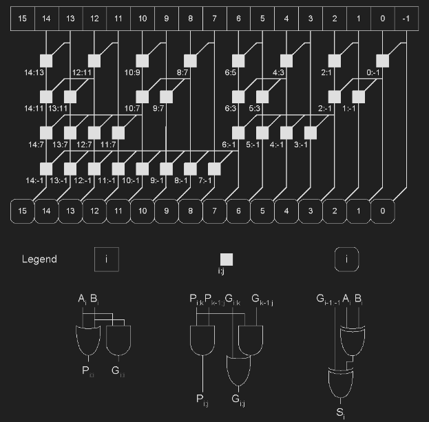

Formula delay: $$
t_{PA} = t_{pg} + \log_2N(t_{pg\text{\_prefix}})+t_\text{XOR}
$$

Con:
- $t_{pg} =$ tempo per produrre $P_i,G_i$
- $t_{pg\text{\_prefix}} =$ delay delle celle nere

Confronto di tempi tra i 3 tipi di sommatori:
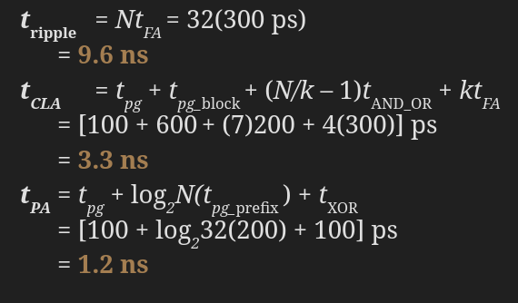

# Sottrattore

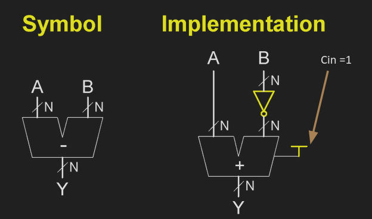

# Uguaglianza

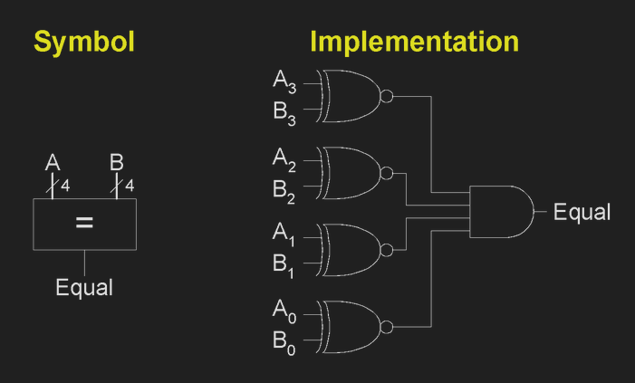

# Minore

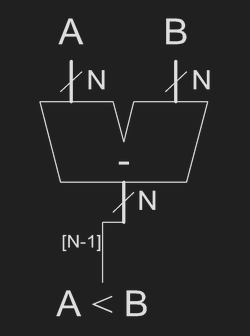

# Shifter

## Logico

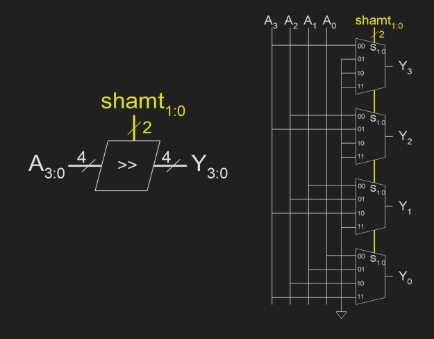

## Aritmetico

metti msb invece di 0

# Moltiplicatore

Shifta e maschera con il bit del moltiplicatore??

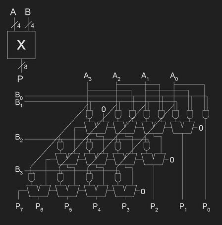
