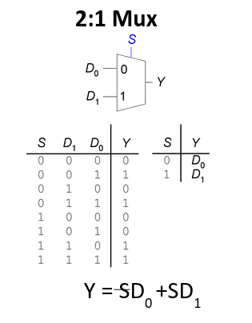
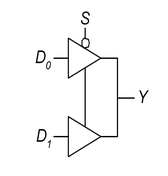
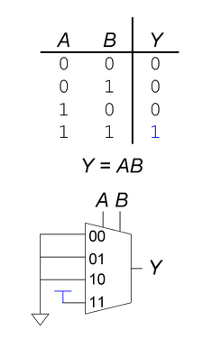
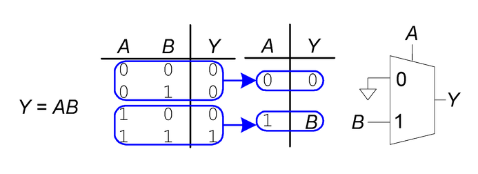
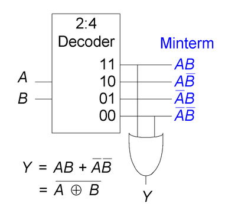
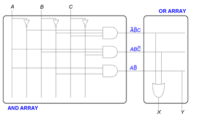
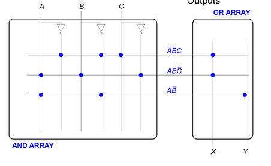
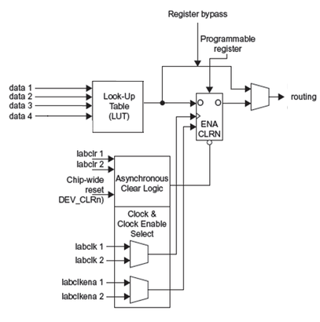

Abbiamo visto i pezzi fondamentali della logica combinatoria. Vediamo ora delle componenti più avanzate.

# Multiplexer

Un *multiplexer* ("mux") permette di "selezionare" un input:

*Questo circuito vale $D_0$ quando $S$ è 0, e vale $D_1$ quando $S$ è 1.*

Per creare un mux a $n$ ingressi servono $\log(n)$ segnali di selezione.

Possiamo realizzare un mux usando i buffer tristate:

*Collegando gli enable dei tristate ma opposti tra di loro si ottiene un mux.*

In questo modo si possono anche realizzare mux a più di 2 ingressi.

Una proprietà dei mux è che, con valori fissi, possono agire come una tavola della verità:

Semplificando:

Possiamo quindi rappresentare qualsiasi equazione booleana usando i mux.

## Teorema di Shannon

> Data una funzione booleana $f$ di $n$ variabili vale l'uguaglianza:
> $$
f(x_1,x_2,...,x_n) = x\cdot f(1,x_2,...,x_n)+\bar x_1\cdot f(0,x_2,...,x_n)
$$

L'equazione sul lato destro modella esattamente un mux con segnale di selettore $x_1$. Possiamo quindi utilizzare questo teorema per realizzare *qualsiasi* funzione di $n$ variabili usando un mux e 2 funzioni da $n-1$ variabili.

# Decoder

Un decoder ha $N$ ingressi e $2^N$ uscite. Ha la proprietà che ogni input produce un output che ha 1 su *esattamente 1* degli output. Questa proprietà è detta "one-hot output".

Possiamo realizzare un mux usando un decoder: mettendo gli output di un decoder in AND con degli input $D_0,...,D_n$, e mettendo gli output degli AND in OR otteniamo un mux. questa implementazione di un mux è esattamente equivalente all'equazione del mux: $f=S_0S_1D_3+\bar S_0S_1D_2 + S_0\bar S_1D_1 + \bar S_0\bar S_1 D_0$.

> [!NOTE]
> Mettere un segnale in AND con un segnale 0 è detto *mascherare* il segnale. (pensa bit mask)

Veramente, possiamo realizzare *qualsiasi* funzione booleana usando un decoder: possiamo considerare ogni output del decoder come un maxterm degli input, e usando altre porte logiche possiamo realizzare una funzione qualsiasi.

(guarda funzioni adder)

---

I mux e decoder sono "programmabili": ci permettono di creare qualsiasi funzione booleana. Possiamo creare circuiti programmabili anche usando solo AND e OR; questi circuiti sono detti *PLAs* (Programmable Logic Arrays).

# PLAs

I PLA sono un array di AND seguito da un array di OR:

In base a come sono scelte le connessioni tra gli input e gli AND nell'array di AND, possiamo ottenere in output degli implicanti diversi, e connetterli insieme per realizzare funzioni nell'array di OR.

Nella progettazione di circuiti con PLA, non ci interessa sempre minimizzare una funzione: spesso è più utile trovare gli implicanti comuni tra più funzioni. La forma con più termini in comune di un'equazione è detta *forma canonica*.

> [!NOTE]
> Nella rappresentazione di una PLA, spesso si utilizza una notazione più compatta (dot notation):
> 

# FPGA

I FPGA (Field Programmable Gate Array) sono composti da:
- Elementi logici (LEs; Logic elements)
- Blocchi I/O
- Interconnessioni programmabili

## Logic elements

Composti da:
- LUTs (lookup tables)
    Logica combinatoria
- Flip-Flops
    Logica sequenziale
- Multiplexers
    Connettono LUTs e flip-flops

*Diagramma di un logic element*.

### LUT

Le LUT sono praticamente multiplexer a 4 ingressi. Si possono programmare (?) con una tavola di verità di una funzione.
