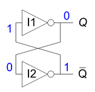
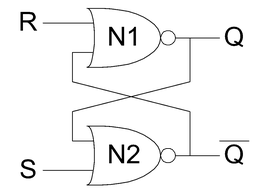

I circuiti sequenziali ci permettono di fare cose più complicate dei circuiti combinatori.

I circuiti combinatori producono un risultato che "non viene salvato". Vogliamo ora creare dei circuiti che possono *memorizzare* degli step intermedi.

> [!IMPORTANT]
> Le uscite dei circuiti sequenziali dipendono dagli input attuali *e passati*: **hanno memoria**.

I *Latch* e *Flip-Flop* permettono di memorizzare 1 bit.

I *circuiti sincroni sequenziali* sono circuiti combinatori seguiti da una serie di flip-flop

# Circuiti Sequenziali

I circuiti sequenziali in genere non memorizzano tutti gli input passati, ma una versione semplificata detta *stato del sistema*. La memoria dei flip-flop è detta *a breve termine*.

I circuiti sequenziali utilizzano *feedback* dagli output agli input per memorizzare informazioni.

## Circuito Bistabile

Il circuito bistabile è il blocco fondamentale per memorizzare un'informazione.

Nella forma più semplice ha 2 uscite e nessun ingresso. Fondamentalmente sono 2 NOT connessi tra di loro:

*Questo circuito rafforza continuamente un valore "magicamente" imposto all'accensione*.

## SR Latch

Per scrivere il valore iniziale di un circuito bistabile potremmo rimpiazzare i NOT con dei NOR. Questo circuito si chiama un *Set/Reset Latch*:

Se entrambi gli input di un SR sono 0 allora il circuito mantiene il valore precedente. Se invece sono entrambi 1 si ha $Q = \bar Q = 0$ (questa condizione non ci interessa, in genere si evita di fornire questo input ad un latch SR).
