I circuiti sequenziali ci permettono di fare cose più complicate dei circuiti combinatori.

I circuiti combinatori producono un risultato che "non viene salvato". Vogliamo ora creare dei circuiti che possono *memorizzare* degli step intermedi.

> [!IMPORTANT]
> Le uscite dei circuiti sequenziali dipendono dagli input attuali *e passati*: **hanno memoria**.

I *Latch* e *Flip-Flop* permettono di memorizzare 1 bit.

I *circuiti sincroni sequenziali* sono circuiti combinatori seguiti da una serie di flip-flop

# Circuiti Sequenziali

I circuiti sequenziali in genere non memorizzano tutti gli input passati, ma una versione semplificata detta *stato del sistema*. La memoria dei flip-flop è detta *a breve termine*.

I circuiti sequenziali utilizzano *feedback* dagli output agli input per memorizzare informazioni.

## Circuito Bistabile

Il circuito bistabile è il blocco fondamentale per memorizzare un'informazione.

Nella forma più semplice ha 2 uscite e nessun ingresso. Fondamentalmente sono 2 NOT connessi tra di loro:

*Questo circuito rafforza continuamente un valore "magicamente" imposto all'accensione*.

## SR Latch

Per scrivere il valore iniziale di un circuito bistabile potremmo rimpiazzare i NOT con dei NOR. Questo circuito si chiama un *Set/Reset Latch*:

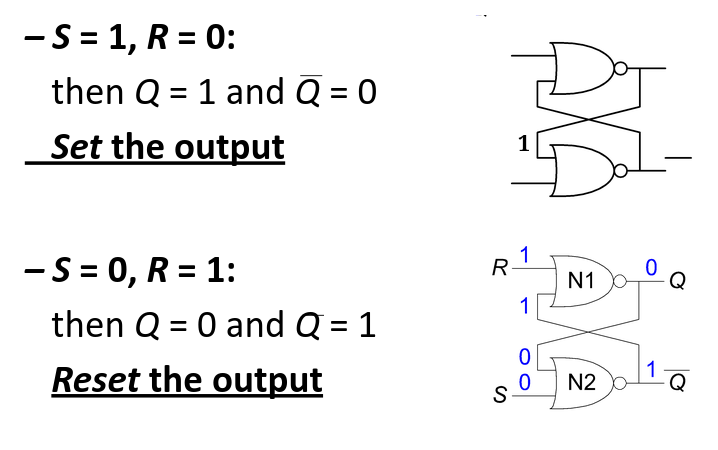

Se entrambi gli input di un SR sono 0 allora il circuito mantiene il valore precedente. Se invece sono entrambi 1 si ha $Q = \bar Q = 0$ (questa condizione non ci interessa, in genere si evita di fornire questo input ad un latch SR).

Quando si ha $S = R = 0$ si dice che il latch è in "condizione di old", e si ha $Q = Q_{\text{prev}}$.

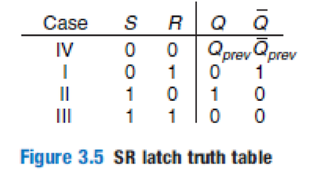
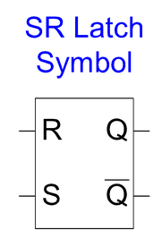

## D Latch

Un *data latch* ha due ingressi: $CLK$ e $D$.

Questo circuito ha valore $D$ quando $CLK=1$, e $D_{\text{prev}}$ quando $CLK=0$.

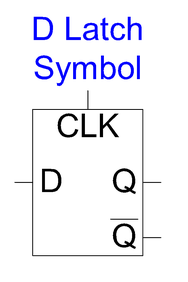

Dato che $CLK$ è un segnale periodico, questo componente permette di *sincronizzare* un circuito.

Si può costruire un D latch a partire da un latch SR:
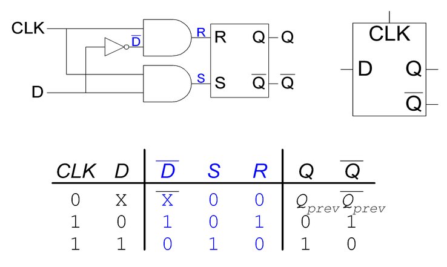

## D Flip-Flop

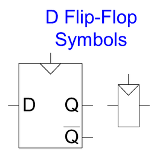

Un *D flip-flop* ha come ingressi $CLK$ e $D$. Questo componente *campiona il valore di $D$ quando $CLK$ passa da 0 a 1*.

Per realizzarlo possiamo usare 2 D latch:
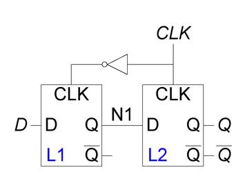

Più flip-flop in parallelo sono compattati:
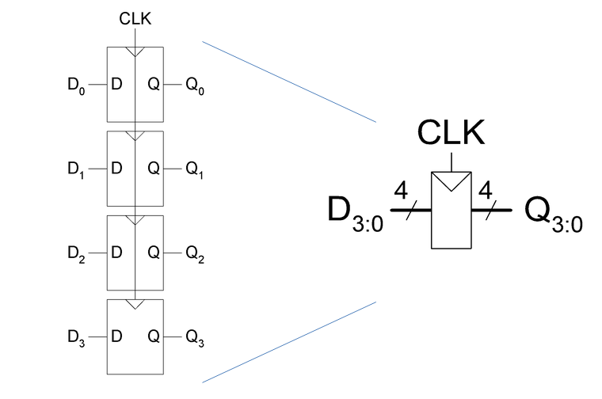

I veri flip-flop hanno anche un ingresso di enable ed un ingresso di reset:
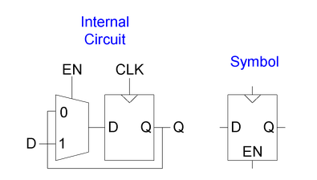

Questi flip-flop "ascoltano" il clock solo se $E=1$ (altrimenti mantengono il valore precedente), e sono $0$ se $R=1$.

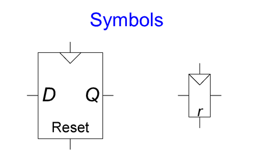

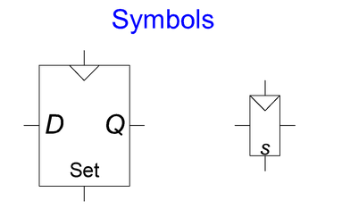

## Timing

Le porte logiche hanno un certo ritardo tra l'input e l'output.

Questo ci permette di realizzare dei clock:
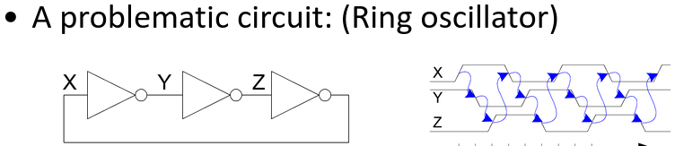
*Clock realizzato con 3 NOT*.

# Circuiti sequenziali sincroni

Nei circuiti sequenziali *sincroni*, si inseriscono dei *registri* nei percorsi ciclici che contengono lo *stato* del sistema. Questo stato cambia sul fronte del clock, e il sistema è *sincronizzato* in base al clock.

Un circuito sequenziale sincrono segue alcune regole:
- Ogni elemento è o un registro (flip-flop) o un circuito combinatorio
- Almeno un elemento è un registro
- Ogni registro riceve lo stesso segnale di clock
- Tutti i percorsi ciclici contengono almeno un registro

# Finite State Machine (FSM)

Una *finite state machine* (macchina a stati finiti) contiene una serie di registri che memorizzano lo stato, un circuito combinatorio che calcola lo stato *futuro* in base allo stato attuale e gli input, ed un circuito combinatorio che calcola l'output in base allo stato presente e gli input\*.

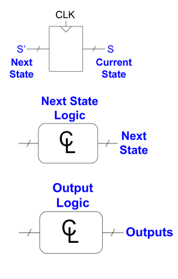
*Componenti di una FSM. "CL" sta per "combinational logic"*.

\*Ci sono 2 tipi di FSM:
- Macchina di Moore
    Output dipende solo dallo stato presente
- Macchina di Mealy
    Output dipende anche dagli input

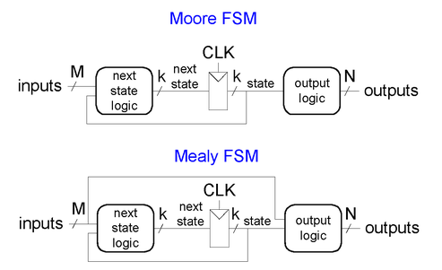
*Differenza tra macchine di Moore e Mealy*.

## Diagramma di Transizione di Stati Finiti

Per visualizzare gli stati di una FSM usiamo un diagramma dove ogni stato è rappresentato da un cerchio, e i passaggi tra gli stati sono rappresentati da frecce:
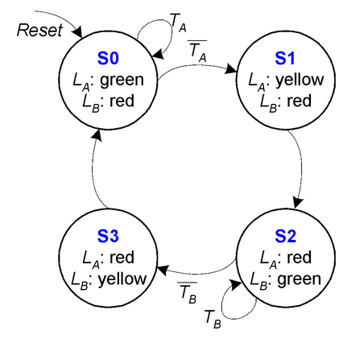
*Diagramma di transizione di una macchina di Moore*.

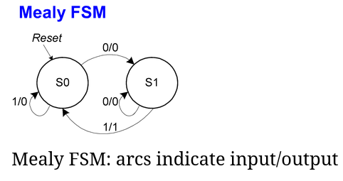
*Diagramma di transizione di una macchina di Mealy. Le macchine di Mealy hanno sempre lo stesso numero o meno stati delle macchine di Moore*.

Per indicare gli input sulle transizioni si può anche usare una notazione con tanti "bit" quanti gli input, dove ogni "bit" può essere $-$ (don't care), $0$ o $1$.

Questo diagramma si può anche rappresentare con una tabella:
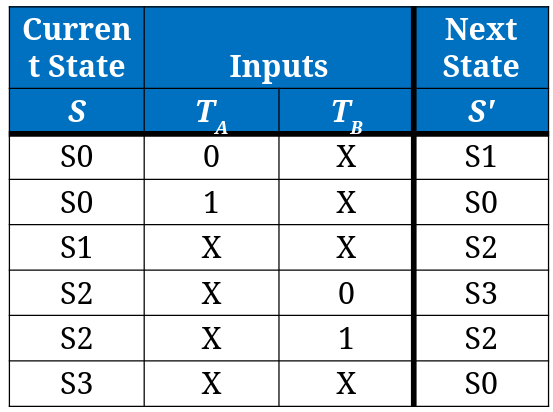

Per memorizzare gli stati dobbiamo usare dei flip-flop. Ci sono 2 codifiche principali per memorizzare gli stati di una FSM: binaria e one-hot. Seguendo l'esempio, con la codifica binaria servono 2 bit:
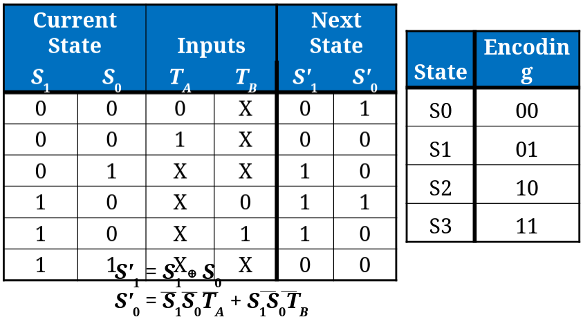
*Codifica binaria. $S'_n$ indica l'$n$-esimo bit della codifica. Le espressioni booleane rappresentano la logica per lo stato futuro*.

Oltre agli stati, usiamo una tabella anche per rappresentare gli output:
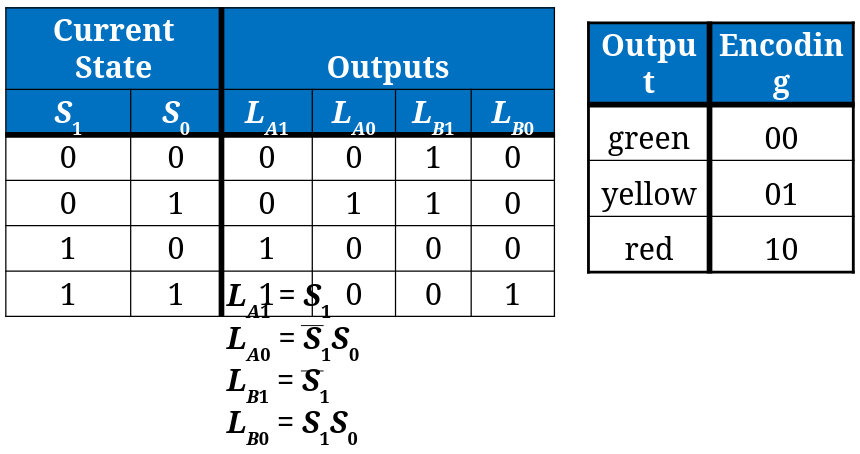
*Tabella di output. Come prima, la codifica è scelta arbitrariamente.*

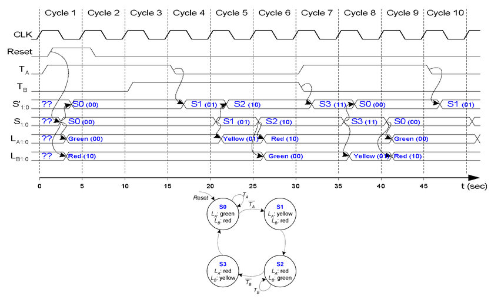
*Diagramma di timing di questa FSM*.

Usare una codifica one-hot invece che binaria incrementa il numero di bit necessari per memorizzare lo stato, ma rende la logica di output molto più semplice.

> [!NOTE]
> Le macchine di Mealy richiedono lo stesso numero o meno stati delle macchine di Moore, ma sono asincrone:
> 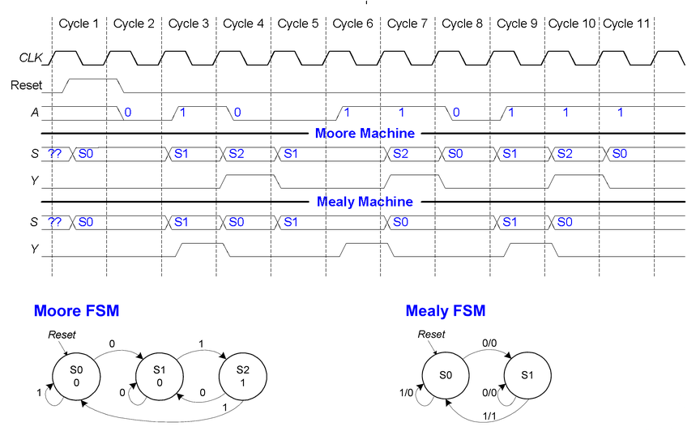
> Ogni macchina di Mealy può essere adattata ritardando gli output per avere lo stesso timing della macchina di Moore equivalente.
> Macchine di Mealy in comunicazione potrebbero violare la sincronizzazione.

## Equivalenza delle macchine

Per trasformare una macchina di Moore ad una macchina di Mealy, basta spostare gli output dallo stato alla transizione:
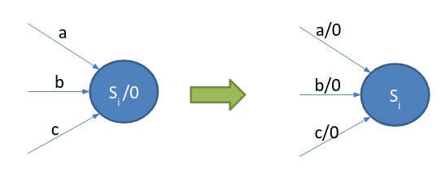
Però in questo modo non è detto che la macchina di Mealy risultante sia minima.

Per l'opposto, se ogni transizione ha lo stesso output allora basta spostarlo allo stato. Altrimenti, si deve aggiungere uno stato per ogni output diverso:
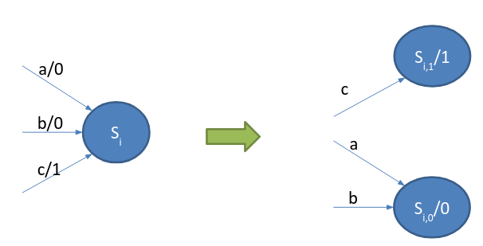

Stessa cosa per le transizioni uscenti:
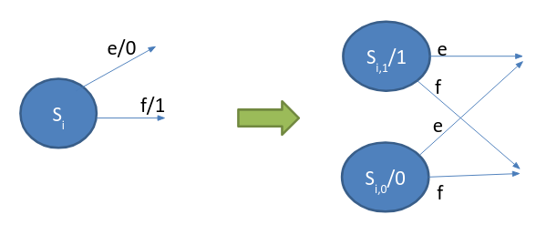

Per transizioni in loop:
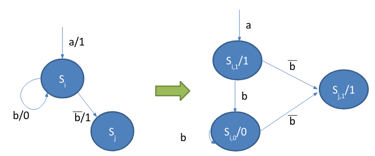

## Stati irraggiungibili

Se il numero di stati di una FSM non è esattamente una potenza di 2 (o sempre con codifica one-hot), ci saranno degli stati *irraggiungibili* con qualsiasi ingresso.

Per alcuni problemi è utile avere degli stati raggiungibili partendo dal reset, ma irraggiungibili da un "loop" principale della macchina.

(Guarda esempio (a), (b), e (c) slide ADE10)

## Sintesi (progettazione) di FSM

Partendo da una descrizione a parole di una macchina:
1. Identifica input e output
2. Disegnare il diagramma di transizione di stato
3. Tabella di transizione di stato
4. Scegliere codifica per gli stati
5. Per macchine di Moore, riscrivere tabella degli stati con la codifica e scrivere la tabella degli output; per macchine di Mealy riscrivere la tabella combinata degli stati e degli output con la codifica degli stati
6. Scrivere equazioni booleane per next state logic e output logic
7. Disegnare la schematica del circuito

### Da schematica a FSM

È il processo inverso...
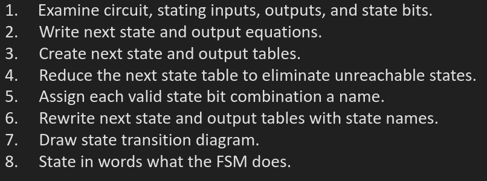

# Contatori

> Un contatore è un componente che aumenta ogni colpo di clock.

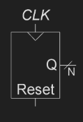

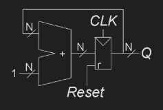

# Shift registers

> Uno shift register ad ogni colpo di clock memorizzano un nuovo bit e ne dimenticano un'altro.

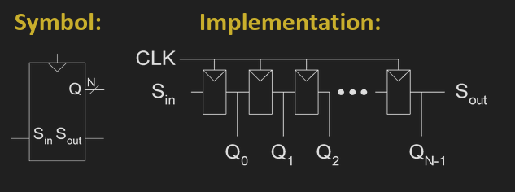

Questi componenti possono trasformare un segnale in serie ad un segnale in parallelo.

Aggiungendo un segnale `load`, si può creare un componente che converte da serie a parallelo e vice versa (shift register con caricamento parallelo):
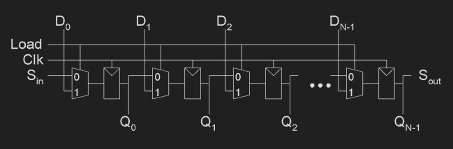

Questo componente è utilizzato nello standard USB per trasmettere dei dati ricevuti in parallelo in serie:
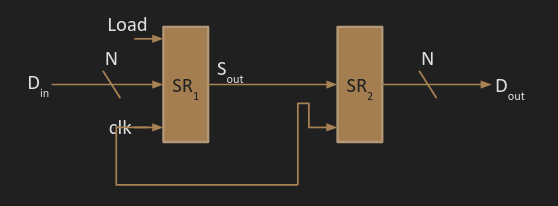
