La memoria serve per memorizzare in maniera *efficiente* grandi quantità di dati.

I flip-flop non sono abbastanza efficienti per questo scopo.

Ci sono 3 tipi principali:
- Dynamic random access memory (DRAM)
- Static random access memory (SRAM)
- Read only memory (ROM)

> [!NOTE]
> Si chiama memoria "ad accesso casuale" perché prima si utilizzava memoria che permetteva solo accesso sequenziale (in nastri).

Nella memoria, ogni dato ad $M$ bit corrisponde ad un unico indirizzo ad $N$ bit.

La memoria concettualmente è una matrice bidimensionale larga $M$ e alta $2^N$.

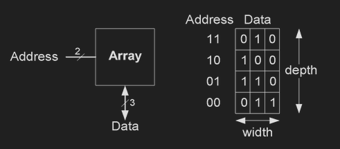

La RAM può essere scritta o letta, quindi ci serve anche un segnale per abilitare la scrittura:
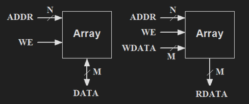
*Due possibili bozze della RAM. A sinistra si usa un bus bidirezionale per scrivere e leggere, a destra si usano 2 segnali diversi.*

## Funzionamento

Le celle di memoria hanno un input, la *wordline*, che seleziona la parola di memoria da leggere, e un output, la *bitline*, dove i bit della parola selezionata scrivono il proprio valore.

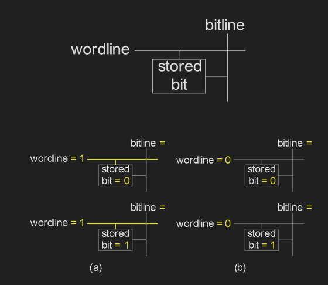
*Celle di memoria. Le celle sulle wordline non selezionate devono mettere alta impedenza sul bus.*

Dato che solo una wordline deve essere attiva ad ogni istante, possiamo utilizzare un decoder:
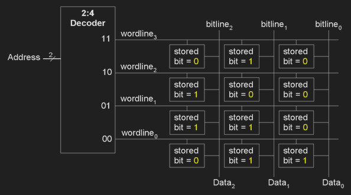
*Utilizzo di un decoder per selezionare la wordline.*

La memoria può essere *volatile* (le RAM) o *non-volatile* (ROM). La memoria volatile si cancella quando perde corrente, quella non-volatile no.

Le RAM si scrivono e leggono molto velocemente; la memoria principale utilizzata dai computer (memoria centrale, cache) è RAM.

Le ROM mantengono le informazioni anche senza corrente, ma sono più lente in lettura e, se scrivibili (storicamente le ROM non erano in alcun modo scrivibili, la memoria flash è anche scrivibile), molto lente (relativamente) in scrittura.

- La DRAM usa un condensatore per memorizzare i bit
- La SRAM usa un bistabile

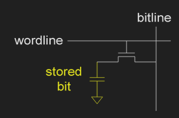
*Cella di DRAM. Utilizza un capacitor e un transistor (funziona come un tristate). Se il bit è 1 ci sarà carica sul capacitor.*

Leggere la DRAM trasferisce la carica sulla bitline; la lettura è *distruttiva*. Quindi la DRAM viene sempre riscritta dopo una lettura. Inoltre, i capacitori perdono carica anche senza lettura, quindi va riscritta periodicamente a prescindere.

Questo riscrivere rende la DRAM più lenta, ma ha costo molto minore rispetto alla SRAM.

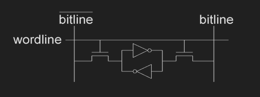
*Cella di SRAM.*

## Scrittura

Per scrivere sulla SRAM, basta imporre un valore "in modo più forte" sulla bitline. Per imporre 0, si impone 1 sulla bitline negata.

---

> [!NOTE]
> In pratica, la memoria non è implementata come abbiamo visto dato che risulterebbe un oggetto stretto e lunghissimo. Invece, si utilizza un indirizzazione a righe e colonne: l'indirizzo seleziona una wordline, e poi ci sono dei mux che selezionano una "colonna", corrispondente alla parola richiesta.

## Operazione DRAM

Ci sono una serie di comandi da mandare alla DRAM per scrivere/leggere:
- ACT
    Si attiva l'intera riga
- RD / WR
    La colonna è selezionata
- PRE
    La riga è riscritta (la DRAM è volatile)

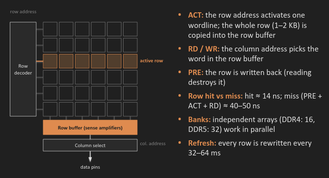

Leggere indirizzi sulla stessa riga è più veloce dato che non va chiusa e riattivata la riga

Le RAM sono organizzate in *banchi*, in modo da poter parallelizzare l'accesso

## DDR

Le RAM moderne sono sincronizzate, e lavorano su entrambi i fronti del clock. Questo tipo di RAM è detta *double data rate* (DDR).

Prefetch??

Sistemi come i server hanno anche un ulteriore dimensione: ci sono diversi bus (canali) che parallelizzano ulteriormente l'accesso ai dati

## High Bandwith Memory

Sistemi avanzati utilizzano un'altro tipo di RAM:
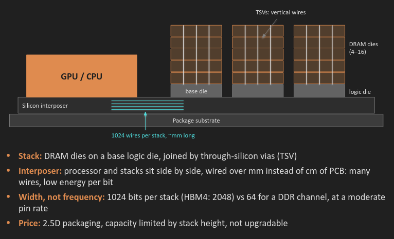

# Memoria Multi Porta

La memoria multi porta può accedere a più dati *contemporaneamente* tramite più porte di input/output.

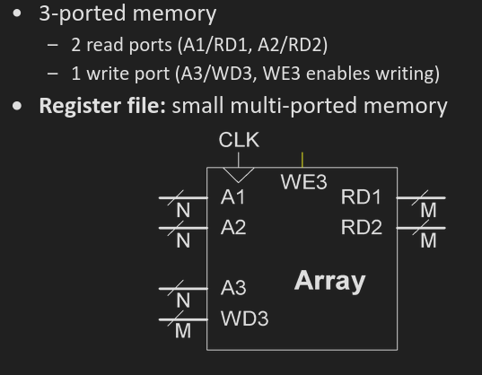

Ogni porta condivide la stessa cella di memoria, ma avrà più bitline per concedere accesso parallelo.

# Logica con memorie

Le ROM sono simili alle DRAM, ma hanno collegamenti statici tra bitline e wordline:
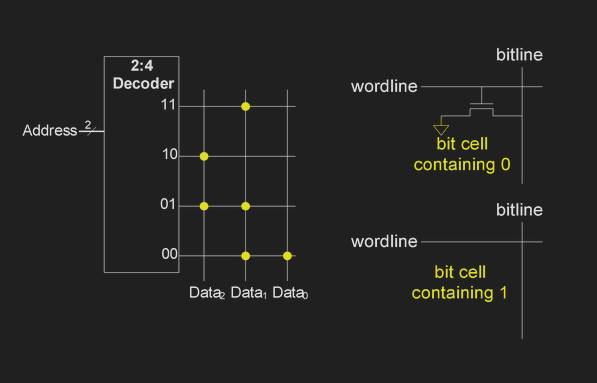
*I pallini indicano i bit che saranno 1 in lettura.*

Le ROM funzionano praticamente come una tabella della verità: ogni bitline rappresenta una funzione
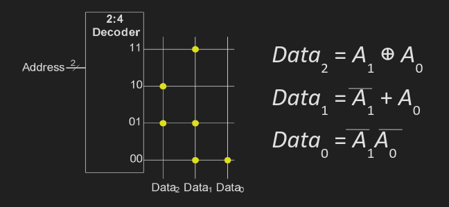

Ovviamente questo ragionamento funziona per qualsiasi tipo di memoria.

Le LUT che abbiamo visto precedentemente sono realizzate esattamente in questo modo.
