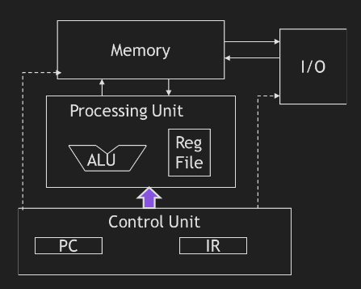
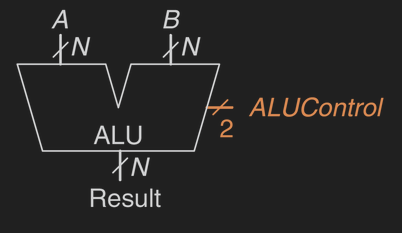
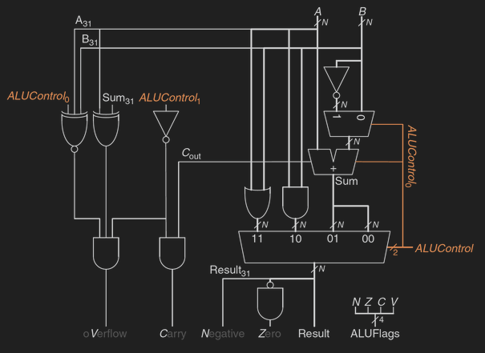
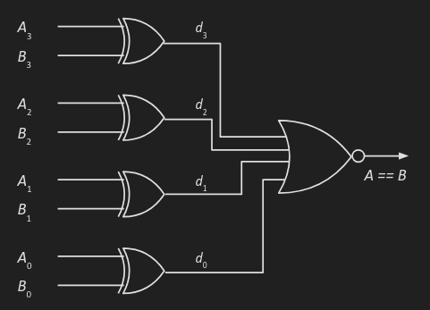

# Architettura di Von Neumann

Il *program counter* (PC) memorizza l'indirizzo dell'istruzione in esecuzione. L'*instruction register* (IR) memorizza l'istruzione presa dalla memoria. Sono entrambi implementati come batterie di flip-flop.

Il *register file* memorizza i valori nei registri della CPU, generalmente realizzato con una memoria multiporta.

L'*arithmetic logic unit* (ALU) esegue le operazioni matematiche e logiche. Come minimo deve poter realizzare addizione, sottrazione, AND, OR.

## ALU

Un ALU con quelle 4 operazioni richiede 2 bit di controllo per selezionare l'operazione:

### Flag

Le ALU dei processori inoltre forniscono in output delle *flag* con delle informazioni aggiuntive sull'operazione.

I flag sono:
- N
    Risultato è negativo. Controlla bit più significativo
- Z
    Risultato è 0. NOR sui bit
- C
    Adder ha prodotto un carry out. Controlla il carry out dell'adder
- V
    Adder ha fatto overflow. Controlla se, in somma, 2 numeri negativi hanno dato un positivo o che 2 numeri positivi hanno dato un negativo. La logica si inverte per la sottrazione

Il percorso critico di questo circuito è da $B$ al flag Z, passando per la sottrazione.

Se volessimo parallelizzare questo oggetto, la scelta di dove spezzarlo dipende dal tipo di adder. Con carry-lookahead, andrebbe bene spezzarlo prima del mux (l'AND per il flag Z ha 5 livelli di logica (32 bit)).

Altrimenti possiamo calcolare a parte il flag Z controllando se A e B sono uguali in sottrazione o opposti in somma.

Usare questo metodo riduce il costo del calcolo del flag Z di circa 12 volte.

# Progettare un calcolatore

Progettare un calcolatore inizia dall'ISA: scegliamo le grandezze e quantità dei registri, grandezza del program counter, delle parole, della ROM, della RAM, e delle istruzioni.

Le istruzioni dovranno avere grandezze pari alla grandezza di parola: in parole a 16 bit possono entrare istruzioni a 16 bit.

## Istruzioni

Ci sono 2 tipi di istruzioni:
- R
    3 registri in input.
- I (immediate)
    2 registri di input + una costante.

Un set di istruzioni minimo potrebbe essere:
- `ADD` (R)
- `SUB` (R)
- `AND` (R)
- `OR` (R)
- `ADDI` (I)
- `LD` (I)
- `ST` (I)
- `BEQ` (I)

Il ciclo di esecuzione di un'istruzione è:
1. Fetch
2. Decode
3. Execute
4. Memory
5. Write-back
