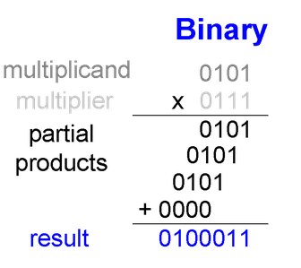

# Bits and Bytes

```
|-- bit
|    |-- nibble
-  ----
1010010
-------
     |-- byte
```

# Overflow

Nell'addizione tra numeri binari a N bit, può capitare che il risultato non entri in 4 bit. In questo caso si ha un *overflow*.

# Numeri con segno

Per rappresentare i numeri con segno con la rappresentazione binaria, si sceglie un bit che indica se il numero è positivo o negativo. Questo bit è il bit più a sinistra, deto *bit più significativo* (most significant bit).

Ci sono 2 principali sistemi per rappresentare i numeri con segno:

- ## Segno/ampiezza
     Con questa rappresentazione, il MSB indica se il numero è negativo o no. Per questo motivo, il range di numeri rappresentabili con questo sistema è $-2^{N-1}-1, 2^{N-1}-1$: si perde un intero bit di range.

     ### Problemi

     Questa rappresentazione ha alcuni problemi:
     - Overflow nell'addizione crea numeri sbagliati
     - Ci sono 2 rappresentazioni per 0 (`1000` e `0000`)

Per risolvere questi problemi, è stato creato un'altro sistema: il *complemento a due*.

- ## Complemento a due
     In questa rappresentazione, il MSB ha valore $-2^{N-1}$ (senza -1). $-1$ si scrive con tutti uni. In questo modo i numeri negativi hanno sempre il MSB segnato, ma i numeri negativi sono interpretati in modo diverso.

     ### "Prendere il complemento a due"

     Con la rappresentazione a complemento a due, è possibile invertire il segno di un numero con un semplice algoritmo: inverti i bit del numero e aggiungici 1. Questo perché se inverti i bit di un numero e lo sommi all'originale viene sempre tutti 1 che è -1 nella rappresentazione con complemento a 2, e il numero $y$ che, sommato ad $x$, dà -1 è proprio $-x - 1$.

     Con questa rappresentazione le somme con numeri negativi funzionano, e è possibile eseguire la sottrazione usando il complemento di due. inoltre, con questa rappresentazione posso usare lo stesso algoritmo di somma che con i numeri senza segno (scarto l'N+1-esimo bit se ho overflow)


*Diagramma che mostra diverse rappresentazioni di numeri 4-bit.*

# Estensione del segno

Per aumentare il numero di bit di un numero a complemento a due mantenendo il valore attuale, basta copiare il valore del MSB nei bit aggiunti:  
- `4-bit: [0]011 =  3 -> 8-bit: [0000]0011 =  3`
- `4-bit: [1]101 = -3 -> 8-bit: [1111]1011 = -3`

# Moltiplicazione



## Shift

"Shiftare" i bit di un numero binario li moltiplica/divide per 2 per ogni spazio di cui sono stati spostati i bit:


Da notare che per estendere quando si shifta a sinistra basta aggiungere altri bit, ma per estendere shiftando a destra bisogna considerare il segno: `>>` = non considerare il segno; `>>>` = considera il segno

---

libro paragrafi 1.4; 5.3

---
