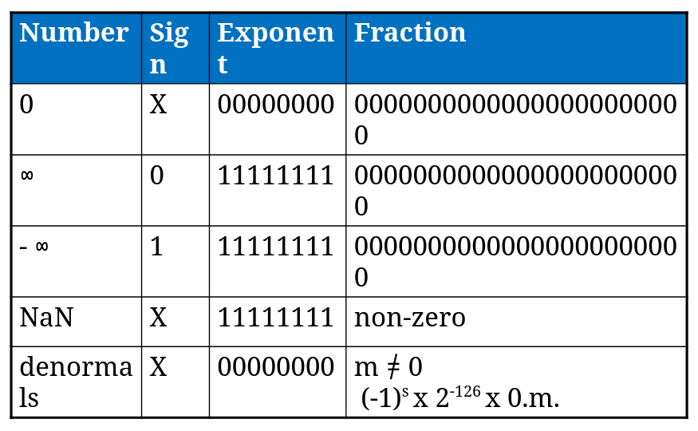
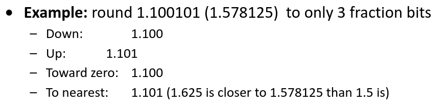

# Bits and Bytes

```
|-- bit
|    |-- nibble
-  ----
1010010
-------
     |-- byte
```

# Overflow

Nell'addizione tra numeri binari a N bit, può capitare che il risultato non entri in 4 bit. In questo caso si ha un *overflow*.

# Numeri con segno

Per rappresentare i numeri con segno con la rappresentazione binaria, si sceglie un bit che indica se il numero è positivo o negativo. Questo bit è il bit più a sinistra, deto *bit più significativo* (most significant bit).

Ci sono 2 principali sistemi per rappresentare i numeri con segno:

- ## Segno/ampiezza
     Con questa rappresentazione, il MSB indica se il numero è negativo o no. Per questo motivo, il range di numeri rappresentabili con questo sistema è $-2^{N-1}-1, 2^{N-1}-1$: si perde un intero bit di range.

     ### Problemi

     Questa rappresentazione ha alcuni problemi:
     - Overflow nell'addizione crea numeri sbagliati
     - Ci sono 2 rappresentazioni per 0 (`1000` e `0000`)

Per risolvere questi problemi, è stato creato un'altro sistema: il *complemento a due*.

- ## Complemento a due
     In questa rappresentazione, il MSB ha valore $-2^{N-1}$ (senza -1). $-1$ si scrive con tutti uni. In questo modo i numeri negativi hanno sempre il MSB segnato, ma i numeri negativi sono interpretati in modo diverso.

     ### "Prendere il complemento a due"

     Con la rappresentazione a complemento a due, è possibile invertire il segno di un numero con un semplice algoritmo: inverti i bit del numero e aggiungici 1. Questo perché se inverti i bit di un numero e lo sommi all'originale viene sempre tutti 1 che è -1 nella rappresentazione con complemento a 2, e il numero $y$ che, sommato ad $x$, dà -1 è proprio $-x - 1$.

     Con questa rappresentazione le somme con numeri negativi funzionano, e è possibile eseguire la sottrazione usando il complemento di due. inoltre, con questa rappresentazione posso usare lo stesso algoritmo di somma che con i numeri senza segno (scarto l'N+1-esimo bit se ho overflow)


*Diagramma che mostra diverse rappresentazioni di numeri 4-bit.*

## Estensione del segno

Per aumentare il numero di bit di un numero a complemento a due mantenendo il valore attuale, basta copiare il valore del MSB nei bit aggiunti:  
- `4-bit: [0]011 =  3 -> 8-bit: [0000]0011 =  3`
- `4-bit: [1]101 = -3 -> 8-bit: [1111]1011 = -3`

## Moltiplicazione


### Shift

"Shiftare" i bit di un numero binario li moltiplica/divide per 2 per ogni spazio di cui sono stati spostati i bit:


Da notare che per estendere quando si shifta a sinistra basta aggiungere altri bit, ma per estendere shiftando a destra bisogna considerare il segno: `>>` = non considerare il segno; `>>>` = considera il segno

# Numeri fratti

Ci sono due principali rappresentazioni binarie per i numeri fratti: a virgola fissa e a virgola mobile.

## Virgola fissa

Si sceglie una posizione in cui fissare la virgola, tutti i bit prima della virgola avranno esponente positivo, quelli dopo avranno esponente negativo:
```
0110.1100 -> 2^2 + 2^1 + 2^-1 + 2^-2 = 6.76
```

Da notare che i bit a destra della virgola rappresentano un numero in $2^{N/2}$-esimi

### Conversione tra basi

1. Separare la parte intera e fratta.
2. Per la parte intera usare il metodo normale.
3. Moltiplicare la parte fratta $p$ per 2. Poi se $p < 1$ la cifra successiva è 0. Altrimenti la prossima cifra è 1 e si sottrae 1 da $p$.
4. Se $p \not = 0$ ripeti da 3.

### Con segno

La rappresentazione segno/ampiezza è uguale ai numeri interi

Per la rappresentazione a complemento di due è uguale: per scrivere un numero negativo si scrive il numero positivo come nella rappresentazione segno/ampiezza e poi si applica il complemento di due (l'addizione è *al bit meno significativo*, non le unità)

## Virgola mobile

La rappresentazione a virgola mobile è simile alla rappresentazione scientifica ($\text{mantissa} \times \text{base}^{\text{exponent}}$)

Dobbiamo quindi scegliere quanti bit associare al segno, alla mantissa, e all'esponente. In una parola a 32-bit, inizialmente è stato scelto che il segno ha 1 bit, l'esponente ha 1 byte e la mantissa ha i restanti 23 bit (segue quindi la rapperentazione modulo-segno).

Lo standard per i numeri floating point si chiama *IEEE 754*. Per convertire un numero ad un float IEEE 754:
- Scrivi il numero in binario
- "Sposta la virgola" fino a subito dopo il bit (non del segno) = 1 più a sinistra
     Praticamente scrivi il numero in notazione scientifica ma in binario
- L'esponente è $2$^numero di bit di cui abbiamo spostato la virgola

Dalla seconda versione dello standard, è stato aggiunto il dettaglio che il bit prima della virgola non è memorizzato ma implicito (dato che la mantissa è sempre tra 1 e 2)

Dalla terza versione, l'esponente ha una *rappresentazione polarizzata*: l'esponente è calcolato come l'esponente nel byte dell'esponente - 127. In questo modo si sposta il range di rappresentazione da $[2^0, 2^{256}]$ a $[2^{-127}, 2^{128}]$.

Esempio: -58.25
```
segno = 1

in binario:
11 1010.01 * 2^0

sposta la virgola:
1.110 1001 * 2^5 (2^101)

polarizza l'esponente:
1.110 1001 * 2^1000 0100

scrivi il numero completo con l'1 sottinteso:
|1|100 0010 0|110 1001 0000 0000 0000 0000|

possiamo anche convertirlo in esadecimale:
0xC2690000
```

Lo standard fissa anche altre regole come per esempio la rappresentazione dello 0:


L'ultima di queste regola riguarda i numeri *denormalizzati*: se l'esponente è tutti 0 allora la mantissa non è interpretata con l'1 sottinteso. Questo permette di rappresentare numeri fino a $2^{-149}$. È stata scelta questa convenzione perché in questo modo può continuare a shiftare i bit del numero a destra per dividere e continua a funzionare anche dopo che finisce lo spazio nell'esponente.

Da notare che nei numeri denormalizzati l'esponente è $-bias + 1$ e non $-bias$, come ci si aspetterebbe (il fatto che è tutti zeri è usato per determinare che il numero è denormalizzato, ma è trattato come se avesse il bit meno significativo dell'esponente segnato).

Esistono anche float rappresentati in 16-bit, detti *half precision*, e in 64-bit, detti *double precision*.

## Arrotondamento

I numeri fratti non divisibili per 2 non si possono rappresentare con la rappresentazione IEEE754. Lo standard specifica alcuni metodi di arrotondamento per approssimarli:
- Down
- Up
- Toward zero
- To nearest
     Il default, lo spareggio è verso il numero pari



Trucco per l'arrotondamento al più vicino: basta vedere il bit a destra di dove sarà la virgola. Se questo è 1 si arrotonda in alto, se è 0 si arrotonda in basso.

## Somma con virgola mobile

1. Estrai esponente e mantissa
2. Aggiungi l'uno sottinteso
3. Confronta esponenti
4. Shifta la mantissa più piccola
     Devi equalizzare gli esponenti
5. Somma i numeri in rappresentazione scientifica binaria
6. Ri-normalizza la mantissa aggiornando l'esponente
7. Arrotonda se necessario
8. Ri-assembla l'esponente e la mantissa al formato IEEE754

La sottrazione è uguale, basta applicare il complemento a due

## Prodotto con virgola mobile

1. Somma esponenti
     Somma numeri polarizzati e sottrai il bias
2. Prodotto mantisse
3. Normalizza
     Il massimo prodotto tra mantisse è ~3.999... quindi basta arrotondare 1 bit
