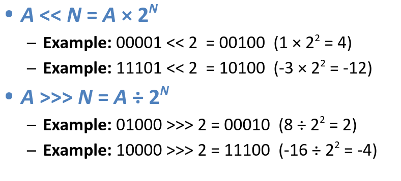

# Bits and Bytes

```
|-- bit
|    |-- nibble
-  ----
1010010
-------
     |-- byte
```

# MSB

Nei numeri con il segno, il bit più a sinistra indica il segno del numero. È stato deciso che lo 0 può essere rappresentato sia con il bit del segno attivo che non attivo

## 2's complement

Modo di scrivere i numeri che può rappresentare 1 cifra in più: il numero con il MSB segnato e tutti 0 (`-2^(N-1)`)

Con questo sistema si può invertire il segno di un numero invertendo i bit e aggiungendo 1 ("taking the two's complement")
    Perché se inverti i bit di un numero e lo sommi all'originale viene sempre tutti 1 che è -1 nella rappresentazione con complemento a 2

Con questa rappresentazione posso usare lo stesso algoritmo di somma che con i numeri senza segno

# Estensione del segno

Basta copiare il bit del segno nei bit aggiunti

# Moltiplicazione


## Shift

"Shiftare" i bit di un numero binario li moltiplica/divide per 2 per ogni spazio di cui sono stati spostati i bit:


Da notare che per estendere quando si shifta a sinistra basta aggiungere altri bit, ma per estendere shiftando a destra bisogna considerare il segno: `>>` = non considerare il segno; `>>>` = considera il segno

---

libro paragrafi 1.4; 5.3

---
