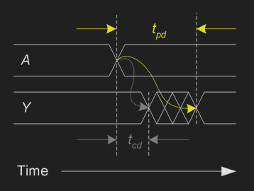
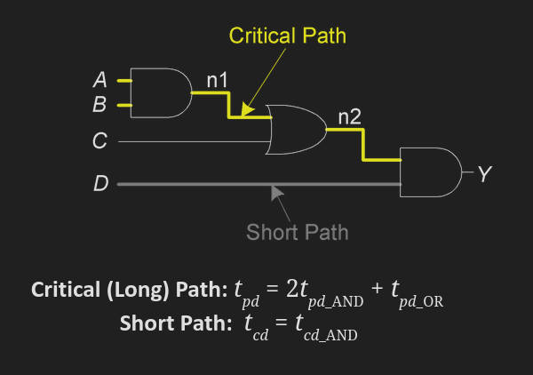
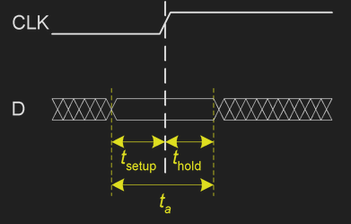
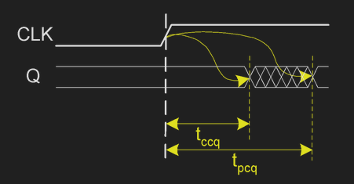
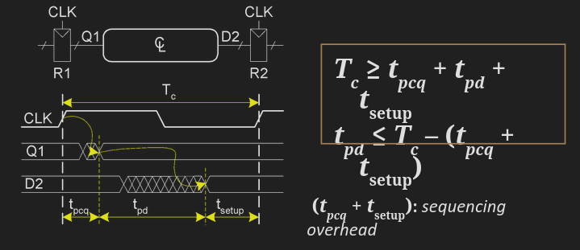
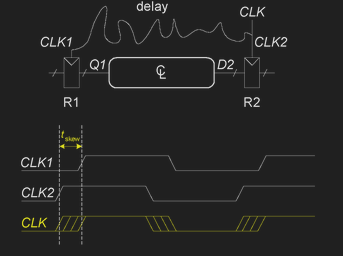
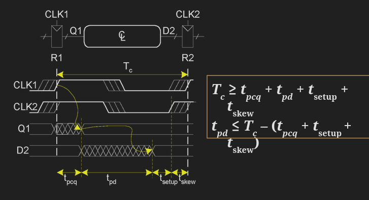
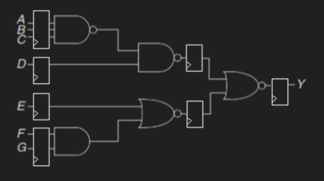

Nei circuiti reali, c'è un ritardo nel cambiamento degli output.

Cerchiamo di capire quanto veloci vanno i circuiti.

# Ritardo di propagazione e contaminazione

> Il tempo di *contaminazione* ($t_{cd}) è il tempo **minimo** tra quando cambia un input e quando cambia un output.

> Il tempo di *propagazione* ($t_{pd}$) è il **massimo** tempo tra quando cambia un input e quando cambia un output.

Quindi la finestra di tempo in cui può cambiare un output è tra $t_{cd}$ e $t_{pd}$.

Questo ritardo è causato da resistenze, capacità, velocità della luce.

Si considera una finestra di tempo dato che i circuiti potrebbero impiegare tempo diverso per accendersi o spegnersi, alcuni input potrebbero essere più veloci, potrebbero avere temperatura diversa.

*Esempio di perché alcuni input potrebbero essere più veloci.*

Per capire quanto velocemente possiamo mandare un circuito (la velocità di clock massima), dobbiamo sapere i timing dei componenti.

Se non sincronizziamo bene i timing di un circuito, questo diventa *metastabile* (non sappiamo cosa fa).

Nei circuiti sequenziali, ci sono altri tempi da considerare:
> Il tempo di *setup* è il tempo **prima** del fronte di clock in cui il circuito deve essere stabile.

> Il tempo di *hold* è il tempo **dopo** del fronte di clock in cui il circuito deve essere stabile.

> La somma del tempo di setup e il tempo di hold è detto il tempo di *apertura*.

I circuiti sequenziali devono essere stabili nella finestra di apertura.

Nei circuiti sequenziali i tempi di contaminazione/propagazione si considerano relativi al clock:

*$t_{ccq}$ è il tempo di **c**ontaminazione rispetto al **c**lock ed i flip-flop. Idem per $t_{pcq}$ e propagazione.*

Con questi tempi possiamo calcolare la freqenza di clock ottimale:

C'è un problema anche se il circuito è troppo veloce: un segnale potrebbe cambiare prima del tempo di hold.

> [!NOTE]
> Si devono calcolare 2 cose: setup time constraint e hold time constraint

## Clock skew

Il clock potrebbe non arrivare a tutti i componenti allo stesso tempo. Questo delay è detto *clock skew*.

Per calcolare i timing considerando lo skew, si devono considerare più segnali clock:

Nel calcolo, è come se un clock sia arrivato prima, quindi questo tempo va aggiunto al constraint.

> [!NOTE]
> Lo skew potrebbe essere negativo (dato che è una differenza) e quindi potrebbe aumentare la frequenza di clock.

# Parallelismo

Per velocizzare i calcoli, si può *parallelizzare*.

Ci sono 2 tipi di parallelismo:
- Parallelismo spaziale
    Duplica l'hardware per fare più calcoli contemporaneamente
- Parallelismo temporale
    Pipelining

Definizioni di alcuni termini:
- Token
    Gruppo di input che vengono processati ad un gruppo di output
- Latenza
    Tempo che un token impiega per essere processato
- Throughput
    Numero di token processati per unità di tempo

Il parallelismo aumenta il throughput.

Il parallelismo temporale aumenta la latenza. Il throughput con parallelismo temporale è limitato dallo stage con throughput minimo.

In un sistema digitale, il parallelismo si ottiene spezzando la logica combinatoria con dei flip-flop:

In un circuito sequenziale, il parallelismo temporale è limitato dal timing dei flip-flop: possiamo dividere la parte di logica combinatoria, ma il tempo dei flip-flop è fisso.
