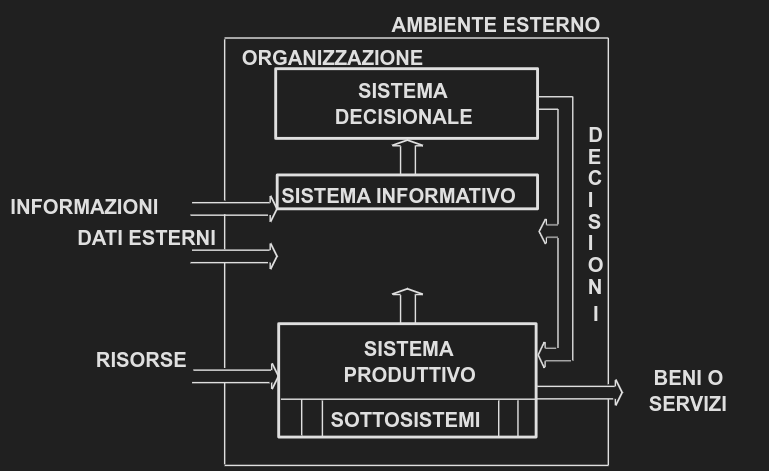
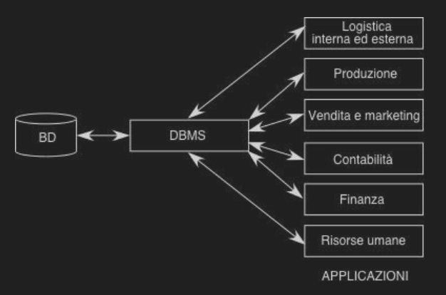
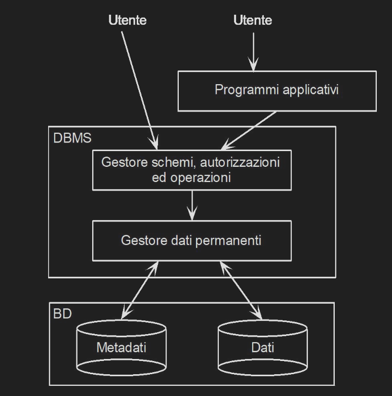

# Argomenti

- Funzionalità di sistemi per basi di dati DBMS
- Modellazione
- Sistemi relazionali e SQL
- Teoria di database relazionali
- Sistemi NoSQL
- Architettura dei DBMS

# Basi di Dati

Una base di dati raggruppa i dati di un'organizzazione e li relaziona con altri dati.

Un esempio di una base di dati è una tabella

## Sistemi informativi

> Un sistema informativo di un'organizzazione è una combinazione di risorse (umane e materiali) e di procedure organizzate per la raccolta, archiviazione, elaborazione, e scambio di informazioni necessarie alle attività dell'organizzazione


*Schema di un'organizzazione che mostra l'importanza del suo sistema informativo*.

Il sistema informativo di un'organizzazione è il componente utilizzato per gestire le informazioni di interesse. È indipendente dalla sua "computerizzazione" (può essere uno schedario ecc.), e opera a supporto delle altre componenti dell'organizzazione

## Sistemi informatici

Il *sistema informatico* è l'insieme delle tecnologie informatiche a supporto di un'organizzazione.
    Quindi un database digitale è sia un sistema informativo che un sistema informatico

Il sistema informativo automatizzato è la parte del sistema informativo che gestisce le informazioni usando un sistema informatico

## Perché usare database

Prima che nascessero i database, ogni applicazione doveva avere una propria collezione di file prioritaria per mantenere informazioni tra esecuzioni. Questo ha vari svantaggi:
- Ridondanza: se 2 applicazioni devono usare gli stessi dati dovevano duplicarli
- Inconsistenza: causato dalla ridondanza; se un dato viene aggiornato da un'applicazione potrebbe rimanere una copia non aggiornata
- Dipendenza dei dati: ogni applicazione organizzava i dati in base a come doveva usarli

# DBMS

> Una *base di dati* (o database) è un insieme di file mutuamente connessi.

Questi dati sono organizzati in diverse strutture dati. Per gestire i database si usano i *Database Management System* (DBMS).

### Possibili dati

I tipi di dati che vogliamo collocare in un database possono essere (?)
- Strutturati
    Gli oggetti sono rappresentati da stringhe di simboli e numeri
    Questa struttura deve poter cambiare nel tempo
- Non strutturati
    Linguaggio naturale

L'obbiettivo dei DBMS è facilitare l'elaborazione dei dati in base alle loro relazioni

I database permettono ad ogni componente di un'organizzazione di accedere ai dati che interessano a quella componente, mantenendo sempre però un'unica copia dei dati. Inoltre è possibile stabilire regole di visibilità in base alla componente. Dato che i dati devono essere accessibili da più utenti, il DBMS deve poter supportare l'accesso concorrente ai dati.

Nei sistemi computerizzati le informazioni sono rappresentati sotto forma di dati che devono essere interpretati e correlati
    I singoli dati non contengono informazioni, hanno valore solo quando interpretati: una stringa ed un intero non hanno senso senza relazione, ma hanno senso se sono "il nome di una persona" e "il suo numero di telefono"


*Schema che illustra il ruolo di un DBMS.*

# Operazioni su basi di dati

Ci sono due principali tipi di elaborazione di dati sui database:

- ### OLTP
    *On-Line Transaction Processing*, l'uso principale dei DBMS. Utilizzano operazioni predefinite e in genere con pochi dati.

- ### OLAP
    *On-Line Analytical Processing*, l'uso principale dei data warehouse. Utilizzano operazioni complesse su dati casuali
    Operazioni di "business intelligence"; da data scientist

# DBMS (cont.)

> Un DMBS è un sistema centralizzato o distribuito che offre linguaggi per
> - Definire lo schema di una base di dati
> - Scegliere le strutture dati per la memorizzazione dei dati
> - Memorizzare i dati rispettando i vincoli definiti nello schema
> - Accedere a e modificare i dati interattivamente (*query language*) o programmaticamente

Un DMBS è l'interfaccia tra gli utenti e la base di dati



## DB in un DBMS

Oltre ai dati, i DBMS raccolgono anche un insieme di *metadati*, che descrivono informazioni relative al DBMS stesso: gli schemi di dati, i livelli di accesso ecc.

I dati gestiti da un DBMS hanno queste caratteristiche:
- Sono organizzati in insiemi *strutturati ed omogenei*, tra i quali sono definite delle *relazioni*. La strutture dei dati e le relazioni sono definite nello schema.
- Sono accessibili tramite *transazioni*: unità di lavoro **atomiche** senza effetti parziali
- Sono protetti da accessi inopportuni e da corruzione
- Sono accessibili contemporaneamente da più utenti

## Modello relazionale

Il meccanismo fondamentale dei DBMS commerciali è la *relazione*. Le relazioni sono praticamente tabelle contenenti dati primitivi. La struttura dei dati in una relazione è definita dal suo schema: definische la quantità e il tipo dei dati della relazione.
    L'header di un file csv è uno schema

Esempio (in SQL) della creazione di una base di dati ed uno schema e di alcune operazioni:
```sql
create database Esempio -- creazione db
create table Esami(Materia char(5), Candidato char(8), Voto int, Lode char(1), Data char(6)) -- creazione schema
insert into Esami values('BDSI1', '080709', 30, 'S', 0709000) -- inserimento dati
select Candidato from Esami where Materia = "BDSI1" and Voto = 30 -- interrogazione
```

Per esempio, in un database di studenti, lo studente è una relazione con campi definiti da uno schema (nome, cognome, matricola...)
    Una relazione (o tabella) è un insieme di dati definiti in uno schema

# Storia

I primi database erano gerarchici; il principale modello di database gerarchico è il modello reticolare

Negli anni '70 IBM introdusse il modello relazionale, ed è ancora lo standard oggi

# Modello relazionale

Nel modello relazionale, gli oggetti sono record: righe in una tabella. Ogni record ha una serie di campi che, **insieme**, rappresentano l'oggetto.

# DDL

È utile avere un linguaggio formale per definire le basi di dati

Dobbiamo però prima distinguere i livelli di descrizione dei dati:
- ### Livello fisico
    Descrive come i dati sono organizzati fisicamente nella memoria. In genere è il DBMS che definisce lo schema fisico.
- ### Livello logico
    Descrive la struttura degli insiemi di dati e delle loro relazioni. Esempio:
    ```sql
    Studenti(Matricola char(8), Nome char(20), login char(8), AnnoNascita int, Reddito real)
    Corsi(IdeC char(8), Titolo char(20), Credito int)
    Esami(Matricola char(8), IdeC char(8), Voto int)
    ```
    Questo schema non basta però: non sono definite le *relazioni* tra gli schemi. Per esempio, non abbiamo definito che `Esami.Matricola == Studenti.Matricola`.
- ### Livello di vista logica
    Descrive come la struttura del database deve apparire alle diverse applicazioni

Questo approccio a livelli garantisce l'indipendenza logica e fisica dei dati.

### Linguaggi per l'uso dei dati

Un DBMS deve fornire più modalità di accesso per i diversi tipi di utenti: interfaccia grafica, linguaggio di interrogazione, linguaggi di programmazione ecc.

## Transazioni

> Una transazione è una sequenza di azioni di lettura e scrittura in memoria permanente e di elaborazione di dati in memoria temporanea, con le seguenti proprietà:
> - Atomiticità: se una transazione è iniziata deve terminare o essere ignorata in caso di errore
> - Consistenza: non devono mai lasciare i dati in uno stato che violi i vincoli imposti
> - Isolamento: in caso di transazioni concorrenti, il risultato di una transazione non deve dipendere dal risultato di un'altra
> - Durabilità: le modifiche sul database da parte di una transazione sono permanenti, non alterabili da malfunzionamenti

Esempio: transazione "Trasferisci €1000 dal c/c 1 al c/c 2"  
Questa transazione è composta da queste operazioni:
- Cerca c1
- Modifica `saldo` di c1
- Cerca c2
- Modifica `saldo` di c2

Problemi con concorrenza
