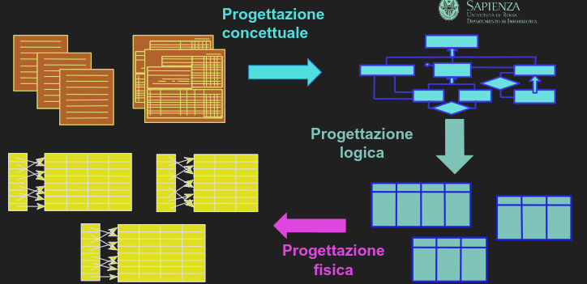
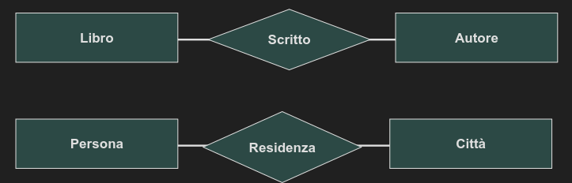
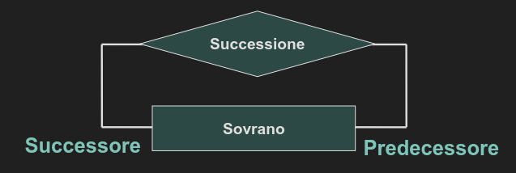
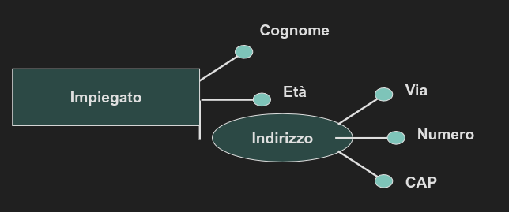
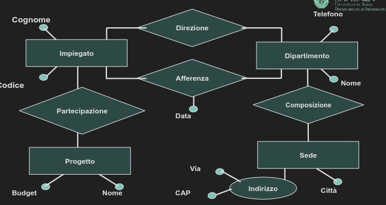

Possiamo distinguere due elementi di una base di dati:
- Lo schema
    Invariante nel tempo, è ciò che descrive la struttura di rappresentazione dei dati.
- L'istanza
    Sono i valori contenuti in una base di dati in un determinato istante

L'istanza sta allo schema come l'oggetto sta alla classe in OOP

Per progettare una buona base di dati conviene avere un buon processo: è utile dividere la progettazione in fasi, e poi scegliere una strategia ed un modello di rappresentazione dei dati per ogni fase. Questo ci aiuta a creare una distinzione tra "cosa voglio modellare" e "come voglio farlo".

*Fasi di progettazione di una base di dati*.

# Progettazione concettuale

La prima fase di progettazione è la progettazione concettuale. Il principale modello concettuale è il modello *entità-relazione*.

## Modello E-R

Ci sono vari costrutti di questo modello:
- Entità
- Relazione/Associazione
- Attributo
- Identificatore
- Generalizzazione

### Entità

La prima cosa da fare nella fase di progettazione concettuale è identificare le entità.

Le entità sono classi di oggetti con delle caratteristiche comuni. Le *occorrenze* sono i singoli elementi di queste classi. Nello schema rappresentiamo solo le entità, non le occorrenze.

Le entità hanno dei nomi. Questi nomi dovrebbero essere rappresentativi della loro funzione. I nomi delle entità per convenzione devono essere scritti al singolare.

### Associazione

Dopo aver identificato le entità, dobbiamo individuare le *associazioni*, cioè i legami logici tra le varie entità.

Le occorrenze di associazioni possono essere *binarie* se sono tra coppie di occorrenze di entità, o *n-arie* se sono tra più occorrenze di entità. Le associazioni sono n-uple ordinate.

*Modello E-R in uno schema concettuale. Le entità sono racchiuse in rettangoli, le relazioni in rombi.*

Anche le associazioni hanno nomi. Sono al singolare ed è meglio usare sostantivi invece che verbi (non è una regola strettissima)

Le entità possono avere più relazioni tra di loro.

Abbiamo già visto che le associazioni/relazioni possono essere ricorsive. Possono però anche essere ricorsive *asimmetricamente*.

*Rappresentazione di una successione ricorsiva asimmetrica. Un sovrano è successore di un'altro sovrano, ma il contrario non è vero.*

### Attributi

Gli attributi di un'entità o di una relazione sono le proprietà fondamentali di quell'entità/relazione. Devono essere tutti e soli i fatti di interesse ai fini dell'applicazione.

#### Attributi composti

Gli attributi possono anche essere *composti* da attributi singoli.

*Rappresentazione di un'entità con attributi singoli e composti. Gli attributi singoli sono rappresentati da pallini, quelli composti da ovali.*

## Esempio: basi di dati di una società

> La società comprende più dipartimenti, ognuno con nome e localizzato in una sede; più dipartimenti in sedi diverse possono avere lo stesso nome, e in una sede possono esserci più dipartimenti.
>
> Ad ogni Dipartimento afferisce un certo numero di impiegati, ognuno a partire da una certa data, e uno degli impiegati svolge il ruolo di Direttore del Dipartimento.
>
> Ogni impiegato partecipa ad uno o più progetti, ognuno con un nome ed un budget assegnato.

Cerchiamo di fare la progettazione concettuale di una base di dati formata su questa descrizione.

Le entità potrebbero essere gli impiegati, i progetti, i dipartimenti e le sedi. Le associazioni potrebbero essere di "composizione" tra dipartimenti e sedi, di "partecipazione" tra impiegati e progetti, e di "afferenza" e "direzione" tra impiegati e dipartimenti.

Con questa scelta di entità e associazioni (e opportuni attributi), lo schema è questo:

---

Oltre ad entità e relazioni, il modello E-R prevede anche altri costrutti.

### Cardinalità

Coppia di valori che si associa ad ogni entità che partecipa ad un'associazione. Vincolano il numero massimo e minimo di occorrenze dell'associazione a cui ogni *occorrenza* di un'entità può partecipare; quindi vincolano il *numero di occorrenze dell'altra entità* a cui ogni entità può essere associata.

*Rappresentazione della cardinalità di una relazione. Questa associazione associa studenti tutor ai docenti: uno studente tutor deve essere associato ad almeno ad un docente e al massimo a 2; un docente può avere minimo 0 e massimo 5 studenti tutor associati.*

Per semplicità, invece di numeri precisi spesso si usano solo 0 o 1 per il minimo e 1 o N per il massimo:
- Minimo: 0 e 1
    0 -> partecipazione opzionale  
    1 -> partecipazione obbligatoria
- Massimo: 1 e N
    1 -> partecipazione esclusiva  
    N -> no limite

In base ai vincoli sul massimo, le associazioni sono chiamate:
- Uno a uno
    (x, 1)/(x, 1)
- Uno a molti
    (x, 1)/(x, N)
- Molti a molti
    (x, N)/(x, N)
