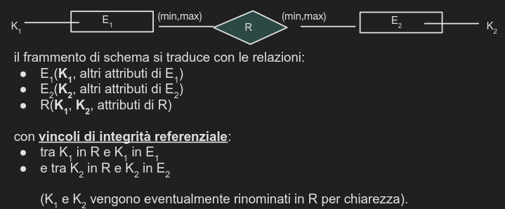
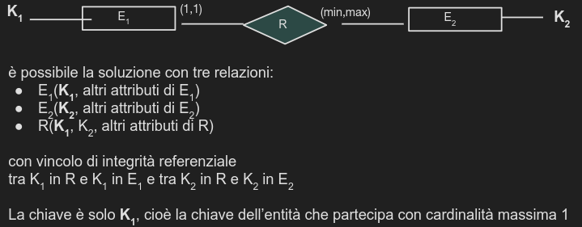
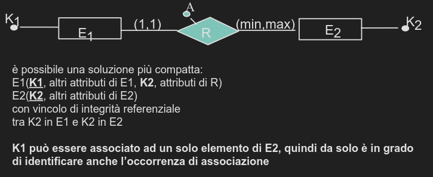

<!-- TODO: prima metà -->

# Traduzione dal diagramma E-R al modello relazionale

Passando dai diagrammi E-R al modello relazionale, sia le entità che le associazioni diventano relazioni (tabelle).

In base del tipo dell'associazione (1-molti, 1-1...) dobbiamo usare una traduzione diversa.

Dobbiamo inoltre capire come tradurre i *vincoli interrelazionali*:
- Vincolo di integrità referenziale
    Parti di informazioni in relazioni diverse sono associate tramite valori di chiave (?)
- Riferimenti tra attributi di relazioni diverse (??)
- boh

## Associazioni molti a molti

Per tradurre queste associazioni, usiamo una relazione che ha come chiave *la coppia delle chiavi delle entità collegate*.

*Esempio della traduzione di un'associazione dal diagramma E-R al modello relazionale. $K_i$ sono attributi che formano le entità $E_i$. L'associazione tra $E_1$ e $E_2$ è tradotta con $R(K_1,K_2,...)$, con eventuali attributi di $R$ al posto dei puntini.*

> [!NOTE]
> È possibile rinominare i $K_i$ in una relazione (in genere si usa il nome dell'entità di cui sono chiave primaria per leggibilità). Nelle associazioni ricorsive la rinominazione è fondamentale per definire il ruolo dei partecipanti all'associazione.

Le associazioni n-arie si traducono allo stesso modo, semplicemente i primi $n$ elementi della tupla della relazione sono i partecipanti mentre il resto sono gli attributi dell'associazione.

## Associazioni uno a molti

Dobbiamo imporre il fatto che un lato dell'associazione può essere presente una sola volta nella relazione. Per farlo (?), non usiamo la chiave della componente "molti" dalla relazione nella chiave dell'associazione: basta la chiave della componente unica per identificare l'associazione.

In questo modo, non dobbiamo neanche esplicitare l'associazione: possiamo semplicemente far comparire $K_2$ e gli attributi della relazione nella tupla che definisce l'entità unica dell'associazione.

Per le associazioni ricorsive è la stessa cosa: aggiungiamo un attributo contenente l'altra componente dell'associazione (esempio padre-figlio).

Per le n-arie è lo stesso che nelle 1-1
