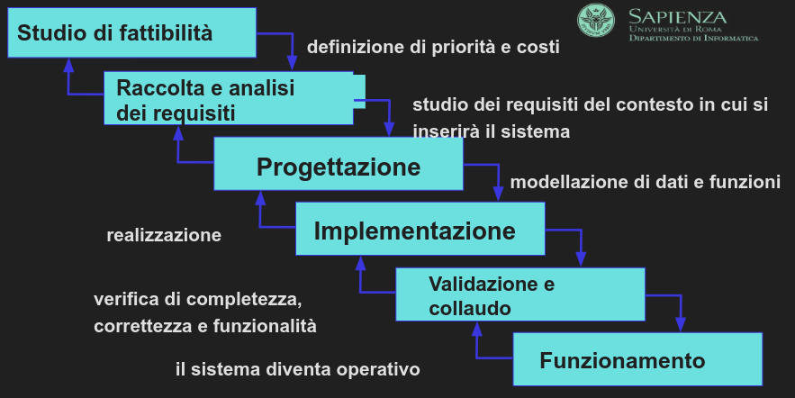
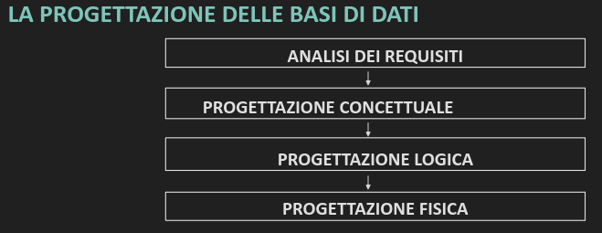
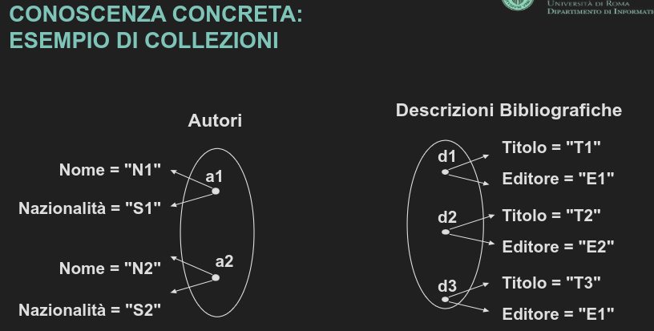
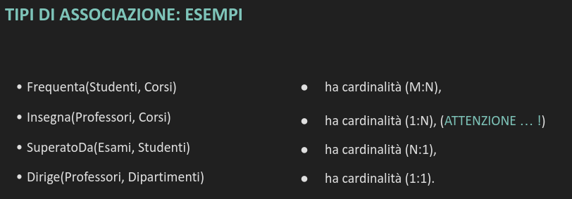
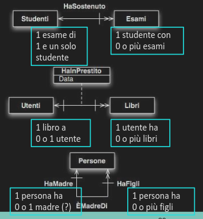

# Progettazione di basi di dati

La progettazione di una base di dati è la parte più importante della sua gestione. Nella progettazione bisogna cercare di modellare i dati nel modo più fedele alla vita reale possibile.

## Ciclo di vita dei sistemi informativi

I sistemi informativi hanno varie "fasi" di sviluppo/utilizzo dei sistemi informativi (progettazione, analisi dati, transazioni...).

Le fasi del ciclo di vita di un database sono:
- Studio di fattibilità
    Definizione di priorità e costi
- Raccolta e analisi dei requisiti
    Studio dei requisiti del contesto in cui verrà utilizzato il sistema
- Progettazione
    Modellazione dei dati
- Implementazione
- Collaudo
- Funzionamento

## Modello astratto

> Un modello astratto è la rappresentazione formale di idee e conoscenze relative ad un fenomeno

Un modello rappresenta dei fatti con un linguaggio formale ed è il risultato di un processo di interpretazione guidato dal modello di astrazione previsto

Nell'elaborazione di un modello astratto bisogna scegliere le strutture da utilizzare per organizzare i dati e le loro relazioni

## Tipi di modelli (?)

- Logici
    Indipendenti dalle strutture dati fisiche; sono i modelli dei DBMS (?)
- Concettuali
    boh

## Aspetti

Ci sono diversi aspetti da considerare nella progettazione di una base di dati:
- Ontologico: Quale parte del dominio di discorso voglio rappresentare?
    Include gli oggetti, i loro vincoli e relazioni, le operazioni concesse agli utenti
- Logico: Quale meccanismo di astrazione voglio usare per rappresentare gli oggetti del dominio?
    In genere si usa l'astrazione di classi e oggetti  
    Useremo la notazione grafica dei diagramma ER (entità-relazione)
- Linguistico: Con quale linguaggio formale voglio definire il modello?
- Pragmatico: Come lo voglio implementare?

### Esempi di tipi di entità

Ogni entità in un db deve essere descritta più che da un nome, dagli attributi che ha.

Alcuni dati possono essere interpretati sia come attributi che come entità. (esempio matricola studente)

boh oggetti e classi

# Oggetti

Il primo passo nella progettazione di un db è identificare i tipi di oggetti che dobbiamo modellare; bisogna poi nominarli e definire l'insieme di attributi che possono avere.

## Associazioni

Dopo aver definito gli oggetti, possiamo definire le *istanze di associazione* tra oggetti: i legami logici tra i vari oggetti.
    Per esempio: "l'utente Tizio ha in prestito una copia della Divina Commedia" mette in relazione l'oggetto "Tizio" con l'oggetto "Divina Commedia"

Un'*associazione* $R(X, Y)$ tra 2 collezioni di entità $X$ e $Y$ è un insieme di istanze di elementi di $X$ e $Y$.
    Il prod. cartesiano $X \times Y$ è detto *dominio* dell'associazione

### Tipi di associazioni

Un'associazione è caratterizzata dalla sua *molteplicità* e *totalità*.

#### Molteplicità

> Un'associazione $R(X, Y)$ è *univoca* rispetto ad $X$ se per ogni elemento $x \in X \exists$ al più 1 elemento di $Y$ associato a $x$. Se questo non vale, l'associazione è *multivalore* rispetto ad $X$.

Notazione:
- $R(X,Y)$ è $(1:N)$ se essa è multivalore su X ed univoca su Y
- $R(X,Y)$ è $(N:1)$ se essa è univoca su X e multivalore su Y
- $R(X,Y)$ è $(N:M)$ se essa è multivalore su X e multivalore su Y
- $R(X,Y)$ è $(1:1)$: se essa è univoca su X e univoca su Y

#### Totalità

> Un'associazione $R(X, Y)$ è *totale* su $X$ se $\forall x \in X\ \exists$ almeno 1 $y\in Y$ associato ad $x$. Se questo non vale, l'associazione è *parziale* su $X$.

### Modellare associazioni tra oggetti

Per modellare le associazioni usiamo un diagramma come questo:

- Freccia singola: unicità
- Doppia freccia: molteplicità
- Barra: parzialità
- No barra: totalità

Le associazioni possono essere anche ricorsive o riflessive: una Persona può avere relazioni con altre Persone
