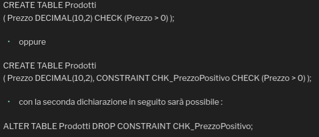

Il linguaggio più utilizzato per interagire con basi di dati è *SQL* (Structured Query Language).

SQL contiene istruzioni sia per definire (DDL; Data Definition Language) una base di dati che per interrogarla (DML; Data Manipulation Language).

# Storia

Lo standard SQL nasce nel 1983, ma già esistevano delle implementazioni. Anche oggi lo standard non è seguito alla lettera da ogni implementazione.

---

SQL è formato da diversi "sottolinguaggi" con funzionalità diverse:
- DDL (Data Definition Language)
    Definizione della base di dati
- DML (Data Manipulation Language)
    Manipolazione dei dati nella base
- DQL (Data Query Language)
    Interrogazione dei dati
- DCL (Data Control Language)
    Gestione dei permessi di accesso

# DDL

Vediamo come implementare una base di dati progettata seguendo il processo che abbiamo visto usando SQL

## Domini

SQL ha dei domini (tipi) predefiniti, ma è anche possibile definirne altri.

I domini predefiniti sono:
- Carattere
- Bit
    Singoli o sequenze di bit
- Numero
    Interi, fratti
- Data/Ora/Intervallo
- Da SQL 1999:
    - Bool
    - File grandi (binari o di testo)

Per creare domini personalizzati ("ad hoc") si usa l'istruzione `CREATE DOMAIN`. Per esempio:
```sql
CREATE DOMAIN Voti
    AS SMALLINT DEFAULT NULL
    CHECK (value >= 18 AND value <= 31 )
```
Questo comando crea un nuovo dominio *Voti* che può contenere valori interi tra 18 e 31, inizializzato a `NULL`.

Il comando `CHECK` viene utilizzato spesso per definire vincoli, e può anche essere utilizzato direttamente nella definizione di una tabella per imporre vincoli sui valori consentiti.

## Definizione degli Schemi

Per creare tabelle si usa l'istruzione `CREATE TABLE`, seguita dal nome e gli attributi, domini, e vincoli.

Esempio:
```sql
CREATE TABLE Impiegato(
    Matricola CHAR(6) PRIMARY KEY,
    CF CHAR(16) UNIQUE,
    Nome CHAR(20) NOT NULL,
    Cognome CHAR(20) NOT NULL,
    Dipart CHAR(15) REFERENCES
        Dipartimento(Codice),
    Stipendio NUMERIC(9) DEFAULT 0,
    -- per aggiungere vincoli a più attributi si scrive prima il vincolo e poi la tupla di attributi
    UNIQUE (Cognome, Nome)
);
```

Con questo comando si crea una tabella `Impiegato` con chiave primaria `Matricola`, vari altri attributi (tra cui `Dipart` che si riferisce all'attributo `Codice` di un'altra tabella `Dipartimento`), e con il vincolo che ogni coppia `Cognome, Nome` deve essere unica.
    Teoricamente si dovrebbe usare `VAR CHAR` per dire "stringa fino a (x) caratteri"; solo `CHAR` impone che sia esattamente quella lunghezza

### Vincoli

Da notare che il comportamento di default di SQL è accettare valori nulli per gli attributi. Per evitare valori nulli si deve utilizzare `NOT NULL`.

`UNIQUE` definisce attributi o insiemi di attributi non ripetibili.

`PRIMARY KEY` implica `UNIQUE` e `NOT NULL`.

Per definire vincoli interrelazionali si usano le keyword `REFERENCES` e `FOREIGN KEY`.
    La tabella da cui proviene il riferimento è detta "master", quella che lo importa è detta "slave".

Si possono definire delle politiche per gestire le violazioni di vincoli. Se non sono definite politiche il comportamento di default è annullare l'operazione.

Le politiche più utilizzate sono:
- `ON DELETE SET NULL`
    Quando una riga è cancellata i riferimenti a quella riga sono settati a `NULL`.
- `ON DELETE CASCADE`
    Quando una riga è cancellata le righe contenente riferimenti a quella riga sono *eliminate*.
- `ON UPDATE SET NULL`
    Quando una riga è aggiornata i riferimenti a quella riga sono settati a `NULL`.
- `ON UPDATE CASCADE`
    Quando una riga è aggiornata i riferimenti a quella riga sono aggiornati con i nuovi valori.

Le politiche sono settate quando si definisce una tabella:
```sql
CREATE TABLE Infrazione(
    Codice CHAR(6) PRIMARY KEY,
    Vigile CHAR(4)
        REFERENCES Vigili(Matricola)
        ON UPDATE CASCADE,
    ...
);
```

Per definire vincoli più complessi si utilizza `CHECK (<condizione>)`. Per esempio:
```sql
CREATE TABLE Impiegato(
    Matricola CHAR(6),
    Sesso CHAR NOT NULL
        CHECK (Sesso IN ('M', 'F')),
    ...
);
```

Per definire vincoli tra colonne si aggiunge `CHECK (cond)` dopo gli attributi.

Questi vincoli in SQL sono detti `CONSTRAINT`, e sono definibili usando la keyword `CONSTRAIN` ed un *nome*. I vincoli definiti in questo modo sono manipolabili con il comando `ALTER TABLE`.


*Esempio di un vincolo definito tramite `CONSTRAINT`.*

### Indici

Gli indici sono riferimenti a record nel file principale: è mantenuto un file che associa un valore (o gruppo di valori) di un record al record effettivo. Questo rende l'accesso ai dati più veloce, dato che va cercato solo il file dei record (più piccolo) e non il file principale.

Servono solo per ottimizzare l'accesso ai dati, non sono parte dello schema della base.

Gli indici sono creati con `CREATE INDEX`:
```sql
CREATE INDEX nomeIndice
    ON nomeTabella(attr1, attr2, ...);
```
Quando si effettua un'interrogazione sugli attributi per cui si è definito un indice si avrà un tempo di ricerca minore.

Se si usa `CREATE UNIQUE INDEX...` è aggiunto un vincolo di unicità *alle colonne utilizzate nell'indice*. È consigliato usare la keyword `UNIQUE` nella creazione della tabella, non negli indici.

Gli indici hanno diversi vantaggi:
1. Ricerche filtrate più veloci
2. Ottimizzano relazioni
3. Raggruppamento più rapido
    I file indice sono ordinati

Ma anche degli svantaggi:
1. Rallentano le operazioni di modifica, dato che devono essere aggiornati gli indici
2. Occupano spazio su disco

Per questo, è meglio utilizzare gli indici solo su colonne usate frequentemente.

## Modifica degli Schemi

Alcuni comandi di modifica:
- `ALTER DOMAIN`
    Modifica la definizione di un dominio
    - `[SET|DROP] DEFAULT`
        Aggiunge o rimuove un valore di default
    - `[SET|DROP] NOT NULL`
        Modifica vincolo di nullabilità
    - `ADD CONSTRAINT nome...`
        Aggiungi nuovo constraint
    - `DROP nomeConstraint`
        Rimuovi constraint
    - `RENAME TO...`
        Rinomina dominio
- `ALTER TABLE nomeTabella`
    Aggiunge o elimina attributi o vincoli
    - `ADD nomeAttributo nomeDomain`
        Aggiungi nuova colonna con dominio specificato
    - `DROP COLUMN nomeAttributo`
        Rimuovi colonna specificata
    - `MODIFY nomeAttributo nomeDominio` o `ALTER COLUMN nomeAttributo SET DATA TYPE nomeDominio` (in base al linguaggio)
        Modifica dominio di una colonna
    - `ADD CONSTRAINT...`
        Aggiunge constraint
    - `DROP CONSTRAINT nomeConstraint`
        Rimuove constraint
    - `RENAME TO nuovoNome`
        Rinomina attributo
- `DROP DOMAIN`
    Elimina un dominio
- `DROP TABLE`
    Elimina una tabella, sia lo schema che l'istanza
- `DROP INDEX`
    Elimina un indice
- `DELETE <query>`
    Elimina le righe ottenute da un'interrogazione
- `TRUNCATE nomeTabella`
    Elimina le righe di una tabella
...

## View

Con il comando `CREATE VIEW` si può creare una tabella *virtuale* contenente un sottoinsieme degli attributi di una tabella. Simile a `SELECT`, ma non crea una copia dei dati che soddifsano il query.

Al contrario delle tabelle create da `SELECT`, le viste sono automaticamente aggiornate quando sono aggiunti nuovi dati che soddisfano il query.

Le viste sono interrogabili esattamente come le tabelle normali.

# DQL

Un *Data Query Lanugage* è utilizzato per estrarre informazioni da una base di dati.

Mentre l'algebra relazionale è procedurale, SQL è un linguaggio *dichiarativo*: si specifica solo **quali** dati si vogliono ottenere, non **come** ottenerli.

## `SELECT`

Il comando principale per interrogare i dati in SQL è `SELECT`.

> [!NOTE]
> `SELECT` corrisponde alla *proiezione* in algebra relazionale; la *selezione* si ottiene con la clausola `WHERE`.

Sintassi:
```sql
SELECT ListaAttributi
    FROM ListaTabelle
    WHERE Condizione; -- opzionale
```

È possibile rinominare una tabella durante un query con la keyword `AS`:
```sql
SELECT p.Nome as Nome, p.Reddito as Reddito
    FROM Persone p
    WHERE p.Età < 30;
```

Per scegliere tutte le colonne di una tabella si può usare `*`:
```sql
SELECT *
    FROM Persone
    WHERE Età < 30;
```

Si possono usare espressioni in un query:
```sql
SELECT Reddito/2 as RedditoSemestrale
    FROM Persone
    WHERE Nome = 'Luigi';

SELECT *
    FROM Persone
    WHERE Reddito > 25 AND (Età < 30 OR Età > 60);
```

### Condizioni

- `LIKE`
    La keyword `LIKE` definisce una specie di espressione regolare ca usare per scegliere stringhe:
    ```sql
    SELECT *
        FROM Persone
        WHERE Nome like 'A_d%'; -- trova nome che iniziano per 'A' e hanno 'd' come terza lettera
        -- `_` == regex `.`
        -- `%` == regex `+`
    ```
- Valori `NULL`
    Per cercare valori nulli o non nulli *non* si usano i normali operatori booleani:
    ```sql
    SELECT ...
        WHERE Attributo IS NULL;

    SELECT ...
        WHERE Attributo IS NOT NULL;
    ```

- `DISTINCT`
    In SQL i duplicati sono mantenuti nel risultato di un query (che non accade in algebra relazionale). Per escluderli si usa `DISTINCT`:
    ```sql
    SELECT DISTINCT Attributi
        FROM ...;
    ```

Usando nomi di più tabelle dopo `FROM`, si possono realizzare query analoghi al prodotto cartesiano e join dell'algebra relazionale. Dato che SQL è un linguaggio dichiarativo, è il DBMS che ottimizza l'interrogazione; non dobbiamo preoccuparci dell'ordine di esecuzione.

Esempio di prodotto cartesiano:
```sql
-- "padri di persone con reddito > 20"
CREATE TABLE Persona(
    Nome STRING PRIMARY KEY,
    Età INT,
    Reddito INT
);
CREATE TABLE Paternità(
    Padre STRING REFERENCES Persona,
    Figlio STRING FOREIGN KEY
);

SELECT DISTINCT Paternità.Padre
    FROM Persone, Paternità -- prodotto cartesiano
    WHERE Persone.Reddito > 20;
```

Però questo query è sbagliato: ci serve un join e non un prodotto cartesiano.

Per fare un join, dobbiamo aggiungere degli argomenti a `WHERE`:
```sql
SELECT DISTINCT Paternità.Padre
    FROM Persone, Paternità
    WHERE Figlio == Nome AND Persone.Reddito > 20; -- si può omettere la tabella di provenienza dell'attributo se le tabelle non hanno attributi con lo stesso nome
```

Si può anche usare la stessa tabella più volte nello stesso query se la si ridenomina:
```sql
SELECT F.Nome, F.Reddito, P.Reddito
    FROM Persone P, Persone F
    WHERE ...;
```

Per ridenominare gli attributi nella tabella risultante, si usa `AS`:
```sql
SELECT Figlio, F.Reddito as Reddito, P.Reddito as RedditoPadre
    FROM Persone P, Paternità, Persone F
    WHERE ...;
```

Alcune implementazioni di SQL permettono di esplicitare il join:
```sql
SELECT Nome, Reddito, Padre
    FROM Persone JOIN Paternità ON Paternità.Figlio = Nome
```
Dove `ON <cond>` indica la condizione.

### Ordinamento

Si può aggiungere la clausola `ORDER BY <attr>` per ordinare la tabella risultante:
```sql
SELECT Nome, Reddito
    FROM Persone
    ORDER BY Nome;
```

## Comandi avanzati

In SQL sono disponibili alcuni comandi di interrogazione che non esistono in algebra relazionale.

### Operatori aggregati

La clausola `WHERE` accetta delle espressioni che operano su *insiemi* di tuple:

#### `count()`
- `count(*)`
    Conta il numero di righe della tabella. Esempio:
    ```sql
    SELECT count(*) as NumFigli
        FROM Paternità
        WHERE Padre = "Franco";
    -- il risultato è una tabella con 1 riga contenente il numero di righe della tabella
    ```
- `count(<attr>)`
    Conta il numero di tuple in cui \<attr\> non è nullo
- `count(DISTINCT <attr>)`
    Come sopra ma conta solo valori diversi

#### `sum(), avg(), max(), min()`

Si applicano su attributi numerici; effettuano l'operazione specificata.

Esempio:
```sql
SELECT avg(Reddito)
    FROM Persone JOIN Paternità ON Nome = Figlio
    WHERE Padre = "Franco";
```

> [!WARNING]
> Gli operatori aggregati non si possono usare con la clausola `WHERE`, bisogna usare una query annidata con `WHERE Colonna = (SELECT <operatore>...)`

Questi operatori ignorano valori nulli.

#### `GROUP BY`

`GROUP BY` crea raggruppamenti utilizzabili dagli altri operatori aggregati:
```sql
SELECT Padre, count(*) AS NumFigli
    FROM Paternità
    GROUP BY Padre;
-- crea una tabella con attributi "Padre" e "NumFigli" contenente una riga per padre.
-- praticamente separa Paternità in tante tabelle quanti padri distinti ci sono (la partiziona) e conta i figli in ognuna di quelle tabelle
```

Quindi l'ordine di operazioni è:
1. Esegui il query con eventuali condizioni `WHERE`, ignorando gli operatori aggregati
2. Raggruppa
3. Applica l'operatore aggregato a ciascun gruppo

Si possono anche aggiungere condizioni ai raggruppamenti con `HAVING`:
```sql
SELECT Padre, avg(F.reddito)
    FROM Persone F JOIN Paternità ON Figlio = Nome
    GROUP BY Padre
    HAVING avg(F.reddito) > 25;
-- filtra il raggruppamento a solo i gruppi che soddisfano la condizione
```


*Operazioni possibili con `SELECT`*.

## Operazioni insiemistiche

Questi operatori si applicano tra tabelle [union compatibili](<./Algebra Relazionale.md#Unione>) e non considerano duplicati (se non si usa `ALL`)

### `UNION`

Crea una tabella con tutte le tuple della prima query e tutte le tuple della seconda query:
```sql
SELECT Padre
    FROM Paternità
UNION
SELECT Madre
    FROM Maternità;
-- tabella con tutti i padri e tutte le madri
```

### `EXCEPT`

Equivalente alla differenza insiemistica:
```sql
SELECT Nome
    FROM Impiegato
EXCEPT
SELECT Cognome AS Nome -- union compatibilità
    FROM Impiegato;
-- tutti i nomi che nono sono anche cognomi di qualcuno
```

### `INTERSECT`

Intersezione insiemistica:
```sql
SELECT NOME
    FROM Impiegato
INTERSECT
SELECT Cognome AS Nome
    FROM Impiegato;
-- solo i nomi che sono anche cognomi di qualcuno
```

### Query annidati

Si possono usare i risultati di altre interrogazioni come condizioni di un'interrogazione:
```sql
SELECT Nome, Reddito
    FROM Persone
    WHERE Nome = (SELECT Padre -- questo query produce una tabella con 1 riga
        FROM Paternità
        WHERE Figlio = "Franco");
-- equivalente a:
SELECT Nome, Reddito
    FROM Persone, Paternità
    WHERE Nome = Padre AND Figlio = "Franco"
```

I query annidati non possono contenere operazioni insiemistiche.

Se il risultato di un query annidato ha più di una riga, si devono usare gli operatori `= ANY/IN` o `<> ALL/NOT IN`:
```sql
SELECT Nome, Reddito
    FROM Persone
    WHERE Nome IN (SELECT Padre -- <-
        FROM Paternità
        WHERE Figlio = ANY (SELECT Nome -- = ANY -> uguale ad almeno una riga == `IN`
            FROM Persone
            WHERE Reddito > 20)
        );
-- equivalente
SELECT DISTINCT P.Nome, P.Reddito
    FROM Persone P, Paternità, Persone F
    WHERE P.Nome = Padre AND Figlio = F.Nome AND F.Reddito > 20;
```

> [!WARNING]
> Le variabili definite nelle query nidificate sono visibili solo a blocchi più interni del blocco in cui sono state definite.

### `EXISTS`

La clausola `EXISTS` effettua la [quantificazione esistenziale](<./Algebra Relazionale.md>), permettendoci di controllare se una condizione è verificata per qualsiasi dei valori di una tabella.

```sql
-- EXISTS è una condizione che richiede che l'espressione controllata abbia almeno 1 riga
SELECT *
FROM Persone
WHERE EXISTS (
    SELECT *
    FROM Paternità
    WHERE Padre = Persone.Nome
) OR EXISTS (
    SELECT *
    FROM Maternità
    WHERE Madre = Persone.Nome
);
-- trova tutte le persone che hanno lo stesso nome di una madre o di un padre
-- equivalente a:
SELECT *
FROM Persone
WHERE 1 <= (
    SELECT count(*)
    FROM Paternità
    WHERE Padre = Persone.Nome
) OR 1 <= (
    SELECT count(*)
    FROM Maternità
    WHERE Madre = Persone.Nome
);
```

> [!NOTE]
> Se il risultato della query annidata non dipende dalla riga della query esterna, non è ricalcolato per ogni riga (es. (`SELECT max(<col>)...`).
> Una query che dipende dall'esterno è detta *subordinata*, altrimenti è detta *coordinata*.

# DML

Un *Data Manipulation Language* serve a manipolare i *dati* all'interno di una base senza modificarne lo schema.

## `INSERT`

Sintassi:
> ```sql
> INSERT INTO Tabella (Attributi)
>    VALUES(Valori);
> ```

Questo comando inserisce una riga composta dalle colonne specificate in `Attributi` con i valori dati, associati 1-1 in base all'ordine. Inserisce valori di default per colonne non specificate (possibilmente causando errori se sono violati vincoli di non nullità).

Si possono anche omettere gli attributi:
```sql
INSERT INTO Tabella VALUES(Valori);
-- associa i valori alle colonne in base all'ordine di definizione della tabella
```

Si può inserire il risultato di una query:
```sql
INSERT INTO Tabella -- (Attributi)
    SELECT ...;
-- inserisce ogni riga ottenuta dalla query usando le colonne come come i `VALUES`, con le stesse considerazioni di prima
```

## `DELETE`

Sintassi:
> ```sql
> DELETE FROM Tabella
>    -- WHERE Condizione;
> ```

> [!WARNING]
> Se la condizione è omessa la tabella *viene svuotata*.

## `UPDATE`

Sintassi:
```sql
UPDATE Tabella
SET Attributo = < -- uno di:
    Espressione|
    SELECT ...|
    NULL|
    DEFAULT
> -- WHERE Condizione
-- se la condizione è omessa tutte le righe sono modificate
```

# DCL

Una *data control language* definisce chi può accedere ai dati e come.

In SQL, è possibile imporre vincoli di accesso a intere tabelle, ma anche a singole colonne o righe etc.

## Privilegi

Un privilegio è caratterizzato da:
- La risorsa a cui si applica
- L'utente che riguarda
- L'utente che concede accesso
- L'azione permessa
- Se l'utente può trasmettere il privilegio

I privilegi di SQL sono:
- `insert`
    Aggiungere righe
- `update`
    Aggiornare righe
- `delete`
    Rimuovere righe
- `select`
    Lettura
- `references`
    Definizione di vincoli di integrità
- `usage`
    Utilizzo di qualcosa (tipo un dominio)

## `GRANT` e `REVOKE`

Concedere privilegi:
> ```sql
> grant Privilegi on Risorsa to Utenti
> -- alternativamente si può usare `GRANT all privileges`
> ```

Rimuovere privilegi:
> ```sql
> revoke Privilegio on Risorsa from Utenti
> -- si può aggiungere `restrict` o `cascade` per mantenere o rimuovere i privilegi trasmessi dall'utente
> ```

# Transazioni

Le operazioni (*transazioni*) su una basi di dati devono garantire alcune proprietà per il corretto funzionamento della base:
- Atomicità
    Una sequenza di operazioni viene eseguita o per intero o per niente
- Consistenza
    Al termine dell'esecuzione di un'operazione, i vincoli di integrità devono essere soddisfatti. Se dopo l'esecuzione alcuni vincoli sono violati, la transazione deve essere annullata
- Isolamento
    L'effetto di transazioni concorrenti deve essere equivalente al risultato delle operazioni eseguite sequenzialmente
- Durabilità
    Avendo l'elenco di transazioni deve essere possibile tornare indietro

In SQL i comandi per le transazioni sono:
- `begin transaction`
    Segna l'inizio della transazione, senza eseguire le istruzioni successive
- `commit work`
    Effettua le istruzioni eseguite dall'ultimo `begin transaction`
- `rollback work`
    Rifiute le istruzioni eseguite dall'ultimo `begin transaction`
