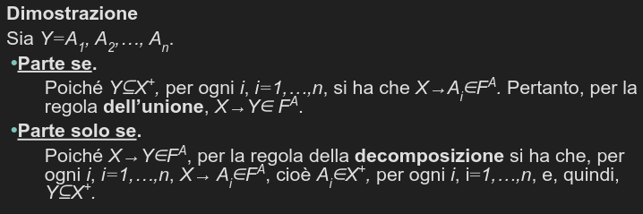
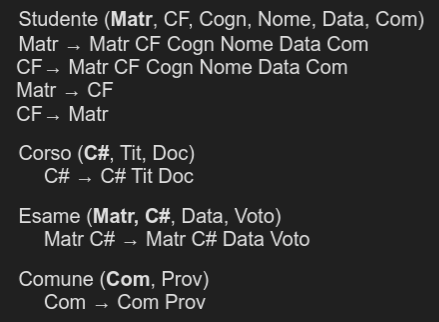
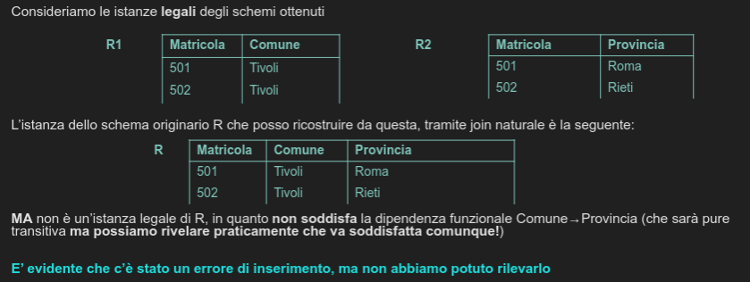
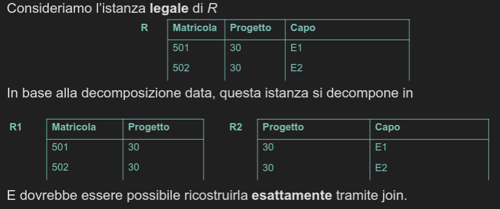
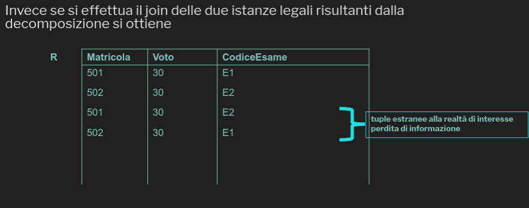

# Dipendenze funzionali

I vincoli funzionali sono vincoli che non si basano su una definizione algebrica o matematica ma di "buon senso". Per esempio il vincolo: se due macchine sono dello stesso modello, allora devono essere della stessa casa automobilistica.

Questi vincoli sono difficili da implementare con i trigger, vogliamo evitarli. Ma per evitarli ci serve avere una base di dati "progettata bene" (in terza forma normale)

> Una dipendenza funzionale su uno schema di relazione $R$ è una coppia ordinata $X\to Y$ ("$X$ determina $Y$"), o $(X,Y)$, con $X,Y\subseteq R$.

Le dipendenze funzionali sono simili a funzioni: associano valori di un dominio (i *determinanti*) ad un insieme codominio (dei *dipendenti*).

Esempio:
> Supponiamo di avere uno schema `Voli(Codice, Giorno, Pilota, Ora)`, con i vincoli:
> - Un volo con un certo codice parte sempre alla stessa ora
>   La dipendenza funzionale di questo vincolo è $\text{Codice}\to \text{Ora}$ (`Codice` determina `Ora`).
> - Esiste un solo volo con un dato pilota in una data ora di un dato giorno
>   $\{\text{Giorno},\text{Pilota},\text{Ora}\}\to \text{Codice}$
> - C'è un solo pilota di un dato volo in un dato giorno
>   $\{\text{Codice},\text{Giorno}\}\to \text{Pilota}$

> Una relazione $r$ con schema $R$ *soddisfa* la dipendenza $X\to Y$ se ogni volta che due tuple di $r$ sono uguali su $X$, sono anche uguali su $Y$ (con $X$, $Y$ insiemi di colonne). Formalmente: $\forall t_1,t_2\in r$, se $t_1[x]=t_2[x]$ allora $t_1[y]=t_2[y]$.

Un'istanza di relazione *soddisfa* una dipendenza funzionale se non viola il vincolo espresso da essa.

> Dato uno schema $R$ ed un insieme di dipendenze funzionali $F=\{X_1\to Y_1, X_2\to Y_2,...\}$, un'istanza $r$ è *legale* se soddisfa tutte le dipedendenze funzionali di $F$.

> [!NOTE]
> Un'istanza con meno di 2 tuple è sempre legale

## Chiusura di F

Osservazione: data uno schema $R$ con $F={A\to B, B\to X}$, ogni istanza legale soddisfa anche $A\to C$.

L'insieme delle dipendenze funzionali soddisfatte in questo modo è detto *chiusura* dell'insieme di dipendenze di partenza.

> Dato uno schema $R$ con insieme di dipendenze funzionali $F$, l'insieme di dipendenze funzionali soddisfatte da ogni istanza legale è detto *chiusura di $F$*, o $F^+$. Si ha inoltre $F\subseteq F^+$.

> [!NOTE]
> $F^+$ ha grandezza esponenziale rispetto ad $F$.

Vedremo successivamente una definizione di $F^+$ che non passa per le istanze.

Osservazione: $X\to Y\in F^+ \iff X\to$ tutti i sottoinsiemi di $Y \in F^+$.

> Con $Y\subseteq X\in R$, la dipendenza funzionale $X\to Y$ è sempre soddisfatta. Dipendenze di questo tipo sono dette *banali*.

> Una *chiave* $K$ è un sottoinsieme di $R$ tale che:
> 1. $K\to R\in F^+$ ("$K$ determina $R$" è un vincolo di $R$).
> 2. $\not\exists K'\subseteq K \text{ t.c. } K'\to R\in F^+$ (è il sottoinsieme minimale tale che 1.).
> Se non vale 2., $K$ si dice *superchiave* (è un soprainsieme di una chiave).

## Assiomi di Armstrong

Per trovare le dipendenze in $F^+$ iniziamo definendo un insieme $F^A$.

> Si ha che $F\subseteq F^A$.
> Assiomi di Armstrong:
> 1. Se $Y\subseteq X$ allora $X\to Y\in F^A$ (Assioma della Riflessività)
    $F^A$ contiene le dipendenze banali
> 2. Se $X\to Y\in F^A$ allora $\forall Z\subseteq R:\ XZ\to YZ\in F^A$ (Assioma dell'Aumento)
> 3. Se $X\to Y\in F^A$ e $Y\to Z\in F^A$ allora $X\to Z\in F^A$ (Assioma della Transitività)

Potremmo poi dimostrare che $F^+ = F^A$.

Ci sono altre regole che sono conseguenze degli assiomi di Armstrong (si dimostrano a partire da quelli):
> 4. Se $X\to Y, X\to Z\in F^A$ allora $X\to YZ\in F^A$ (Regola dell'Unione)
    Dimostrato applicando aumento e transitività ($X\to Y \Rightarrow X\to XY \Rightarrow XY\to YZ \Rightarrow X\to YZ$)
> 5. Se $X\to Y\in F^A$ e $Z\subseteq Y$ allora $X\to Z\in F^A$ (Regola della Decomposizione)
> 6. Se $X\to Y\in F^A$ e $WY\to Z\in F^A$ allora $WX\to Z\in F^A$ (Regola della Pseudotransitività)

Osservazione:  
$X\to Y\in F^A, Y=A_1,A_2,...,A_R \iff X\to A_1\in F^A \land X\to A_2\in F^A \land ... \land X\to A_R\in F^A$. In questo modo possiamo raggruppare le dipendenze funzionali per brevità.

> La *chiusura* di un sottoinsieme di attributi $X$ rispetto ad $F: X^+_F$ o solo $X^+$ è l'insieme di attributi univocamente determinati da $X$ (eventualmente applicando gli assiomi di Armstrong):
> $$
X^+_F = \{A\in R\ |\ X\to A\in F^A\}
$$

> [!NOTE]
> $A$ è _**un** attributo_, non un insieme di attributi

> Lemma di Chiusura:
> $$
X\to Y\in F^A \iff Y\subseteq X^+
$$
> 

Dimostriamo ora che $F^+=F^A$. Dobbiamo dimostrare:
1. $F^A\subseteq F^+$
2. $F^+\subseteq F^A$

> 1. Vogliamo dimostrare $X\to Y\in F^A \Rightarrow X\to Y \in F^+$. Abbiamo che $X\to Y\in F \Rightarrow X\to Y\in F^+$ (caso base). Dobbiamo fare una dimostrazione induttiva sul numero di volte che abbiamo applicato Armstrong, con 3 casi in base a quale assioma abbiamo applicato per ultimo.

**Dimostrazione**:  
Definiamo ${F^A}_i =$ insieme delle dipendenze funzionali ottenuto applicando al più $i$ volte assiomi di Armstrong. Dimostriamo ${F^A}_i\subseteq F^+$ per induzione:
- Caso base: $i=0$
    ${F^A}_0=F\subseteq F^+.$
- Caso induttivo: ${F^A}_i\subseteq F^+\Rightarrow {F^A}_{i+1}\subseteq F^+$
    Sia $X\to Y\in {F^A}_{i+1}$, $r$ un'istanza legale. $X\to Y$ può essere stato ottenuto da ${F^A}_i$ applicando:
    - Riflessività
        Per le condizione dell'assioma si ha che $Y\subseteq X$. Quindi $\forall t_1, t_2\in r$, se $t_1[X]=t_2[X]$ allora $t_1[Y]=t_2[Y] \Rightarrow X\to Y\in F^+.$
    - Aumento
        Esiste una dipendenza funzionale $V\to W\in {F^A}_i$ ed un insieme $Z\subseteq R$ tali che $X=VZ, Y=WZ$. $$
        \begin{align}
        \forall t_1,t_2\in r,\ t_1[X]&=t_2[X]\Rightarrow \\
        t_1[VZ]&=t_2[VZ]\Rightarrow \\
        t_1[V]=t_2[V]&\land t_1[Z]=t_2[Z]= \text{ Per ipotesi induttiva}\Rightarrow\\
        t_1[W]=t_2[W]&\land t_1[Z]=t_2[Z]\Rightarrow \\
        t_1[WZ]&=t_2[WZ]\Rightarrow \\
        t_1[Y]&=t_2[Y]\\
         \text{Quindi } X&\to Y\in F^+.
        \end{align}
        $$
    - Transitivià
        Esiste un $V\subseteq R$ t.c. $X\to V, V\to Y\in {F^A}_i$. Per ipotesi induttiva: $$
        \forall t_1,t_2\in r, t_1[X]=t_2[X]\Rightarrow t_1[V]=t_2[V]\Rightarrow t_1[Y]=t_2[Y]\text{  quindi } X\to Y\in F^+.
        $$

> 2. Vogliamo dimostrare $X\to Y\in F^+\Rightarrow X\to Y\in F^A$.

**Dimostrazione**:  
Vogliamo utilizzare il lemma di chiusura: $X\to Y\in F^A\iff Y\subseteq X^+_F$. Costruiamo un'istanza legale $r$. Ci saranno degli attributi di $r\in X^+$, il resto sarà in $R-X^+$. L'istanza avrà 2 tuple $t_1$ e $t_2$, con $t_1[X^+]=t_1[R-X^+]=1$ e $t_2[X^+]=1, t_2[R-X^+]=0$. Dimostriamo che $r$ è legale.

Sia $V\to W\in F$. $$
\begin{align}
\text{Se } t_1[V]&=t_2[V]\Rightarrow(\text{abbiamo definito $t_1$ e $t_2$ come uguali solo su $X^+$})\\
V\subseteq X^+ &= \text{Lemma di Chiusura}\Rightarrow \\
X\to V\in F^A &= \text{Transitività} \Rightarrow \\
X\to &W\in F^A \Rightarrow \\
W&\subseteq X^+\Rightarrow \\
t_1[W]&=t_2[W].
\end{align}
$$

Dimostrato che $t_1$ e $t_2$ sono legali:
$$
\begin{align}
X&\subseteq X^+\Rightarrow \\
t_1[X]&=t_2[X]\Rightarrow \\
t_1[Y]&=t_2[Y]\Rightarrow \\
Y&\subseteq X^+\Rightarrow \\
X\to &Y\in F^A
\end{align}
$$

---

Dimostrato questo teorema, possiamo ora trovare $F^+$ calcolando $X^+_F$. Però abbiamo definito la chiusura usando $F^A$, che non vogliamo dover calcolare.

# Trovare la chiusura

Dato che calcolare $F^A$ richiede tempo esponenziale, vogliamo un algoritmo che calcola la chiusura in tempo minore.

Input: $R$ schema, $F$ dipendenze funzionali, $X\subseteq R$. Output: $X^+_F$.
```
Z := X;
S := {A | Y -> V in F and A in D and Y subset Z};
while not S subset Z
    Z := Z union S;
    S := {A | Y -> V in F and A in V and Y subset Z};
return Z;
```

**Dimostrazione**:  
Siano $Z_0,...,Z_n$ gli insiemi $Z$ all'$n$-esima iterazione. Sia ha:
$$
Z_0=X; Z_1 = Z_0\cup S_0; ...; Z_n=Z_{n-1}\cup S_n
$$
Con $Z_f, S_f$ gli insiemi all'ultima iterazione (esistono perché gli attributi di $R$ sono finiti), si ha anche $S_f\subseteq Z_f$ (condivione del while). Dimostriamo che $Z_f=X^+_F$:
- $Z_f\subseteq X^+_F$ per induzione ($Z_i\subseteq X^+_F\ \ \forall i\leq f$)
    - Caso base
        $Z_0=X\subseteq X^+_F$ ok
    - Caso induttivo ($Z_i\subseteq X^+_F\Rightarrow Z_{i+1}\subseteq X^+_F$)
        $A\in Z_{i+1} = Z_i\cup S_i$ quindi
        1. $A\in Z_i\subseteq X^+_F$ ok
        2. $$
        A\in S_i\Rightarrow \exists Y\to V\in F \text{ t.c. } A\in V\land Y\subseteq Z_i\Rightarrow \\
        Y\subseteq X^+_F\Rightarrow X\to Y\in F^A \Rightarrow \\
        X\to V\in F^A\Rightarrow V\subseteq X^+_F\Rightarrow \\
        A\in X^+_F
        $$
- $X^+_F\subseteq Z_f$
    Sia $A\in X^+_F$. $X\to A\in F^A\Rightarrow X\to A\in F^+$. Costruiamo una $r$ con due tuple $t_1,t_2$ tali che $t_1[Z_f]=t_2[Z_f]\land t_1[R-Z_f]\not=t_2[R-Z_f]$. Dimostriamo che $r$ è legale. $$
    \text{Sia $Y\to V\in F$. Allora $t_1[Y]=t_2[Y]\Rightarrow Y\subseteq Z_f$} \Rightarrow \\
    \forall A\in V: A\in S_f \Rightarrow \\
    V\subseteq S_f\subseteq Z_f\Rightarrow \\
    t_1[V]=t_2[V] \text{ CVD.}
    $$
    Ora dato che $r$ è legale $\Rightarrow r$ sodddisfa $X\to A$. $$
    X=Z_0\in Z_f\Rightarrow t_1[X]=t_2[X]\Rightarrow t_1[A]=t_2[A]\Rightarrow A\in Z_f\Rightarrow X^+\subseteq Z_f \text{ CVD}.
    $$

# Trovare chiavi

boh

# 3NF

Per progettare uno schema relazionale "corretto", possiamo o
- fare uno schema concettuale e tradurlo (quello che abbiamo già fatto), o
- partire da uno schema già fatto e completarlo.

Se vogliamo partire da uno schema già fatto, però, dobbiamo prima capire se lo schema è corretto o no.

## Correttezza di una base di dati

Vediamo delle basi di dati con dei problemi:
- Base con tutto in una relazione
    
    Causa:
    - Spreco di memoria/storage
    - Rende difficile aggiornare i dati (Anomalia di aggiornamento)
    - Dati incompleti potrebbero essere impossibili da inserire senza valori nulli (Anomalia di inserimento)
    - Eliminare una riga potrebbe eliminare più informazioni del voluto (Anomalia di cancellazione)
- Base con schemi che rappresentano entità e relazioni
    
    - Possibili ridondanze (es. comune identifica la sua provincia); causa gli stessi problemi della base di sopra

> Uno schema di dati è *buono* se non presenta:
> - Ridondanze
> - Anomalie di aggiornamento, inserimento e cancellazione

Nelle basi che abbiamo visto, il problema era che stavamo usando un'unica relazione per rappresentare concetti **distinti**. I problemi sono eliminati quando ogni concetto è rappresentato da uno schema separato.

Dobbiamo quindi sviluppare un processo per arrivare ad una base "buona" partendo da una base qualsiasi.

Abbiamo già visto qualcosa che rappresenta un "concetto" in algebra relazionale: *le chiavi*.

---

Consideriamo questa base di dati "buona":


Guardiamo ogni relazione:
- Studente
    In questa relazione, abbiamo che sia `Matricola` che `CF` determinano `Studente`. Sono entrambi chiavi.
    
    Le uniche dipendenze funzionali di questo schema "interessanti" (non banali) sono del tipo $K\to X$, dove $K$ contiene *una* chiave. Questa è una condizione per la 3NF.
- Esame
    L'unica chiave è `Matr C#`. Non ci sono altre relazioni non banali.

## Definizione

> Dati uno schema di relazione $R$ ed un insieme di dipendenze funzionali $F$ su $R$, $R$ *è in 3NF* se $$
\begin{align}
&\forall X\to A\in F^+,A\not\in X \text{ (Dipendenza non banale)}: \\
&- A\text{ appartiene ad una chiave (è }\textbf{primo}\text{) oppure} \\
&- X \text{ contiene una chiave (è una superchiave)}
\end{align}
$$

Se **una sola** dipendenza di $F^+$ viola questa definizione lo schema non è in 3NF.

Non vanno considerate le dipendenze banali perché sono presenti anche in schemi "buoni" (puoi prendere un attributo $B$ qualsiasi non chiave o superchiave e hai che $B\to B$ che non rispetta le condizioni di 3NF).

Controllando la base di prima sotto queste condizioni, vediamo che è in 3NF:


Inoltre, le dipendenze che causano la violazione della 3NF sono proprio le relazioni che causano anomalie.

> [!NOTE]
> C'è una definizione equivalente di 3NF che fa uso delle dipendenze *transitive* (dipendenze che permettono l'applicazione dell'assioma di transitività (quella a destra: con $A\to B, B\to C$ la transitiva è $B\to C$)) e *parziali* (dipendenze in cui il determinato dipende da un sottoinsieme di una chiave): se uno schema non contiene dipendenze transitive o parziali è in 3NF.

### Dipendenze parziali e transitive

Siano $R$ uno schema, $F$ un insieme di dipendenze funzionali su $R$.

> $X\to A\in F^+| A\not\in X$ è una *dipendenza parziale* su $R$ se $A$ non è primo ed $X$ è contenuto propriamente in una chiave di $R$.

> $X\to A\in F^+| A\not\in X$ è una *dipendenza transitiva* su $R$ se $A$ non è primo e per ogni chiave $K$ di $R$ si ha che $X$ non è contenuto propriamente in $K$ e $K-X\not=\emptyset$.

---

Abbiamo scoperto come capire se uno schema buono. Dobbiamo però ancora capire come decomporlo in schemi che rispettano la 3NF.

## Decomposizione

Un dato schema può essere decomposto in più modi in un'insieme di schemi 3NF, ma non tutti questi insiemi ci vanno bene. Infatti alcune decomposizioni potrebbero *perdere* alcune dipendenze che erano in $F^+$. Una buona decomposizione mantiene tutte le dipendenze di $F^+$.

Esempio: $R=(\text{Matricola, Comune, Provincia}),F=\{\text{Matricola}\to\text{Comune},\text{Comune}\to\text{Provincia}\}$


Ma non basta neanche presevare le dipendenze di $F^+$: non è detto che sarà possibile ricostruire lo schema originale partendo dalla decomposizione (*perdita di informazione*).

Esempio: $R=(\text{Matricola}, \text{Progetto}, \text{Capo}), F=\{\text{Matricola}\to \text{Progetto}, \text{Capo}\to \text{Progetto}\}$



Quindi una buona decomposizione:
- Preserva le dipendenze funzionali ($F^+$) dello schema originario
- Permette di ricostruire tramite join naturale ogni istanza legale dello schema originario

### Forma normale di Boyce-Codd

> Una relazione è in forma normale di Boyce-Codd (BCNF) quando in essa *ogni determinante di $F^+$ è una superchiave*. Ogni relazione in BCNF è in 3NF, ma non è vero l'opposto

Uno schema in 3NF ma non in BCNF può causare ridondanze che rendono l'aggiornamento difficile.

Per portare uno schema in 3NF alla BCNF si può decomporre, utilizzando come chiavi dei nuovi schemi i determinanti delle dipendenze funzionali che non rispettavano la BCNF. Purtroppo però questo non è sempre possibile.
