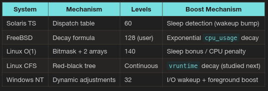
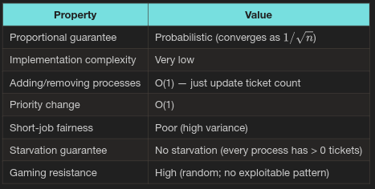
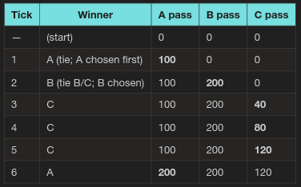

We've seen some [basic scheduling policies](./Virtualization.md#Scheduling), but they relied on extremely unrealistic assumptions. We'll now look into some more practical scheduling policies.

# Multi-Level Feedback Queue

By understanding if a job is interactive or CPU-bound, we can manage its priority to optimize jobs.

MLFQ utilizes *multiple* queues: long jobs start in the highest priority and gradually get moved down to the lowest priority as they run. The different priority levels use different scheduling policies: short timeslice RRs for the highest priorities, then timeslice RR, and FIFO for the lowest priorities. Jobs also periodically get a boost in priority to make sure they don't get stuck waiting for newer jobs.

## Rules

MLFQ's behaviour is based on these 5 rules:
1. If Prio(A) > Prio(B): A runs
2. If Prio(A) = Prio(B): A and B run in RR
3. New jobs get max priority
4. Once a job spends enough time in a priority level it gets deranked
    To avoid gaming the scheduler for more CPU time, usage is tracked per UID, not per process. This prevents forking before time allotment expires to get more CPU time.
5. *All* jobs get moved to top priority periodically

Real OSes have varying amounts of queues, from < 8 to > 100.

## MLFQ in Real Systems

### BSD

BSD uses a range of priorities from 0 to 255, with a lower number meaning higher priority. Every second each job's priority gets recalculated based on a base value + half of its recent CPU usage time.

### Linux

Before 2007, Linux used the *O(1) Scheduler*, which was an implementation of MLFQ.

It had 140 priority levels, with lower meaning higher priority again. It gets its name due to the algorithm to find the highest non-empty level having complexity $O(1)$ thanks to using a bit-mask to mark non-empty levels.

It gives more priority to processes that sleep often (assumes that they are interactive), and penalizes jobs that have high CPU usage.

### Windows NT

Windows uses 32 priority levels, with higher numbers meaning higher priority (?).

It boosts the priority of the focused window and of processes that are woken up after blocking for I/O, while penalizing processes that use up their whole timeslice.

---

MLFQ optimizes for turnaround and response times. Another metric to optimize for is *proportional fairness*: each process gets a configurable fraction of the CPU time.

An example use case for this is realtime audio (to avoid stuttering).

There are 2 main proportional-share scheduling approaches:
1. Lottery scheduling
    Randomized
2. Stride scheduling
    Deterministic

# Lottery Scheduling

With this algorithm, each job gets assigned a number of "lottery tickets". Then, at each scheduling event, the scheduler draws a random "winning number", and the process that has the ticket with that number gets the CPU.

By tuning the amount of "tickets" each job gets, we can adjust the average CPU time it'll get over long periods of time.

Each scheduling event has linear complexity, scaling with the job queue length, since we have to find the job with the winning ticket.

A problem with this approach is that for short jobs, random chance can hurt fairness.

*Summary of the properties of lottery scheduling*.

# Stride Scheduling

Each process gets 2 values: the *stride*, and the *pass*.

The stride is calculated as $\frac{W}{tickets}$, where $W$ is a large constant. The pass is initially 0.

The algorithm behaves like this:
1. Run the process with the lowest pass
2. Increase the selected process' pass by its stride

This way, processes with a large share of tickets will have a lower stride, which means a lower increase in pass, leading to more CPU time since the smallest pass gets the CPU.

Here is an example with the following values: $W= 10000; \text{tickets: } A= 100, B= 50, C= 250$

Stride bounds the maximum deviation between target and actual CPU time much more tightly than lottery scheduling.

To prevent newly added processes from monopolizing the CPU until it catches up with other processes' pass values, new jobs get assigned as pass value the lowest minimum pass value of currently active jobs.

# Linux Completely Fair Scheduler (CFS)

The O(1) scheduler had some issues:
1. The bonus/penalty system was hard to balance and unstable under certain workloads
2. At scale, rounding errors lowered fairness

CFS *does not use priority queues*. Instead, it models a perfectly fair CPU where every process runs simultaneously and gets exactly $1/n$ CPU speed.

It does this by tracking every process' CPU time (`vruntime` counter) and always scheduling the process that is furthest behind.

## `vruntime`

The value that tracks a process' runtime is its `vruntime`, measured in nanoseconds. A process' `vruntime` counter gets incremented like this:
$$
\text{vruntime} += \Delta t\cdot\frac{W_0}{w_i}
$$
Where $\Delta t$ is the time the process ran, $W_0$ is the baseline process weight (weight of a process with "nice" value = 0; equal to 1024), and $w_i$ is the weight of the process.

In this way, a process with lower nice *appears to run slower*, and as such gets scheduled longer.

> [!NOTE]
> Each process has a *weight*, which is inversely proportional to its *niceness*. The relationship between niceness and weight is stored in a pre-computed table.

CFS stores active jobs in a self-balancing red-black tree, keyed by `vruntime` (basically it has similar tree depth for all paths). Linux then caches the pointer to the leftmost node, making looking up the next process $O(1)$.

Like stride scheduling, CFS intializes new process' `vruntime` to the current minimum `vruntime` of active processes.

Slepping processes get assigned `vruntime = max(current vruntime, min_vruntime - sched_latency)` when they wake up as to not monopolize the CPU, since `vruntime` does not advance for sleeping processes.

## CFS parameters

- Target scheduling latency (`sched_latency`)
    Time within each process should run at least once
- Minimum granularity (`sched_min_granularity`)
    Minimum timeslice; to prevent excessive time spent context switching
