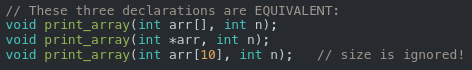
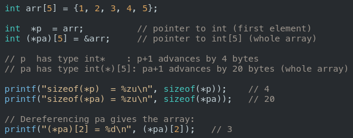
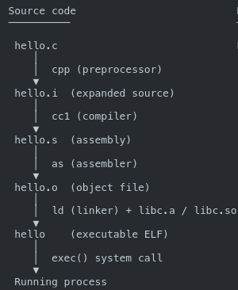
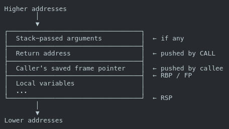
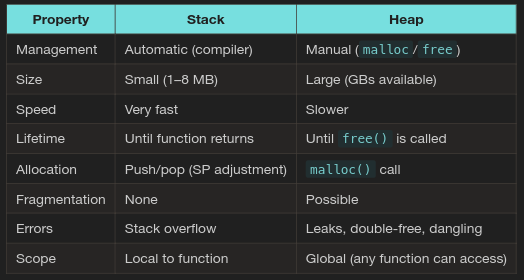
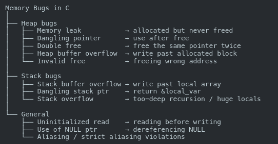
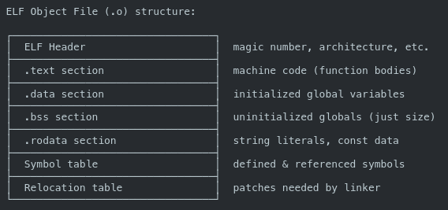
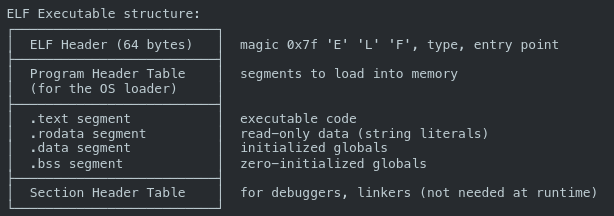
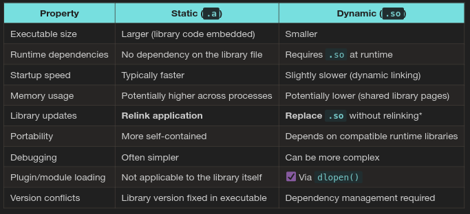

C is still the primary language used for systems programming.

# C's Memory Model


# Variables

> A variable is a named region of memory that holds value of a certain type.

A variable's *declaration* and *definition* can be decoupled. Usually you always want to initialized declared variables.

Variables are not accessible outside the scope they were defined in. A variable's scope determines the data section it'll be stored in (`.data`, `.bss`...)

## Variable keywords

### `static`

In C, the `static` keyword has 2 functions:
- Inside a scope it defines a variable that is initialized *once* at program start, it doesn't get re-initialized every time the function gets called
- Before a global declaration it defines a variable or function that is only visible inside the file

### `register`

`register` asks the compiler to store this variable in a CPU register. This could be ignored.

### `volatile`

`volatile` tells the compiler to never use the cached value for this variable

## Shadowing

Variables can be redefined inside a more specific scope. The variable will have the new value inside that scope, but keeps its value outside of it.

## Types


> [!WARNING]
> Signed overflow is undefined behaviour in C.

# Arrays

> Arrays are contiguous (in virtual memory) sequences of elements of the same type.

Arrays have a fixed size.

Arrays can be initialized in multiple ways:


When you initialize the array, the variable will contain *the address of the first element of the array*.

> [!NOTE]
> 2d arrays are stored linearly in memory, row by row.

## VLAs

You can declare arrays with a value that is only known at runtime. This is usually a bad idea, it's better to use `malloc` for large arrays.

## Array Decay

When passing arrays to functions, they *decay* to just a pointer to their first element. The function will not know the size of the array. This applies even if you specify an array in the function declaration's arguments:


This means you *always* have to pass the size of the array if you need to iterate it.

> [!WARNING]
> If you try to use `sizeof` in a function that takes an array, you'll get the size of *the pointer*, not of the array!
>
> `sizeof(array)` only works if the array was defined in scope.

# Strings

Strings in C are just arrays of characters with a *null terminator* byte at the end.

String literals are stored in the binary as **read-only** data (section `.rodata`). If you want a mutable string you have to declare it as an array: `char[] mystring`.

## String functions

Useful functions (in `string.h`):
- `strcpy` and `strncpy`
- `strlen`
- `strcmp`
    Can't do `a == b` since that compares pointers
- `sprintf` and `snprintf`

> [!WARNING]
> `strcpy` does no bounds checking when copying. `strncpy` is a safer alternative. `strncpy` doesn't add the null terminator to the end of the string, you have to add it yourself (does it?).

# Pointers

> Pointer variables are variables (with an address themselves) that contain an address to another variable.

Pointers allow functions to modify variables defined in scopes outside their own, dynamic memory allocation, complex data structures, and much more.

## Declaring

```c
int  i; // integer
int *i; // pointer to integer
int *i, x; // pointer to integer and integer!
int *i, *x; // pointers to integers
```

To get the address of a variable, we use the "address-of" operator `&`.

> [!NOTE]
> It's good practice to cast pointers to `(void*)` when printing.

To follow a pointer to get at the underlying data, we use the dereference operator `*`.


*Usage of "address-of" and dereference operators*.

By dereferencing pointers, we can change variables indirectly.

## Null pointer

`NULL` is a constant that contains the address to nothing (`0x0`).

Dereferencing the null pointer is *undefined behaviour*, so it's good practice to always check that a pointer is not null when dereferencing it.

## `void*`

`void*` variables are generic pointers: they accept all pointer types. Generic pointers can't be dereferenced, so they must always be cast before dereferencing.

## `const` and pointers

`const` qualifies a variable as constant. When used when declaring pointer variables it can either mean "pointer to constant variable" or "constant pointer to variable":


## Pointer Arithmetic

Arithmetic operations on pointers return pointers. Adding/subtracting from a pointer returns an address offset by the specified amount *times the size of the type the pointer is pointing to*:


Subtracting pointers of the same type gives the number of elements between them.

Pointer arithmetic is very useful in C since arrays decay to pointers. For example, indexing an array is just syntax sugar for pointer arithmetic: `arr[i] == *(arr + i)`. (funny: `i[arr] == arr[i]`)

> [!WARNING]
> `&arr` points to *the whole array*, so `&arr + 1` returns a pointer *to the first byte after the array:



# Memory Safety

Manual memory management is very powerful, but can also cause a lot of bugs if you aren't careful
- ### Dangling pointers
    A dangling pointer is a pointer to invalid memory. These can be created when, for example, trying to return a pointer to a local variable from a function or freeing a malloc'd pointer.
    
- ### Wild pointers
    Wild pointers are uninitialized pointer variables. Trying to dereference a wild pointer is undefined behaviour.
- ### Buffer overflows
- ### Uninitialized variables
    Reading uninitialized variables is also undefined behaviour. It's good practice to always 0- or null-initialize variables.

There are some tools to try to find issues with memory, like Valgrind (checks for memory leaks) and AddressSanitizer (`-fsanitize` in gcc; catches various memory-related issues).

# From code to executable

C source code goes through various steps before being turned into an executable:


First, the preprocessor expands macros and defines into their actual values. Then the compiler turns the preprocessed source code into assembly, which gets assembled into an object file. This is then linked with potentially other files into the final executable.

# The stack

The stack is the region of memory that holds local variables, function parameters (if they can't be stored in registers), return addresses, saved registers, and return values. It starts high in memory and grows towards lower addresses (on x86), the reverse of the heap.

Every time a function gets called, a new *stack frame* (record di attivazione) is created. Once the function returns, its stack frame gets deallocated. The base of the current stack frame is saved in a register (`rbp`; frame pointer. Points to the address where local variables will start getting pushed), and so is the top of the stack (`rsp`; stack pointer).

Usually the stack has a fixed size based on the OS (8mb on modern linux systems), and modifying it is very fast since you just have to move the stack pointer.


*Diagram showing the layout of a stack frame. When a function is called its stack frame will contain (optionally) the function arguments, the return address of the function, the pointer to the calling function's stack frame's base (its frame pointer), and local variables.*

## Function call steps

1. Store arguments in registers or stack
2. Push ret address to stack
3. Push current base pointer to stack
4. Jump to first function instruction
5. Set new base pointer
6. Execute function, potentially allocating on the stack
7. Set the stack pointer to the base pointer
8. Restore caller base pointer
9. Execute `ret`, popping the return address from the stack

## Stack registers

- `rsp`
    Points to top of stack
- `rbp`
    Points to base of current stack frame

# The Heap

> The heap is a region of memory for **manual**, *dynamic* allocation; for memory whose size is unknown at compile-time.



## `malloc`

To allocate on the heap, you use the `malloc(n)` syscall. `malloc` takes allocates `n` bytes on the heap, returning a `void*` to the allocated memory. After using `malloc`'d memory, the allocated memory must be *manually* freed using `free`. It is also good practice to `NULL` the free'd pointer, to avoid unintended behavior.

While returning a pointer to stack memory causes undefined behavior, you can safely return heap pointers from functions. This is what lets you use functions with complicated data structures.

### Variants

- `calloc(n, size)`
    Allocates `n` *0-initialized* elements of `size` bytes
- `realloc(ptr, new_size)`
    Resizes previously allocated memory. It allocates `new_size` bytes and copies the data pointed to by `ptr` into the new allocation.

### Fragmentation

If making lots of allocations, the heap could start to get *fragmented*: there could be enough space to allocate the requested bytes, but not contigously. This will cause `malloc` to fail (it returns `NULL` if it fails).

# Memory bugs



# C Preprocessor

Preprocessing is the first step in compiling a C program. The preprocessor takes the initial C source file and expands some special keywords, like:
- `#include`
- `#define`
- `#ifdef/ifndef`

It also removes comments and adds line numbers (?)

## `#include`

The `#include` directive tells the preprocessor to insert the *entire text* of the specified file. This is usually used for header files to add external libraries to your program.

## `#define`

The `#define` directive tells the preprocessor to replace all instances of a word with the supplied value. You can also use `#define` to create function-like *macros*.

# Compilation

You can pass multiple files to the compiler. Every `.c` file passed is compiled independently as a *translation unit*. Every translation unit can only see the contents of the headers passed to the compiler, not the contents of other `.c` files.

`.c` files get compiled down to `.s` *assembly* files, differing based on the target architecture. It might be useful to inspect the generated assembly to check if certain operations are atomic or not, for concurrency purposes.

The compiler also optimizes the source code. This can be controlled with compiler flags.

## Assembly

Assembly code is turned into a `.o` object file by the *assembler*.


# Linking

The final step of compilation is *linking*. In this step *the linker* (`ld` on linux) turns multiple different object files into a single executable.

One of the things the linker does is *symbol resolution*. It looks inside the object files, finds externally defined functions and variables, and links them to their implementations. It does this by building a global *symbol table*.

## ELF format

The linux executable format is called *ELF*, or *Executable and Linkable Format*.


## Headers vs Source

There are 2 types of C code files: headers, with the `.h` extension, and source, with the `.c` extension.

Header files are where symbols are *defined*, source files are where they are *implemented*. Header files can be seen as the *interface* for your program, since they can be included by files other than their implementation.

## Static vs Dynamic linking

There are 2 ways of using external code: *static* linking and *dynamic* linking.

### Static

*Static libraries*, with the `.a` extension, are just collections of object files. When linked with an executable, the linker looks inside the archive file and extracts the object files needed for the final executable, including them into the binary. The `.a` file then is not needed for program execution.

### Dynamic

*Shared libraries*, with the `.so` (`.dll` on Windows) extension, are loaded *at runtime*, and are **shared** by multiple processes. This means that the linked library's code doesn't have to be included into the executable, but can be accessed from the singular shared copy.


*Trade-offs of the different linking types.*
