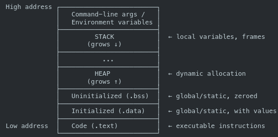
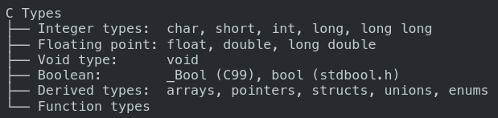
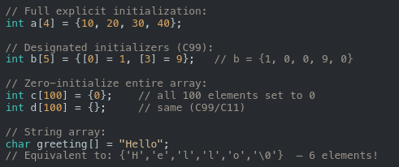
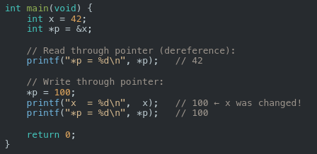
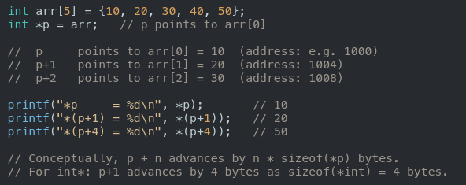
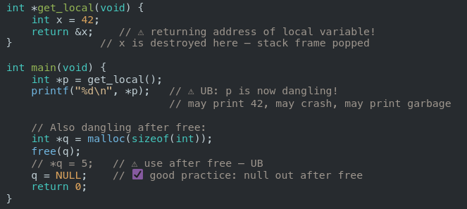

C is still the primary language used for systems programming.

# C's Memory Model



# Variables

> A variable is a named region of memory that holds value of a certain type.

A variable's *declaration* and *definition* can be decoupled. Usually you always want to initialized declared variables.

Variables are not accessible outside the scope they were defined in. A variable's scope determines the data section it'll be stored in (`.data`, `.bss`...)

## Variable keywords

### `static`

In C, the `static` keyword has 2 functions:
- Inside a scope it defines a variable that is initialized *once* at program start, it doesn't get re-initialized every time the function gets called
- Before a global declaration it defines a variable or function that is only visible inside the file

### `register`

`register` asks the compiler to store this variable in a CPU register. This could be ignored.

### `volatile`

`volatile` tells the compiler to never use the cached value for this variable

## Shadowing

Variables can be redefined inside a more specific scope. The variable will have the new value inside that scope, but keeps its value outside of it.

## Types



> [!WARNING]
> Signed overflow is undefined behaviour in C.

# Arrays

> Arrays are contiguous (in virtual memory) sequences of elements of the same type.

Arrays have a fixed size.

Arrays can be initialized in multiple ways:


When you initialize the array, the variable will contain *the address of the first element of the array*.

> [!NOTE]
> 2d arrays are stored linearly in memory, row by row.

## VLAs

You can declare arrays with a value that is only known at runtime. This is usually a bad idea, it's better to use `malloc` for large arrays.

## Array Decay

When passing arrays to functions, they *decay* to just a pointer to their first element. The function will not know the size of the array. This applies even if you specify an array in the function declaration's arguments:


This means you *always* have to pass the size of the array if you need to iterate it.

> [!WARNING]
> If you try to use `sizeof` in a function that takes an array, you'll get the size of *the pointer*, not of the array!
>
> `sizeof(array)` only works if the array was defined in scope.

# Strings

Strings in C are just arrays of characters with a *null terminator* byte at the end.

String literals are stored in the binary as **read-only** data (section `.rodata`). If you want a mutable string you have to declare it as an array: `char[] mystring`.

## String functions

Useful functions (in `string.h`):
- `strcpy` and `strncpy`
- `strlen`
- `strcmp`
    Can't do `a == b` since that compares pointers
- `sprintf` and `snprintf`

> [!WARNING]
> `strcpy` does no bounds checking when copying. `strncpy` is a safer alternative. `strncpy` doesn't add the null terminator to the end of the string, you have to add it yourself (does it?).

# Pointers

> Pointer variables are variables (with an address themselves) that contain an address to another variable.

Pointers allow functions to modify variables defined in scopes outside their own, dynamic memory allocation, complex data structures, and much more.

## Declaring

```c
int  i; // integer
int *i; // pointer to integer
int *i, x; // pointer to integer and integer!
int *i, *x; // pointers to integers
```

To get the address of a variable, we use the "address-of" operator `&`.

> [!NOTE]
> It's good practice to cast pointers to `(void*)` when printing.

To follow a pointer to get at the underlying data, we use the dereference operator `*`.


*Usage of "address-of" and dereference operators*.

By dereferencing pointers, we can change variables indirectly.

## Null pointer

`NULL` is a constant that contains the address to nothing (`0x0`).

Dereferencing the null pointer is *undefined behaviour*, so it's good practice to always check that a pointer is not null when dereferencing it.

## `void*`

`void*` variables are generic pointers: they accept all pointer types. Generic pointers can't be dereferenced, so they must always be cast before dereferencing.

## `const` and pointers

`const` qualifies a variable as constant. When used when declaring pointer variables it can either mean "pointer to constant variable" or "constant pointer to variable":


## Pointer Arithmetic

Arithmetic operations on pointers return pointers. Adding/subtracting from a pointer returns an address offset by the specified amount *times the size of the type the pointer is pointing to*:


Subtracting pointers of the same type gives the number of elements between them.

Pointer arithmetic is very useful in C since arrays decay to pointers. For example, indexing an array is just syntax sugar for pointer arithmetic: `arr[i] == *(arr + i)`. (funny: `i[arr] == arr[i]`)

> [!WARNING]
> `&arr` points to *the whole array*, so `&arr + 1` returns a pointer *to the first byte after the array:


# Memory Safety

Manual memory management is very powerful, but can also cause a lot of bugs if you aren't careful
- ### Dangling pointers
    A dangling pointer is a pointer to invalid memory. These can be created when, for example, trying to return a pointer to a local variable from a function or freeing a malloc'd pointer.
    
- ### Wild pointers
    Wild pointers are uninitialized pointer variables. Trying to dereference a wild pointer is undefined behaviour.
- ### Buffer overflows
- ### Uninitialized variables
    Reading uninitialized variables is also undefined behaviour. It's good practice to always 0- or null-initialize variables.

There are some tools to try to find issues with memory, like Valgrind (checks for memory leaks) and AddressSanitizer (`-fsanitize` in gcc; catches various memory-related issues).
