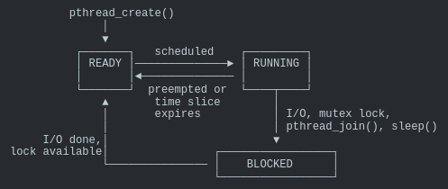
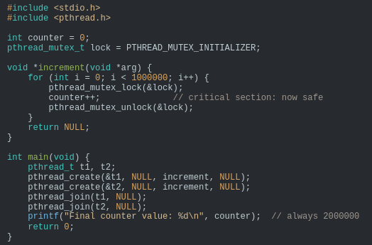

A single executable can have multiple *threads* of execution that run "at the same time".

When we consider threads, the minimum schedulable unit is no longer the process, but the thread.

# Threads

Threads let programs split work across cores, letting them run multiple different tasks at the same time. An example is having a function that blocks on I/O while another function does work.

Multi-threading can be useful even on single-core CPUs for certain programs (when doing I/O). It is not useful on single-core architectures for programs that never yield the CPU.

## Threads vs. Processes

A program could simply spawn a child process instead of using threads. But this has 2 main disadvantages:
1. Creating processes is more expensive
    Each process needs its own PCB and address space...
2. Threads *share an address space*, while processes do not.

With threads, there's no need to use extenral memory sharing methods like pipes or sockets.

*Differences between processes and threads.*

Having this sharing of resources also makes context switching betweens threads of the same process way more efficient.

> ![NOTE]
> Each thread gets a fixed amount of memory allocated for its (private) stack

## Thread Control Block

Threads still need to keep some data about its state of execution like its registers. This data is stored in the *thread control block* (TCB).

Some of the data stored in the TCB:
- PC
- Registers
- Stack pointer
- Thread ID
- Thread state (running/blocked...)
- Reference to parent process' PCB

*Lifecycle of a thread.*

## Threading API

Defined (for C) in `pthread.h`.

### Creating a thread

The function for calling a thread is `pthread_create()`.

*Arguments for `pthread_create`.*

The thread executes the function passed to it as soon as it is scheduled by the scheduler.

Once a thread is spawned, we *cannot* know for certain whether the thread or the spawning function will execute first: it is up to the scheduler. So if a function spawns a thread that prints to stdout and then also prints to stdout, the order of the outputs is *undefined*.

### Waiting for a thread

`phtread_join(tid thread, void **retval)` lets a thread block until the specified thread returns (like `waitpid()` for processes).

The thread can return a value, which will be written to `retval`.

> [!WARNING]
> Careful passing arguments to threads: the arguments must not change before the thread starts executing.

# Synchronization

Consider this example:

The expected value of `counter` at the end of `main` is 2,000,000. But the value will (most of the time) be *less*: the `++` operator needs to first load the value of `counter`, perform an addition, and then write the new value back to the variable. But the thread may be pre-empted at any point in between those steps, causing a desync between the actual value of the variable and the value in the thread's registers; this operation is not **atomic**.

*Why the example fails*.

This kind of error is called a *race condition*.

> A *race condition* occurs when a program has non-deterministic behaviour caused by timing differences in thread scheduling.
> Race conditions are often also hard to debug, since adding prints, using a debugger, or compiler optimizations could prevent them from happening.
> Race conditions are a big security risk.

## Atomic operations

> An operation is *atomic* if it appears to execute as a single step, impossible to observe before it is completed.

> A *critical section* of a program is a region of code that accesses shared data, and so must execute atomically in respect to other threads.

## Proper access to critical sections

To avoid race conditions, we can impose a protocol for every thread that accesses shared data:
1. Request permission to the critical section
2. Access shared data
3. Signal that the thread is done accessing the critical section
4. Execute non-critical code

If followed correctly, this protocol guarantees *mutual exclusion* between threads.

### Locks

The main abstraction for avoiding overlaps in the execution of critical sections is the *lock*.

The lock defines 2 operations:
- `lock()`
    If the lock is free, acquire it. If the lock is held, wait until the lock is free, then acquire it.
- `unlock()`
    Release the lock, letting 1 waiting acquire it.

> [!NOTE]
> How a thread waits for a lock is defined by the implementation. The ideal is for the thread to sleep while waiting and getting woken up when the lock is released.

### Mutex API

Defined in `pthread.h`.

The POSIX API for locks uses the `pthread_mutex_t` type.

A mutex must first be initialized via `pthread_mutex_init(*pthread_mutex_t, *attr)`. It can then be locked with `pthread_mutex_lock(*mutex)` and unlocked with `pthread_mutex_unlock(*mutex)`. When done with the mutex, it must be cleaned up with `pthread_mutex_destroy(*mutex)`. There is also a non-blocking version of the lock function.

*Corrected example using a mutex.*
