A single executable can have multiple *threads* of execution that run "at the same time".

When we consider threads, the minimum schedulable unit is no longer the process, but the thread.

# Threads

Threads let programs split work across cores, letting them run multiple different tasks at the same time. An example is having a function that blocks on I/O while another function does work.

Multi-threading can be useful even on single-core CPUs for certain programs (when doing I/O). It is not useful on single-core architectures for programs that never yield the CPU.

## Threads vs. Processes

A program could simply spawn a child process instead of using threads. But this has 2 main disadvantages:
1. Creating processes is more expensive
    Each process needs its own PCB and address space...
2. Threads *share an address space*, while processes do not.

With threads, there's no need to use extenral memory sharing methods like pipes or sockets.

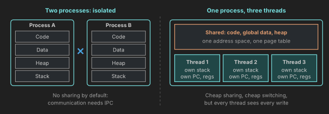
*Differences between processes and threads.*

Having this sharing of resources also makes context switching betweens threads of the same process way more efficient.

> ![NOTE]
> Each thread gets a fixed amount of memory allocated for its (private) stack

## Thread Control Block

Threads still need to keep some data about its state of execution like its registers. This data is stored in the *thread control block* (TCB).

Some of the data stored in the TCB:
- PC
- Registers
- Stack pointer
- Thread ID
- Thread state (running/blocked...)
- Reference to parent process' PCB


*Lifecycle of a thread.*

## Threading API

Defined (for C) in `pthread.h`.

### Creating a thread

The function for calling a thread is `pthread_create()`.


*Arguments for `pthread_create`.*

The thread executes the function passed to it as soon as it is scheduled by the scheduler.

Once a thread is spawned, we *cannot* know for certain whether the thread or the spawning function will execute first: it is up to the scheduler. So if a function spawns a thread that prints to stdout and then also prints to stdout, the order of the outputs is *undefined*.

### Waiting for a thread

`phtread_join(tid thread, void **retval)` lets a thread block until the specified thread returns (like `waitpid()` for processes).

The thread can return a value, which will be written to `retval`.

> [!WARNING]
> Careful passing arguments to threads: the arguments must not change before the thread starts executing.

# Synchronization

Consider this example:
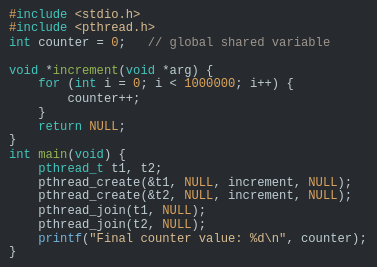
The expected value of `counter` at the end of `main` is 2,000,000. But the value will (most of the time) be *less*: the `++` operator needs to first load the value of `counter`, perform an addition, and then write the new value back to the variable. But the thread may be pre-empted at any point in between those steps, causing a desync between the actual value of the variable and the value in the thread's registers; this operation is not **atomic**.

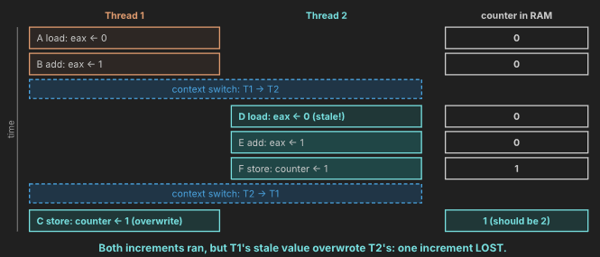
*Why the example fails*.

This kind of error is called a *race condition*.

> A *race condition* occurs when a program has non-deterministic behaviour caused by timing differences in thread scheduling.
> Race conditions are often also hard to debug, since adding prints, using a debugger, or compiler optimizations could prevent them from happening.
> Race conditions are a big security risk.

## Atomic operations

> An operation is *atomic* if it appears to execute as a single step, impossible to observe before it is completed.

> A *critical section* of a program is a region of code that accesses shared data, and so must execute atomically in respect to other threads.

## Proper access to critical sections

To avoid race conditions, we can impose a protocol for every thread that accesses shared data:
1. Request permission to the critical section
2. Access shared data
3. Signal that the thread is done accessing the critical section
4. Execute non-critical code

If followed correctly, this protocol guarantees *mutual exclusion* between threads.

### Locks

The main abstraction for avoiding overlaps in the execution of critical sections is the *lock*.

The lock defines 2 operations:
- `lock()`
    If the lock is free, acquire it. If the lock is held, wait until the lock is free, then acquire it.
- `unlock()`
    Release the lock, letting 1 waiting acquire it.

> [!NOTE]
> How a thread waits for a lock is defined by the implementation. The ideal is for the thread to sleep while waiting and getting woken up when the lock is released.

### Mutex API

Defined in `pthread.h`.

The POSIX API for locks uses the `pthread_mutex_t` type.

A mutex must first be initialized via `pthread_mutex_init(*pthread_mutex_t, *attr)`. It can then be locked with `pthread_mutex_lock(*mutex)` and unlocked with `pthread_mutex_unlock(*mutex)`. When done with the mutex, it must be cleaned up with `pthread_mutex_destroy(*mutex)`. There is also a non-blocking version of the lock function.


*Corrected example using a mutex.*

## How to mutex

A mutex needs to satisfy 3 conditions:
1. Correctness
    Only 1 thread can have the lock, and if the lock is requested while free it gets taken by the requestor
2. Fairness
    No thread is starved of the lock
3. Performance

The simplest implementation of a mutex is simply disabling interrupts until the lock is released, since preemption happens when the timer interrupt goes off. But this has problems:
- Disabling/enabling interrupts is a trusted instruction
- Interrupts will only be disabled on the core that executed the instruction
- Loss of information about other interrupts for the duration of the lock

A naive software approach is having a flag that gets set when the lock is taken.
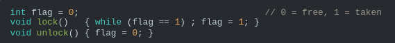
But this is not an atomic operation: the thread may be preempted between checking and setting the flag, causing multiple threads to access the critical section.

We could try with other software only approaches, but they are all insufficient. We need **hardware support**, in the form of specfific *atomic instructions*.

## Atomic primitives

Modern hardware provides some atomic instructions that can be used to create our mutex.

### Test-and-Set (`xchg` on x86)

> Always write 1 to the variable and return the old value.

So if the returned value is 1, the lock is held and the thread must try again. Otherwise, the lock is acquired.

A busy-waiting implementation using this primitive could look like this:
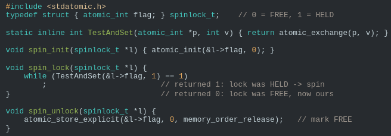
*"Spinlock" implementation; busy waits while the lock is held.*

This implementation, while correct, if unfair since scheduling order decides who gets the lock, and is obviously wasteful since threads must busy wait.

### Compare-and-Swap (`cmpxchg`)

> Write the new value if the old value matches an expected value, otherwise do nothing. Returns success or failure

This primitive is a more general version of TAS, since that can be derived from CAS.

CAS can modify a variable atomically arbitrarily, instead of just flipping it.

Implementing a mutex with this primitive still doesn't fix the unfairness and performance problems.

### Fetch-and-Add (`lock xadd`)

> Add a value and return the old value

To resolve the unfairness problem, we can assign each attempted lock a number and serve the threads in order of arrival.

In practice, every lock call gets a *ticket*, computed by calling FAA on a shared `ticket` variable, incrementing it by 1. Then the thread waits until another shared `turn` variable, increased when unlock is called, is equal to the ticket.
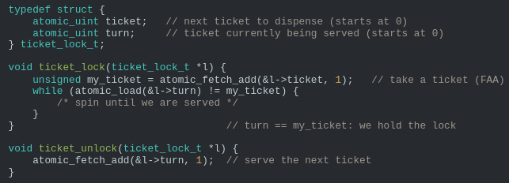
This approach emulates a FIFO queue, achieving fairness, but still requires busy waiting.

## Sleeping locks

With ticket locks we achieved fairness. Now let's see how we can create a lock that does not necessitate busy waiting.

To achieve this, instead of busy looping on a held lock, we can sleep until the lock is released.

This requires way less CPU while waiting for the lock (just the overhead of going to sleep), but also adds overhead (cost of waking up) to acquiring the lock. If the critical section is short, a spinlock may be worth over a sleeping lock.

> [!NOTE]
> A thread going from executing to waiting for a lock is called *parking* the thread. A thread being woken up to acquire the lock is *unparked*.

In practice, this means that mutex structs must also, in addition to whether the lock is held or free, hold the queue of threads waiting to acquire the lock, and also a guard that is accessed atomically before checking the other mutex fields.

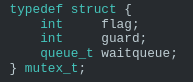

A lock and unlock implementation could look like this:
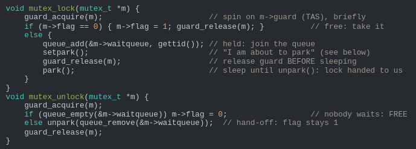
*`setpark()` is necessary since a thread may be preempted between releasing the guard and parking, leading to losing the wakeup signal if the lock is released while the thread is waiting. `park()` is implemented to do nothing if the thread is unparked between `setpark()` and `park()`.

### `futex`

Linux has a special "fast" mutex called *futex*, which avoids syscalls if the lock is free.

### Two-phase locks

To mitigate the spinlock/sleep lock traedoff, we can use a mutex with 2 phases: there is first a short busy-waiting phase before the thread parks, which allows lower overhead if the critical section is short and the thread acquires the lock quickly, while still saving CPU time on long critical sections.

# Thread communication

Sometimes the basic atomic primitives aren't enough*, like if a thread needs to wait until another thread finished some operation before proceeding.

*You could use a shared flag, but then the waiting thread needs to poll the flag, wasting CPU time.

Currently, we have `pthread_join` for checking if a thread has completed, but we want something to check for arbitrary conditions.

We want to be able to sleep until a certain *condition variable* becomes true, then be woken by the OS.

## Condition Variable

> A *condition variable* is a synchronization primitive that allows a thread to sleep until a condition is true, letting another thread signal when that condition becomes true.

A condition variable has a condition, which is a predicate referring to a shared variable (in a mutex), and a queue of threads that are waiting for the condition to become true.

Usage:
- Thread calls `wait()`, sleeping until woken
- Another thread calls `signal()`
- The sleeping thread wakes up and checks the condition

`wait()` takes 2 arguments: the condition variable (queue), and a mutex.

The caller, which must be holding `m`, releases `m` and gets put to sleep in the queue (this is done atomically!), `cv`. When another thread calls `signal(cv)` the waiting thread is woken and re-acuquires `m`.

The signaller wakes *one* thread on `cv`, then keeps running *while holding `m`*. The woken thread will get to run when the signaller releases `m` (and gets scheduled).

> [!NOTE]
> `wait()` must both release the lock and go to sleep *atomically*, or the signal could be lost since the waiting thread could be preempted between unlocking (and thus allowing the signalling thread to `signal`) and sleeping.
> `pthread_cond_wait()` is the POSIX API function that does this atomic operation.


*Diagram showing flow of execution with a `wait`ing and `signal`ing thread.*

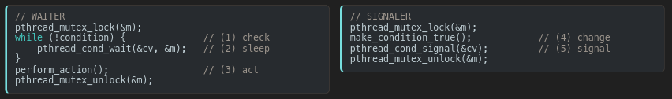
*`wait` and `signal` usage in pseudo-C.*

### POSIX condition variable API

POSIX API for condition variables:
- `PTHREAD_COND_INITIALIZER` or `phtread_cond_init(*pthread_cond_t, NULL)`
    Initialize a condition variable
- `pthread_cond_wait(cv, mutex)`
    Sleep on the cv, must be holding the mutex
- `pthread_cond_signal(cv)`
    Wake a waiting thread
- `pthread_cond_broadcast(cv)`
    Wake all waiting threads
- `pthread_cond_destory(cv)`
    Deallocate the condition variable

## Signal use cases

### Producer-consumer

A *producer* thread generates items, putting them in a fixed-size shared buffer. A *consumer* thread takes items out of the shared buffer. Producers wait if the buffer is full, consumers wait if the buffer is empty. Only 1 thread touches the buffer at a time.

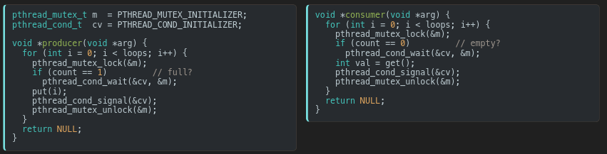
*Single slot buffer, 1 producer and cosumer. With multiple consumers we need `while`s instead of `if`s, and separate queues for producers and consumers.*

For a fixed size buffer of arbitrary length, we just have to add to the buffer by wrapping around.
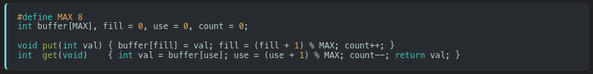


Basically, there's a different condition variable for every possible state (buffer full/buffer empty) (see [example](./Concurrency/thread.c)).

## Condition variable semantics

There are 2 ways to design a `signal` function:

- Hoare semantics
    Signalling thread immediately gives the mutex to the waiting thread, then sleeps as soon as the waiting thread starts executing; the condition is guaranteed true when it does so
- Mesa semantics (what the POSIX API uses)
    The signalling thread keeps the mutex after signalling, the waiting thread could run later; the condition needs to be checked again once it starts running

---

Sometimes `signal()` is not enough, for example when multiple threads are waiting on a condition but for slightly different reasons, for example if they need a shared number to be in a certain range.

Waking only one thread would leave it up to luck if the woken thread can actually execute. We could use many different condition variables for different ranges, but this is not ideal.

The solution is `broadcast()`.

## `broadcast()`

`broadcast()` wakes every thread waiting on a given condition variable. Each thread then checks its condition based on the new value (sequentially), and the first thread that runs that meets the condition does so.

Obviously, if the number of threads that gets woken is large, this can cause a big slowdown since all threads will be trying to get the lock.

### Thread pool

Maybe look at that idk

# Semaphores

We've seen locks and condition variables as synchronization tools for mutual exclusion and ordering, respectively. We will now look at a new primitive, *semaphores*, which can be used to solve both problems.

Semaphores are kind of like a box of tickets, with threads taking from and returning tickets to the box. When the box is empty threads sleep until another thread returns a ticket.

The 2 actions defined on semaphores ar `wait` (take a ticket) and `post` (add a ticket).

Based on the initial number of tickets (the number can change over time!), a semaphore solves a different kind of problem:
- 1 ticket: Mutual exclusion
    Only 1 thread can get a ticket at a time
- 0 tickets: Ordering
    Waiting threads get to run when another thread decides to add a ticket
- N tickets: Resource pool

> [!NOTE]
> A thread does not need to be holding a ticket to `post`, any thread can `post` at any time.

> A semaphore is an integer $S\geq 0$ (following POSIX convention) plus a wait queue, modified only via 2 atomic operations (`wait` and `post`).

When a thread calls `wait` it sleeps while $S$ is 0, then decreases $S$ when it gets to run.

When a thread calls `post`, it increments $S$ by 1 and wakes a sleeper (if present).

## POSIX API

Defined in `semaphore.h`

- `sem_t`: Semaphore struct
- `sem_init(*sem, pshared, S)`
- `sem_wait(*sem)`: Wait
- `sem_post(*sem)`: Post
etc

## Ordering

Using a semaphore for ordering also solves the problem of signals being lost if no waiters were present, since `post` always increments $S$.

## Producer-consumer

To implement producer-consumer with semaphores we can use 2 semaphores, one which counts the empty slots and one that counts the filled slots. We then also use a mutex to protect the buffer and pointers to the next item to be consumed and the next slot to be filled.

```c
#define MAX 5

int buffer[MAX], fill = 0, use = 0;

sem_t empty, full, mutex;

void init(void) {
    sem_init(&empty, 0, MAX); // all MAX slots free
    sem_init(&full, 0, 0); // no items yet
    sem_init(&mutex, 0, 1); // binary: protects buffer, fill, use
}

// called while holding mutex
void put(int v) {
    buffer[fill] = v;
    fill = (fill + 1) % MAX;
}

// called while holding mutex
int get(void) {
    int v = buffer[use];
    use = (use + 1) % MAX;
    return v;
}

void *producer(void *arg) {
    for (int i = 0; i < 100; i++) {
        sem_wait(&empty); // 1. reserve a free slot (may sleep)
        sem_wait(&mutex); // 2. enter the critical section
        put(i);
        sem_post(&mutex); // 3. leave it
        sem_post(&full); // 4. one more item
    }
    return NULL;
}

void *consumer(void *arg) {
    for (int i = 0; i < 100; i++) {
        sem_wait(&full); // reserve an item (may sleep)
        sem_wait(&mutex);
        int v = get();
        sem_post(&mutex);
        sem_post(&empty); // one more free slot
        /* ... process v ... */
    }
    return NULL;
}
```

## Dining Philosophers

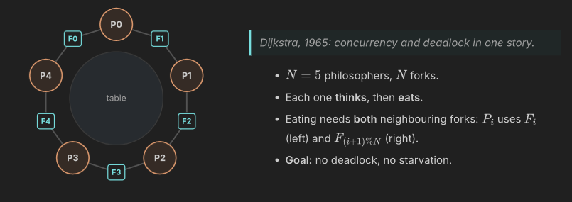

How do you get each philosopher to eat without deadlocks?

The naive approach of having a lock for each fork, then having every thread lock on both forks doesn't work: every thread could lock on the left fork and then wait forever for the other one.

A fix is breaking the symmetry by having at least one thread lock the forks in the opposite order. This way, the threads can never deadlock waiting for the other fork, but fairness is not guaranteed.

## Zemaphore

A semaphore can be implemented with a mutex, condition variable, and a value.

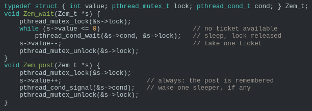

This implementation is called a *zemaphore*.

# Deadlocks

A *deadlock* occurs when a thread holding a lock waits for another lock, held by a thread waiting for the first's lock. This results in both threads waiting endlessly for the other to release the lock.

This is the problem we encountered in the dining philosophers example.

Preventing deadlocks usually means incurring some extra overhead; deciding to handle them is a trade-off.

Deadlocks are sort of invisible bugs: they don't cause crashes, they just block forever.

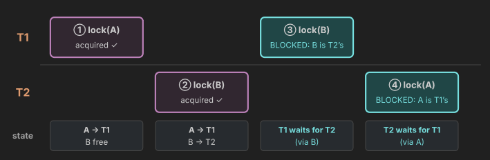
*Example execution flow of a deadlocking program.*

## Avoiding deadlocks

To catch deadlocks, we can use a *resource allocation graph*: we create a diagram which models the shared resources of the program and the threads that want to access them. Deadlocks show up as cycles in a RAG (with single-instance resources):
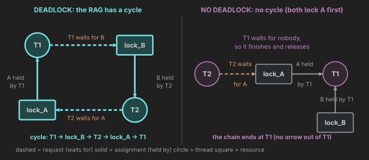

> [!NOTE]
> RAGs are graphs of a program *execution* not of the program's *code*, they are snapshots of the state of the program.
> The 2 graphs in the example above can be generated by the same code.

Cycles don't always mean deadlocks when we're working with multiple-instance resources:
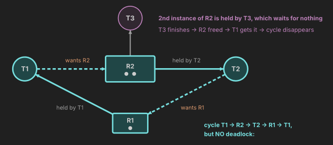

## Coffman Conditions

There are 4 conditions which must all be met for a deadlock to be possible. These are called *Coffman conditions*:
1. Mutual exclusion
    There are resources which can only be accessed under mutual exclusion. Hard to avoid when using shared resources.
2. Hold and wait
    A thread holds a resource while waiting for another. Avoidable by taking all resources at once, or none (`trylock` pattern).
3. No preemption
    The resource cannot be preempted by the OS (like locks). Avoidable by releasing resources when one is unavailable, then retrying.
4. Circular wait
    There is a cycle in which threads wait for others. Avoidable by enforcing a global lock order.

### `trylock`

Locking all resources at once or none can prevent the hold and wait condition:
```c
// Returns holding BOTH locks, or loops until it can. Never waits while holding one.
void acquire_both(pthread_mutex_t *a, pthread_mutex_t *b) {
    while (1) {
        if (pthread_mutex_trylock(a) == 0) { // got A
            if (pthread_mutex_trylock(b) == 0)
                return; // got B too: success
            pthread_mutex_unlock(a); // B busy: give A back
        }
        sched_yield(); // then retry
    }
}
```

This could cause another issue though: 2 threads could both try to get the locks but succeed in getting only one, retrying forever (this would be monumentally unlucky though). This is called a *livelock*.

### Lock ordering

To break the fourth condition, we can enforce an order in which the threads must acquire the locks. This is what making the last philosopher get the forks in the opposite order does.

## Banker's Algorithm

Coffman conditions could never actually manifest in a program, so trying to avoid them could be a waste of time.

Another way to avoid deadlocks is to guarantee that the program remains in a *safe state*: every time a thread requests a resource, we simulate what the state of the program would be if the resource was granted, and accept requests only when doing so moves the program to another safe state.

A state is *safe* when there is a possible thread ordering with which each thread gets resources it wants and can finish its work.

Consider this state, with 12 units of a resource $R$:

| Thread | Allocated | Max       | Need      |
| ------ | --------- | --------- | --------- |
|   A    |     5     |     10    |     5     |
|   B    |     2     |     4     |     2     |
|   C    |     2     |     9     |     7     |

Each thread terminates when it gets the max amount of resources, releasing the resources it was holding.

Right now there are 3 free units of $R$. This state is safe, since there's a valid ordering: $C\to B\to A$ or $C\to A\to B$.

This only works if we assume that each thread will tell us how many resources it will need in advance.

So, to tell if a state is safe:
1. Find a thread whose request can be fulfilled with the currently available resources
2. Grant the thread the requested resources; its previously allocated resources are returned
3. Repeat until all requests have been granted

If step 1. fails at any iteration, the state is not safe. Otherwise, we found a valid sequence and so the state is safe. This is known as the *Banker's Algorithm*.

This algorithm is used to determine wheter or not to grant a thread's request for resources:
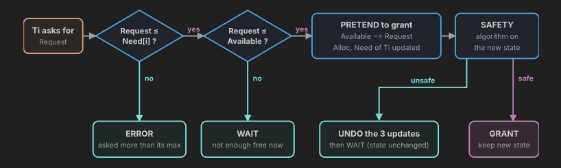
*The last 2 steps are where the algorithm is applied: first you calculate the state the program would be in if the request was granted, then you run the algorithm on that hypothetical state. If the hypothetical state is safe, you actually grant the request.*

## Recovering from deadlocks

Another approach would be to just let deadlocks happen, and recover from them when they do.

When a request blocks for too long, you could create the resource allocation graph and visit it to look for a cycle. If a cycle is found, you can choose how to handle the deadlock (terminate offending threads, deallocate resources...)

## Ignore the deadlocks lmao

In real systems, deadlocks are just ignored because of their rarity.

Deadlocks are only a problem in user-space code, since kernel code is checked extensively for bugs.

The cost of detecting them would outweigh the impact of the actual deadlocks.
