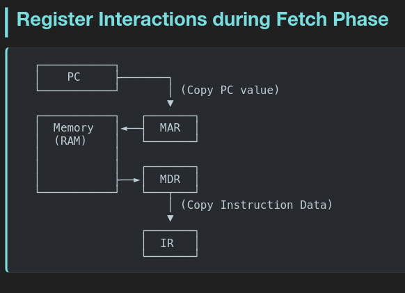
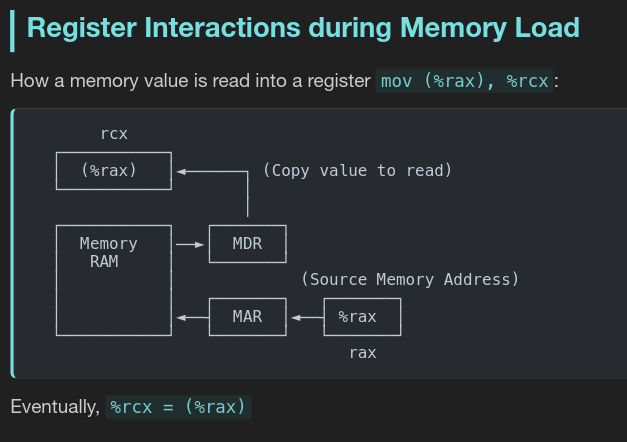
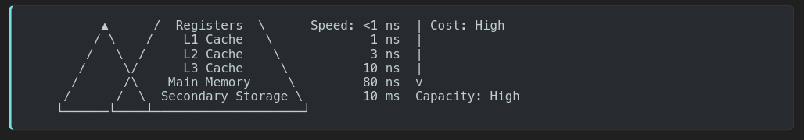
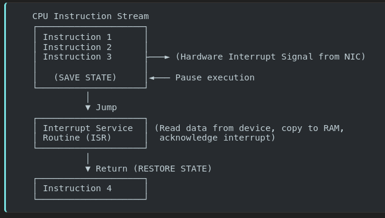

We study operating systems since they allow us to use our devices efficiently. They *abstract* hardware resources

In this first lecture we'll cover:
1. The Von Neumann Architecture
2. The CPU
3. ...

The operating system sits in the middle between applications (top level) and hardware (bottom level)
Applications communicate with the operating system as a proxy to the hardware.
    This abstraction moves the responsibility of resource management to the operating system, instead of the applications
    This way the applications can focus on their business logic

General purpose machines have some physical restrictions though: the CPU is way faster at calculating than the speed at which memory can be read; storage space scales directly with cost and inversly with size. An efficient OS is designed to minimize the impact of these limitations.

# The Von Neumann Architecture

It's the theoretical foundation for all modern general-purpose computers:
- Stored-Program concept
    Instructions and data share the same physical memory space
    Can't read code and data at the same time; causes the *von Neumann Bottleneck*
- Sequential execution
    Instructions are read one by one from memory and executed by the CPU
- Components:
    1. Processing unit
    2. Control unit
    3. Memory
    4. Mass storage (external I/O devices)
    5. Interconnection bus

### Harvard architecture

Alternative architecture; used at the lowest level (L1 cache) to optimize speed
- Instructions and data are in different spaces in memory and travel on different buses
    This allows simultaneous access to data and instructions, circumventing the von Neumann Bottleneck

## System bus

Shared set of wires that lets the different components communicate  
Divided in:
1. Address bus
    Memory addresses
2. Data bus
    Data bytes
3. Control bus
    Command signals

### The Address Bus

This part of the bus specifies a location in memory.  
Unidirectional from the CPU.  
The width of the bus determines the maximum addressable locations  
A bus of $N$ lines can address $2^N$ locations
    This is what is referred to when talking about "32-bit" or "64-bit" CPUs

### The Data Bus

The data bus transports data and instructions  
Bidirectional, can carry data from or to the CPU  
The width of the data bus determines the amount of data that can be transferred in a single clock cycle
    "Word size" refers to this

### The Control Bus

The control bus manages bus access and synchronzation  
Common signals:
- Read/Write memory
    Tells memory to place or read data to/from the bus
- Read/Write I/O
    Commands I/O devices to read or write
- Interrupt Signals
    Sent by hardware devices to notify the CPU of some event
- Clock

## The Von Neumann Bottleneck

Since instructions and data share the same bus, the CPU *cannot* read and write at the same time, so the CPU spends a lot of time waiting for data transfers  
A good operating system can mitigate this waiting by implementing techniques such as caching, paging, and intelligent scheduling

## The Instruction Cycle

The base sequence of operations for the CPU is:
1. Fetch
    Get the memory from the RAM to the CPU
2. Decode
    Parse the data into an instruction
3. Execute
    Perform the operation
4. Repeat

Every program loops this cycle during execution.

### Fetching step

1. The CPU copies the value from the *Program Counter* into the *Memory Address Register* and then into the address bus.
    The program counter is a special register that contains the address to the next instruction
2. The control unit (CU) sends a "memory read" signal on the control bus
3. Memory reads the address and places the instruction bytes into the data bus.
4. The CPU reads the instruction from the data bus into the *Instruction Register* (IR).
5. The PC is incremented to point at the next instruction.

### Decoding step

1. The CU reads the bits stored in the IR
2. It identifies the *Opcode*
3. It identifies the *Operands*
4. The CU configures internal data paths to prepare the ALU and registers for execution

### Execution step

- If the instruction is arithmetic, the ALU takes input from the registers and writes the output back
- If the operation is a load/store, the CPU reads or writes RAM using the Memory Address Register (MAR) and Memory Data Register (MDR)
- If the operation is a jump/branch, the PC is updated with the target address
    This changes the flow of execution
    So `jmp` loads an address into the PC

# The CPU

The CPU is composed of 3 main parts:
1. The *Datapath*
    It contains registers and the *Arithmetic Logic Unit(s)* to manipulate data
2. The *Control Unit* (CU)
    Coordinates fetching and decoding instructions, and it drives the datapath
3. The Internal Bus
    Paths connecting registers, ALUs, CU

## The Datapath

- ALU
    Arithmetic and bitwise operations
- General Purpose Registers (GPRs)
    Stores values

## The Control Unit

- "*Finite State Machine*", synchronized by the *system clock*
- Inputs from the *Instruction Register*, *Flags* or status registers, clock signal
- Outputs to the registers and memory I/O lines, controls the ALUs

## Registers

Fastest and smallest units of memory  
Split in *general purpose* and *control/status* registers
    General purpose registers are used by running programs
    Control/status registers are used by the CU to drive execution flow, and are only accessible from privileged actors (like the OS)

General purpose registers are named differently based on the CPU architecture

The special registers are:
- ### Program Counter/Instruction Pointer

Holds the address to the *next* instruction to execute  
Incremented automatically in the instruction cycle  
Manipulated to create branching

- ### Instruction Register

Holds the current instruction's bits

- ### Stack pointer

Holds the address to the top of the stack  
The stack is necessary to implement subroutines, function calls, local variables, return addresses

- ### MAR

Holds the address to be put on the address bus

- ### Memory Data Register (MDR)

Holds the data read from RAM or waiting to be written to RAM

- ### Flags / Program Status Register

Holds information relating to the status of the CPU and ALUs  
For example, one of the flags is 1 if the previous operation was 0
    Used for `==` operations

#### Register interactions

*Roles of registers during the fetch phase*

*Roles of registers during memory reads*

*Roles of registers during memory writes*

-----

## Instruction Pipelining

The instruction cycle is naive  
We can optimize it by parallelizing it: we don't wait for each step to finish before moving on to the next

### RISC 5-Stage Pipeline

Every instruction is separated into 5 steps:
1. Instruction fetch
2. Instruction decode
3. Execution
4. Memory access (if needed)
5. Writeback

But these steps are not always executed in sequence, they are often parallelized:  
  
*Diagram showing how the above steps are run in parallel.*

This way, in ideal conditions, the CPU is executing *1 instruction per clock cycle*.

#### Pipeline Hazards

The above diagram shows what happens only in ideal conditions.  
There are some hazards that get in the way of this ideal:
- Structural Hazards
    Instructions compete for resources (read/writing at the same time)  
    Modern CPUs solve this by using Harvard architecture at the L1 level: there's an L1 cache for instructions and one for data
- Data Hazards
    An instruction depends on a previous instruction's result
- Control Hazards
    Fetching an instruction in a branch that doesn't end up being executed  
    To circumvent this, modern CPUs try to predict if a branch will be executed based on the structure of the code or previous decisions

## Instruction Set Architectures

The ISA defines the interface between hardware and software.  
There are 2 main ISA types:
- CISC (Complex Instruction Set Computer)
    Large, rich, and variable instruction sets
    x86_64
- RISC (Reduced Instruction Set Computer)
    Small, uniform instruction sets
    ARM, RISC-V

## Multi-Core Processor Architectures

Every core in a multi-core processor is an indepentent CPU capable of running its own instruction cycle  
The OS is responsible for distributing processes across these cores

Knowing the target hardware's capabilities is fundamental for writing an efficient OS.

## CPU Performance

CPU performance is usually measured in *clock speed*
    $\frac{1}{Clock\ Period}$

## Metrics

- CPI (Cycles Per Instruction)
- IPC (Instructions Per Cycle)
Formula to calculate execution time:
    CPU Time = Instruction Count \* CPI \* Clock Cycle Time

# Memory Hierarchy

There are different types of memory

CPU speed has gotten a lot faster than DRAM speed, leading to a lot of wasted time waiting for memory writes. To mitigate this, memory is organized in a hierarchy:

*The memory hierarchy.*

At the top of the hierarchy, we have the fastest, but also smallest and most expensive memory. As we go towards the bottom, memory becomes cheaper, but larger and slower.

## RAM

There are 2 main types of RAM:
- SRAM (Static)
    Also called static ram, it's used in registers
- DRAM (Dynamic)
    "Normal" RAM

### RAM organization

Main memory is organized as a table where every RAM address represents exactly 1 byte of data (? word size?)

**Principle of Locality**: in programs, these 2 properties very often hold true
- *Temporal Locality*
    If a memory address is accessed once, it's very likely to be accessed again soon
- *Spatial Locality*
    If a memory address is accessed, it's very likely that nearby memory will also be accessed soon
These 2 principles are used by good CPU and OS architectures for optimization. A classic example is accessing arrays: when indexing an array, a chunk of the elements is loaded in the cache instead of only the requested one

## Cache architecture

The cache stores memory in blocks, called *cache lines*. Usually these are 64 bytes long. Each cache line entry contains:
- Valid bit
    Indicator to track whether the cached data is valid
- Tag bit
    Refers to the original address of the cached data
- Data block
    The data

When the CPU requests data it first checks the cache, then DRAM, then physical storage. When it finds data in the cache, that's called a *cache hit*, and the access only takes 1-2 cycles. On a cache *miss*, the time to access data in DRAM is around 100 cycles slower.

### Cache Coherency

Since every core has its own cache, a core could hold outdated values in cache if a different core modifies some value.

### Cache Write Policies

There are 2 main ways to keep RAM and the cache synchronized:
- Write-Though Policy
    Write to DRAM every time you write to cache. Negates benefits of cache for writes
- Write-Back Policy
    Only the cache is written to, then it's marked as modified and written to RAM only when the cache line gets flushed

### Cache Line Mapping Policies

Memory gets mapped to a location in cache in one of 3 main schemes:
- #### Direct Mapping

Every memory block gets a single cache slot (a slot is the address of a cache line). This policy is prone to conflicts, resulting in different memory blocks constantly evicting each other from the cache slot.

- #### Fully Associative

Any block of memory can end up in any cache slot. Though this requires searching through the cache every time we look for a cache hit. For this reason, it's only used in systems with small caches.

- #### Set Associative

"Best of both worlds"

The cache is divided in sets. Then each memory block is assigned one of these sets, data from that block can be put in any of the slots within the set. This is the most common policy in modern CPUs.

# I/O

A computer has to communicate with external devices to be useful, such as:
- Storage devices
- Network devices
- Input devices
- Sensors

All of these devices fall under the category of I/O devices.

## Controlling I/O Devices

I/O devices are managed by 2 layers: hardware and software

### Device Controller

The hardware side, it's a chip on the device that exposes a set of control registers and commands to the cpu

### Device Driver

A piece of the OS that knows how to interact with the device controller. It provides a standardized interface to the rest of the OS for the same types of devices

## Mapping Device Registers

There are 2 ways to interact with a device controller's registers:
1. Port-Mapped I/O
    Dedicated CPU instructions with a separate address space for I/O devices
2. Memory-Mapped I/O
    Reserves a range of main memory addresses for I/O device registers to be mapped onto. This way the CPU can write to IO devices directly. This is the way mostmodern CPUs handle IO.

### Device Registers

A device controller typically has 3 types of registers:
- Status register
    Read-only, indicates the state of the device
- Command register
    Write-only, the controller listens for commands written to this register
- Data register
    Read-write, stores written/read data

## CPU/IO device communication

There are 3 main communication protocols:
1. ### Programmed I/O, or polling

This is the simplest method. It generally goes like this:
- CPU sets the command on the command register
- CPU continously reads the status register, waiting for it to change from "busy". This is known as "busy-looping".
    Wastes cycles
- Read the data from the data register once it's ready

2. ### Interrupt-driven I/O

To avoid busy-looping, devices can send signals to the CPU once they are ready.
- CPU starts the operation
- CPU continues execution
- When the device is done, it'll send a signal on the *interrupt line*
- When the CPU receives the signal, it interrupts what it was doing, executes some code (the *interrupt service routine*) to handle the signal, then resumes original execution
    The problem with this system is that when a routine is interrupted, the CPU has to save the state of execution to then restore after handling the interrupt.

*Diagram showing the flow of interrupt-driven IO*

The code to be run when a signal is received is stored in the *interrupt vector table*, a table storing pointers to the functions that handle specific interrupt signals

3. ### Direct memory access

For high-volume data tranfers, both polling and interrupts are too slow. The solution is introducing a specialized component, the *Direct Memory Access controller*, to handle these operations.

When a large read is completed, the CPU requests the DMA controller to move the data directly from the device to main memory. While the DMA controller is working, the CPU is free to continue normal execution. Then the controller sends a single interrupt when it finishes transferring.
