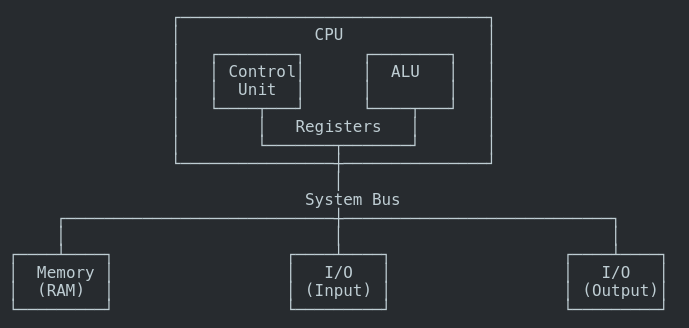
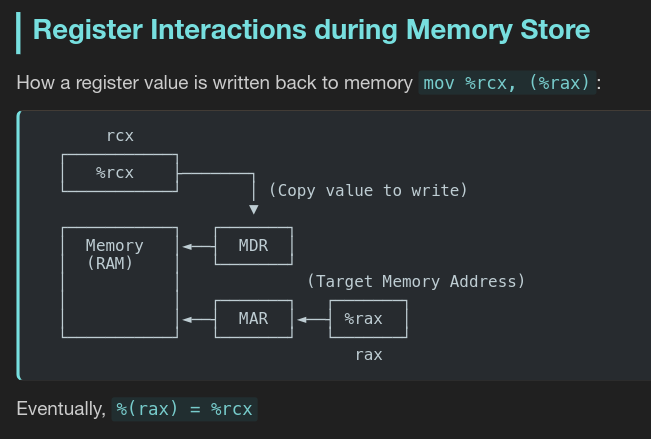
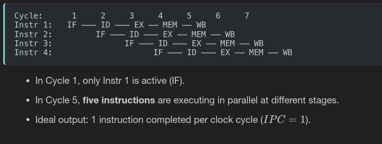

We study operating systems since they allow us to use our devices efficiently. They *abstract* hardware resources

In this first lecture we'll cover:
1. The Von Neumann Architecture
2. The CPU
3. ...

The operating system sits in the middle between applications (top level) and hardware (bottom level)
Applications communicate with the operating system as a proxy to the hardware.
    This abstraction moves the responsibility of resource management to the operating system, instead of the applications
    This way the applications can focus on their business logic

General purpose machines have some physical restrictions though: the CPU is way faster at calculating than the speed at which memory can be read; storage space scales directly with cost and inversly with size. An efficient OS is designed to minimize the impact of these limitations.

# The Von Neumann Architecture

It's the theoretical foundation for all modern general-purpose computers:
- Stored-Program concept
    Instructions and data share the same physical memory space
    Can't read code and data at the same time; causes the *von Neumann Bottleneck*
- Sequential execution
    Instructions are read one by one from memory and executed by the CPU
- Components:
    1. Processing unit
    2. Control unit
    3. Memory
    4. Mass storage (external I/O devices)
    5. Interconnection bus

### Harvard architecture

Alternative architecture; used at the lowest level (L1 cache) to optimize speed
- Instructions and data are in different spaces in memory and travel on different buses
    This allows simultaneous access to data and instructions, circumventing the von Neumann Bottleneck

## System bus

Shared set of wires that lets the different components communicate  
Divided in:
1. Address bus
    Memory addresses
2. Data bus
    Data bytes
3. Control bus
    Command signals

### The Address Bus

This part of the bus specifies a location in memory.  
Unidirectional from the CPU.  
The width of the bus determines the maximum addressable locations  
A bus of $N$ lines can address $2^N$ locations
    This is what is referred to when talking about "32-bit" or "64-bit" CPUs

### The Data Bus

The data bus transports data and instructions  
Bidirectional, can carry data from or to the CPU  
The width of the data bus determines the amount of data that can be transferred in a single clock cycle
    "Word size" refers to this

### The Control Bus

The control bus manages bus access and synchronzation  
Common signals:
- Read/Write memory
    Tells memory to place or read data to/from the bus
- Read/Write I/O
    Commands I/O devices to read or write
- Interrupt Signals
    Sent by hardware devices to notify the CPU of some event
- Clock

## The Von Neumann Bottleneck

Since instructions and data share the same bus, the CPU *cannot* read and write at the same time, so the CPU spends a lot of time waiting for data transfers  
A good operating system can mitigate this waiting by implementing techniques such as caching, paging, and intelligent scheduling

## The Instruction Cycle

The base sequence of operations for the CPU is:
1. Fetch
    Get the memory from the RAM to the CPU
2. Decode
    Parse the data into an instruction
3. Execute
    Perform the operation
4. Repeat

Every program loops this cycle during execution.

### Fetching step

1. The CPU copies the value from the *Program Counter* into the *Memory Address Register* and then into the address bus.
    The program counter is a special register that contains the address to the next instruction
2. The control unit (CU) sends a "memory read" signal on the control bus
3. Memory reads the address and places the instruction bytes into the data bus.
4. The CPU reads the instruction from the data bus into the *Instruction Register* (IR).
5. The PC is incremented to point at the next instruction.

### Decoding step

1. The CU reads the bits stored in the IR
2. It identifies the *Opcode*
3. It identifies the *Operands*
4. The CU configures internal data paths to prepare the ALU and registers for execution

### Execution step

- If the instruction is arithmetic, the ALU takes input from the registers and writes the output back
- If the operation is a load/store, the CPU reads or writes RAM using the Memory Address Register (MAR) and Memory Data Register (MDR)
- If the operation is a jump/branch, the PC is updated with the target address
    This changes the flow of execution
    So `jmp` loads an address into the PC

# The CPU

The CPU is composed of 3 main parts:
1. The *Datapath*
    It contains registers and the *Arithmetic Logic Unit(s)* to manipulate data
2. The *Control Unit* (CU)
    Coordinates fetching and decoding instructions, and it drives the datapath
3. The Internal Bus
    Paths connecting registers, ALUs, CU

## The Datapath

- ALU
    Arithmetic and bitwise operations
- General Purpose Registers (GPRs)
    Stores values

## The Control Unit

- "*Finite State Machine*", synchronized by the *system clock*
- Inputs from the *Instruction Register*, *Flags* or status registers, clock signal
- Outputs to the registers and memory I/O lines, controls the ALUs

## Registers

Fastest and smallest units of memory  
Split in *general purpose* and *control/status* registers
    General purpose registers are used by running programs
    Control/status registers are used by the CU to drive execution flow, and are only accessible from privileged actors (like the OS)

General purpose registers are named differently based on the CPU architecture

The special registers are:
- ### Program Counter/Instruction Pointer

Holds the address to the *next* instruction to execute  
Incremented automatically in the instruction cycle  
Manipulated to create branching

- ### Instruction Register

Holds the current instruction's bits

- ### Stack pointer

Holds the address to the top of the stack  
The stack is necessary to implement subroutines, function calls, local variables, return addresses

- ### MAR

Holds the address to be put on the address bus

- ### Memory Data Register (MDR)

Holds the data read from RAM or waiting to be written to RAM

- ### Flags / Program Status Register

Holds information relating to the status of the CPU and ALUs  
For example, one of the flags is 1 if the previous operation was 0
    Used for `==` operations

#### Register interactions

*Roles of registers during the fetch phase*

*Roles of registers during memory reads*

*Roles of registers during memory writes*

-----

## Instruction Pipelining

The instruction cycle is naive  
We can optimize it by parallelizing it: we don't wait for each step to finish before moving on to the next

### RISC 5-Stage Pipeline

Every instruction is separated into 5 steps:
1. Instruction fetch
2. Instruction decode
3. Execution
4. Memory access (if needed)
5. Writeback

But these steps are not always executed in sequence, they are often parallelized:  
  
*Diagram showing how the above steps are run in parallel.*

This way, in ideal conditions, the CPU is executing *1 instruction per clock cycle*.

#### Pipeline Hazards

The above diagram shows what happens only in ideal conditions.  
There are some hazards that get in the way of this ideal:
- Structural Hazards
    Instructions compete for resources (read/writing at the same time)  
    Modern CPUs solve this by using Harvard architecture at the L1 level: there's an L1 cache for instructions and one for data
- Data Hazards
    An instruction depends on a previous instruction's result
- Control Hazards
    Fetching an instruction in a branch that doesn't end up being executed  
    To circumvent this, modern CPUs try to predict if a branch will be executed based on the structure of the code or previous decisions

## Instruction Set Architectures

The ISA defines the interface between hardware and software.  
There are 2 main ISA types:
- CISC (Complex Instruction Set Computer)
    Large, rich, and variable instruction sets
    x86_64
- RISC (Reduced Instruction Set Computer)
    Small, uniform instruction sets
    ARM, RISC-V

## Multi-Core Processor Architectures

Every core in a multi-core processor is an indepentent CPU capable of running its own instruction cycle  
The OS is responsible for distributing processes across these cores

Knowing the target hardware's capabilities is fundamental for writing an efficient OS.

## CPU Performance

CPU performance is usually measured in *clock speed*
    $\frac{1}{Clock\ Period}$

## Metrics

- CPI (Cycles Per Instruction)
- IPC (Instructions Per Cycle)
Formula to calculate execution time:
    CPU Time = Instruction Count \* CPI \* Clock Cycle Time
