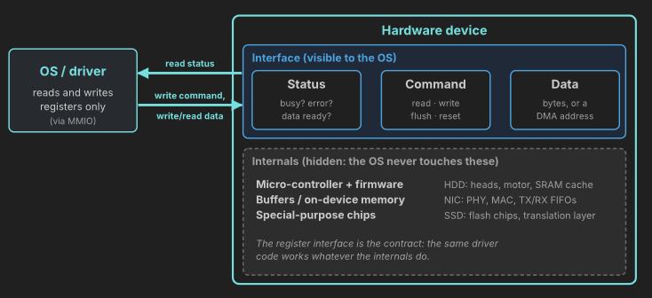
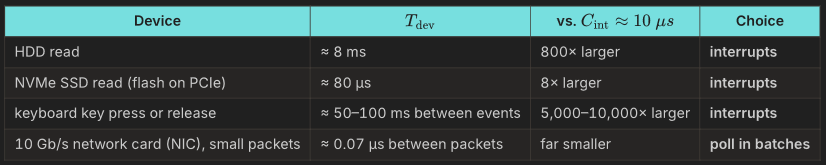
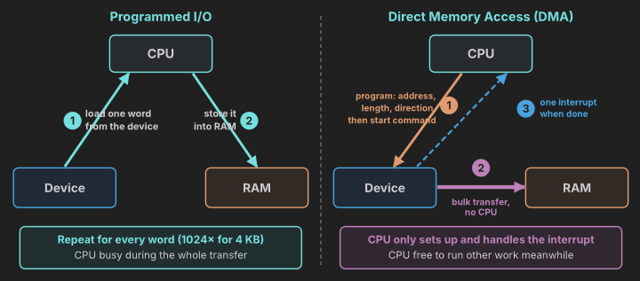

A computer that cannot save information across reboots is not very useful, so we need *persistence*.

But, how does the OS communicate with I/O devices without wasting CPU time while blocking?

# Physical layout

The CPU is connected to other devices via buses of varying speeds. RAM gets the fastest bus, but there are more buses that connect to more devices (PCIe, USB, SATA):

This tiered system is to offset costs: each component gets the cheapest bus that doesn't limit its speed.

# The I/O Interface

Different I/O devices work differently, but the operating system access them all the same way: by running regular memory operations on a specific address range.

The different device buses are mapped to a known address range, and the OS communicates with the devices in the same way it would access main memory. Instead of trying to read or write to the data directly though, it writes commands to control the device (memory-mapped I/O).

The values in these addresses are also never cached, since they are also modified by the I/O devices.

> [!NOTE]
> User code cannot access these device addresses. Only the kernel is allowed to control I/O devices.

## How devices are mapped

At boot, the computer's firmware (BIOS) requests each device's address space size, writing a base address in each device's base address registers. Then the kernel reads the mapping. After that, each device's driver does something idk

# The I/O interface

Every I/O device exposes the same interface to the operating system, consisting of 3 registers:
- The status register
- The command register
- The data register

The naive way to work with this interface is for the OS to poll the device's status, writing commands or reading data once it's not busy; this is obviously wasteful.

## Interrupt-driven I/O

With interrupt-driven I/O, we avoid polling the device and wasting CPU time. The device will send an interrput once it's ready, causing a context switch back to the driver code.

Interrupts are good if the device's operations are much slower than the time to execute a context switch. Certain devices, such as network interfaces, work in very fast intervals. For these sorts of operations, it's better for the device to buffer its data and poll it in batches.

If events are rare, choose interrupts. If events are very frequent, choose polling.

## Direct Memory Access

If we use the `data` register as the only access point to the device's memory (programmed I/O), big reads or writes would take very large amounts of memory transfers between the register and RAM.

With DMA, the CPU just tells the device what to read/write and the address to write to/read from. The DMA controller handles the actual data transfers, with the device generating a single interrupt once the full operation is completed.

To handle multiple requests, the OS keeps a ring buffer containing all requests, writing the address to the start of the buffer to the device at boot (?). The driver code will then add requests at the tail, and the device's controller reads the head, marking requests as done as it completes operations.

### DMA and virtual addresses

Since DMA works with physical addresses, if a device tried to write a bunch of data contigously it could violate the page mappings allocated to the program.

This is handled by the driver: it divides the operation by word size and maps each word to its physical address. This is known as *scatter-gather DMA*.

# Device driver operation

Device drivers are kernel code. They have different responsibilities:
- Initialization
    Find the device, map registers, setup buffers and request rings
- Handle requests
    Translate `read`/`write` syscalls to specific device instructions
- Handle interrupts
- Cleanup
    Stop the device and deallocate resources initialized by the driver

