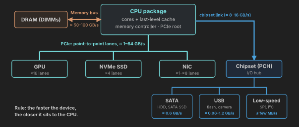
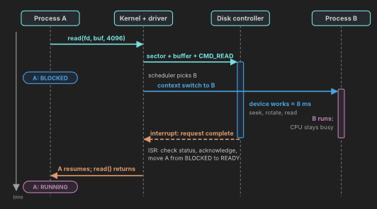
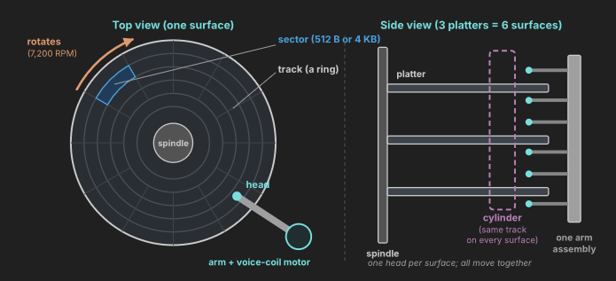
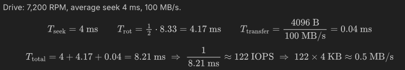
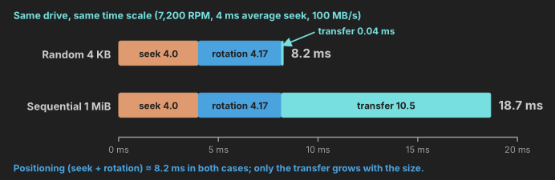
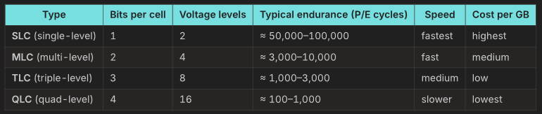

	A computer that cannot save information across reboots is not very useful, so we need *persistence*.

But, how does the OS communicate with I/O devices without wasting CPU time while blocking?

# Physical layout

The CPU is connected to other devices via buses of varying speeds. RAM gets the fastest bus, but there are more buses that connect to more devices (PCIe, USB, SATA):

This tiered system is to offset costs: each component gets the cheapest bus that doesn't limit its speed.

# The I/O Interface

Different I/O devices work differently, but the operating system access them all the same way: by running regular memory operations on a specific address range.

The different device buses are mapped to a known address range, and the OS communicates with the devices in the same way it would access main memory. Instead of trying to read or write to the data directly though, it writes commands to control the device (memory-mapped I/O).

The values in these addresses are also never cached, since they are also modified by the I/O devices.

> [!NOTE]
> User code cannot access these device addresses. Only the kernel is allowed to control I/O devices.

## How devices are mapped

At boot, the computer's firmware (BIOS) requests each device's address space size, writing a base address in each device's base address registers. Then the kernel reads the mapping. After that, each device's driver does something idk

# The I/O interface

Every I/O device exposes the same interface to the operating system, consisting of 3 registers:
- The status register
- The command register
- The data register

The naive way to work with this interface is for the OS to poll the device's status, writing commands or reading data once it's not busy; this is obviously wasteful.

## Interrupt-driven I/O

With interrupt-driven I/O, we avoid polling the device and wasting CPU time. The device will send an interrput once it's ready, causing a context switch back to the driver code.

Interrupts are good if the device's operations are much slower than the time to execute a context switch. Certain devices, such as network interfaces, work in very fast intervals. For these sorts of operations, it's better for the device to buffer its data and poll it in batches.

If events are rare, choose interrupts. If events are very frequent, choose polling.

## Direct Memory Access

If we use the `data` register as the only access point to the device's memory (programmed I/O), big reads or writes would take very large amounts of memory transfers between the register and RAM.

With DMA, the CPU just tells the device what to read/write and the address to write to/read from. The DMA controller handles the actual data transfers, with the device generating a single interrupt once the full operation is completed.

To handle multiple requests, the OS keeps a ring buffer containing all requests, writing the address to the start of the buffer to the device at boot (?). The driver code will then add requests at the tail, and the device's controller reads the head, marking requests as done as it completes operations.

### DMA and virtual addresses

Since DMA works with physical addresses, if a device tried to write a bunch of data contigously it could violate the page mappings allocated to the program.

This is handled by the driver: it divides the operation by word size and maps each word to its physical address. This is known as *scatter-gather DMA*.

# Device driver operation

Device drivers are kernel code. They have different responsibilities:
- Initialization
    Find the device, map registers, setup buffers and request rings
- Handle requests
    Translate `read`/`write` syscalls to specific device instructions
- Handle interrupts
- Cleanup
    Stop the device and deallocate resources initialized by the driver

# Hard disks

All I/O devices are addressed by *logical block addresses*, with block sizes between 512B and 5KB. These logical addresses function much like virtual memory addresses.

This mean that, despite the physical layout of the device, the OS always seems teh same flat array of blocks.

In the case of hard disks, the cost of reading can vary significantly based on the physical distance between the blocks: let's see why that is.

## Inside hard disks

This is the layout of a hard disk:

The disk has multiple platters and heads. Each platter has 2 sides, so it gets 1 head per side. The platters are divided in sectors (blocks), and are spun by the spindle. The heads are moved linearly by arms to the correct spot in the disk to read sectors on a particular track. Once the platter spins under the head, the sector can be read. The group of sectors that are vertically aligned on each platter is called a cylinder.

A disk that runs at 7200 RPM makes 120 revolutions per second, meaning 1 revolution takes 8.33 ms. This is the biggest factor in why hard disks are so much slower than RAM/SSDs.

> [!NOTE]
> Because of angular velocity, outer tracks spin faster than inner tracks, meaning they're faster to access. It's the OS's job to choose how to layout data for the best performance.

### Drive cache

Drives have a DRAM cache that can hold data read in advance and allows a write to be marked as completed before the data is actually writte to the platter.

## Calculating performance

For the OS to be able to optimize data accesses to drives, it has to know how long any request will take.

Each HDD request has 3 steps:
- Seek
    The arm moves to the right track. Takes ~1ms for adjacent tracks, ~4-9ms on average. Grows less than linearly with distance (due to accel/decel).
- Rotation
    The correct sector rotates under the head. Takes half a revolution no average
- Transfer
    The data is accessed. Time depends on the drive's bandwidth; negligible compared to the other 2 steps.

So, the total time for a request is $T=T_\text{seek}+T_\text{rotation}+T_\text{transfer}$.

Example calculation:

Clearly most of the time is spent waiting for the drive's components to move to the right spot. This is why optimizing where data is stored is so important: sequential accesses cost much less since we can make use of the platter's rotation.

The OS can use this information to reorder request to optimize for sequential accesses.

## HDD request scheduling

The OS needs to schedule I/O requests to optimize for HDD accesses.

Processes send their I/O requests to a queue. The I/O scheduler is responsible for choosing who gets to access the drive from the queue.

The I/O scheduler faces similar challenges the CPU scheduler does.

### Algorithms

We use head track movement as a measure.

- First come first serve
    Simply serve the requests in arrival order. This algorithm is fair but slow.
- Shortest seek time first
    Analogous to CPU SJF. Greedy algorithm: considers only the next closest request, doesn't consider the shortest global path. Can cause starvation.
- SCAN/elevator
    Sweeps the platter, serving incoming requests on the way and reversing once it reaches the last track. Avoids starvation, but requests wait unevenly: requests in the middle of the platter get served more often.
- C-SCAN
    Same as SCAN, but only serves in one direction, resetting quickly once it reaches the end. Moving across the whole platter is fast since the head doesn't have to accelerate and decelerate.
- LOOK
    Same as SCAN but only move between the first and last requests along the tracks.
- C-LOOK
    LOOK with the C-SCAN approach.

Real systems usually use a variant of LOOK/C-LOOK, since it offers even waits with good average travel time.

We only consider track travel time since that's what the OS knows. The device itself has more information, and so will reorder requests sent by the operating system to optimize further.

# Solid State Drives

Solid state drives work more like RAM than a hard disk: access times aren't dependant on the internal physics of the device; randomized access is always the same speed.

SSDs can't overwrite: they must delete and write in 2 separate steps. Because of this, overwriting is always done by writing to a new location, then deleting the old one later. Since randomized access is not slower, this doesn't cause any overhead.

## Layout

An SSD contains a controller, DRAM, and several *NAND chips*. Each NAND chip contains several *dies*, which work in parallel. Each die contains 2-4 *planes*. Each plane has ~thousands of *blocks*. Each block has ~256 *pages*, which are rows of *cells*.

The minimum deletion unit is the block. The minimum read/write unit is the page.

Cells work by maintaining a certain level of voltage, based on the cell's size in bits, which encodes which bits are active.

## Using flash memory

Reading a page costs \~25-100 us. Writing ("programming") an (erased) page costs \~200-900 us. Erasing a block costs \~2-5 ms.

Programming a page can only change bits from 1 to 0. Erasing sets all bits back to 1.

A naive way to overwrite a page is to copy the whole block into RAM, erase the block, then write back all the pages with the one targeted page modified. Obviously, this is very wasteful. The better approach is to write the modified page in a *new* location, and reading from that new location instead of the old one.

### Wear

Flash memory is not perfect:
- Erasing and programming slightly damages the SSD
- Data fades over time if left static
- Reading a page slightly affects its neighbors

The biggest damage is done by erasing. The SSD's controller optimizes operations to reduce the number of erases, increasing lifetime.

## Flash translation layer

The operating system needs a unified interface for interacting with I/O devices, it doesn't care about optimizing flash memory lifetime. It's the firmware that abstracts away the details of managing flash memory.

The *flash translation layer* is part of the SSD's firmware, and it sits between the physical NAND chips and the operating system to provide the interface the OS needs.

### Address mapping

The FLT must do some address mapping to keep track of where overwritten pages actually are.

In the SSD's DRAM lives a table that maps logical addresses to the physical pages inside the NAND chips. Once a page is overwritten, the table is updated to point to the new physical page, and the old one is marked as *stale*.

Though, if we wanted to map each page, we'd need a very large amount of RAM: with 4kB pages and 4B/page, we'd need around 1 MB per GB of storage. Mapping blocks doesn't work since then the minimum operable unit becomes a block (256 pages). There's a hybrid approach?

### Garbage collector

Stale pages are cleaned up periodically by the *garbage collector*.

The garbage collector's logic is:
1. Pick victim blocks
    Find blocks with a lot of stale pages; minimizes copying valid pages
2. Copie still valid pages to free blocks
3. Update the mapping table
4. Erase the victim(s)

Garbage collection runs when the drive is idle, but must be run forcefully under heavy write loads.

This process causes *write amplification*: each write by the host actually costs more than 1 write, scaling with the number of valid pages in the victim block.

With $n=$ pages in a block, $v=$ valid pages, the formula for write amplificaton is (lower = better): $$
\text{WAF}=\frac{\text{total writes}}{\text{requested writes}} = \frac{n}{n-v};\text{ or } \frac 1{1-u} \text{ with } u=\frac vn \text{ being the fraction of valid pages}
$$

#### Over-provisioning

Drives often have more storage than they report to the operating system, known as *over-provisioning*.

Over-provisioning reduces WAF, since if every block is full most blocks will have very few invalid pages. With more spare blocks, they need to be erased less often, leading to more invalid pages and thus lower WAF.

### Wear leveling

It's advantageous to have blocks age at roughly the same rate, since one dead block can ruin the drive. This is known as *wear leveling*, and it can be implemented in 2 ways:
- Dynamic wear leveling
    Prioritize writing the least-aged free block
- Static wear leveling
    Periodically move cold data to young blocks

The FTL also manages dead blocks by replacing them with spare blocks from the over-provisioned area.

---

Full walkthrough of a memory access:
1. OS sends `write(LBA 1000)`
2. FTL picks an erased page and programs it
3. Map entry of `LBA 1000` points to the new page
4. Old page is marked stale
5. At some point the GC picks the block with the least valid pages, copies them and erases the block

The erase uses one program/erase cycle. New writes are sent to the least worn blocks, and over-provisioning increases the chance that there are enough free blocks.

## IOPS

Another metric for device performance is *I/O operations per second* (IOPS). SSD NAND chips work in parallel, which increases the number of requests it can handle per second.

$$
\text{IOPS} = \frac{\text{max queued requests}}{\text{drive latency}}
$$

The max queued requests is determined by the max level of parallelization the device can handle.

## Lifespan

A drive's lifespan is proportional to the number of P/E (program/erase) cycles its flash can handle and inversly proportional to write amplification: $$ \text{TBW (terabytes written)} = \frac{\text{capacity (TB)}\times \text{P/E cycles}}{\text{WAF}} $$

### Tricks

File deletions are entirely handled by the filesytem, the drive sees no change. `TRIM` is a message that the OS can send to the drive to forcefully mark them as stale. This increases the number of invalid pages, lowering WAF.

On Linux, this is sent periodically, or on every deletion if the drive is mounted with a specific option.

---

The drive's cache is volatile, so it could say it's done with a write before the data has been made persistent. *Flushing* makes sure the data is actually written before the drive answers.

# Linux I/O schedulers

Shortest-time-to-complete-eqsue scheduling could starve requests. Real schedulers use *deadlines* to avoid starvation.

Every request gets a time limit. If a request's limit is about to exipre, it is served next, regardless of time-to-complete.

Reads get quick deadlines, since processes will be waiting on them. Writes can afford to get long deadlines, since the data can sit in memory for a bit.

## `mq-deadline`

This scheduler is what Linux uses for HDDs.

New requests are sent to 2 queues, one sorted by LBA and one FIFO queue with deadlines. Normally, the scheduler picks the next request from the sorted queue, but if a request in the FIFO queue has passed its deadline it is served first.

## `none`

Only merges adjacent requests. Used for NVMe SSDs.

## `bfq`

*Budget fair queueing*, optimizes firness/latency.

## `kyber`

Tries to meet a latency target.

---

The scheduler sends requests to the device drives, which can also queue and reorder requests based on the current drive geometry.
