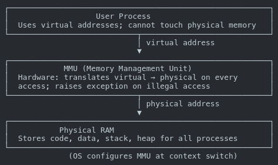
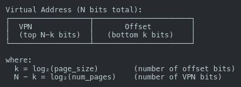
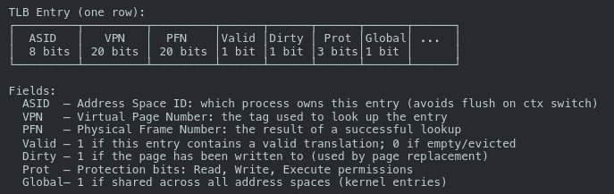
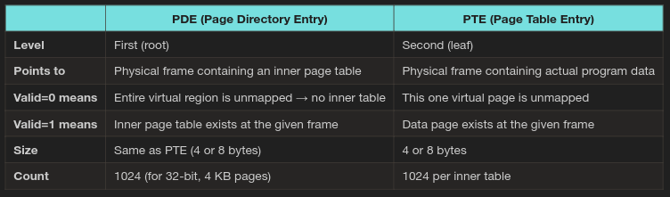

Initially, memory wasn't abstracted: computers only ran a single program at a time other than the operating system. This meant that a program could accidentally (or intentionally) write over the operating system's memory and corrupt it.

To safely allow multiple processes running at once, the operating system must abstract memory by limiting the addresses any given process has access to.

A well implemented memory abstraction has 3 main properties:
1. Transparency
    Processes believe they have their own individual address space  
2. Efficiency
    It doesn't impact speed or size. To achieve this hardware support is necessary
3. Protection
    Processes can't access other process' memory in any way

# Static Relocation

A simple implementation of memeory virtualization is *static relocation*.

This is a purely software based solution: the OS loader rewrites all absolute addresses in the binary *before executing the program*, remapping them usually by applying an offset.

The linker generates a list of all memory addresses to be modified for the OS loader to use.

This approach is very simple and requires no hardware, but has problems:
1. No protection for other processes
2. Processes can't be relocated after load

# MMU

The hardware component that translates virtual addresses to physical is the *memory management unit* (MMU).

The simplest form of hardware translation is *base and bounds*. With this system, the CPU has 2 special registers: the *base register* holds the starting physical address of the process' address space, and the *bounds register* holds the size of the address space. The base offset is applied to each address generated by the process, and virtual addresses are checked against the bounds register to make sure they're valid.

These checks and additions are done in-hardware: the MMU intercepts memory accesses generated by the execution core.

These registers must be updated every time the CPU context switches.

This approach permits dynamically relocating a process, since the only change needed is the process' base register's value.

The OS keeps a list of free physical addresses for processes. There's 3 different policies for picking a slot for a process: (assuming differently sized process allocation)
1. First-fit
    Scan the list and pick the first found. Leaves fragments near the front.
2. Best-fit
    Find the smallest region that fits the slot. Leaves many small fragments.
3. Worst-fit
    Use the largest region. Leaves larger fragments which may be able to be filled later.

Fragmentation causes issues since base and bounds necessitates contigous regions of memory for process allocation.

Base and bounds also suffers from internal fragmentation: the gap between the heap and stack is always physically allocated, even when unused. This breaks down with larger address spaces and multiple processes.

Additionally, base and bounds prohibits a potential optimization of sharing code data blocks for multiple active copies of the same program

---

We'll now see how to resolve fragmentation.

Internal fragmentation is caused by the fact that the whole program's address space is treated as one indivisible block. We can split up this block into multiple segments and keep a base/bounds register pair for each segment. This strategy is known as *segmentation*.

# Segmentation

A basic segmentation strategy is to split the address space into static, stack and heap. Then when a program accesses one of these segments, the memory access is translated using the segments' base and bounds registers.

This eliminates internal fragmentation: the operating system can allocate the individual segments instead of the whole address space.

Each segment can also have its own read/write permissions. This increases security.

Another advantage is that now different instances of the same program can share the executable's data in memory.

To select the memory segment to access, we can use the top 2 bits of the address, since they can represent a total of 4 values (one of these is considered invalid).

The OS must take some actions to work with segmented memory:
1. Process creation
2. Process termination
    Potentially compacts nearby allocated memory (expensive)
3. Context switch
    Save each segment's base/bounds registers and load the new ones
4. Growing segments
    The `sbrk()` syscall extends the heap, extending the existing segment if there's adjacent free memory or reallocating in a different location otherwise
5. Handle faults

---

Segmentation introduces a different problem: external fragmentation. There could be a large amount of total free but *not contiguous* memory, causing allocations to fail.

External fragmentation happens because every segment allocation takes up a different amount of memory. To resolve it, we must use allocate fixed-size units of memory.

These fixed-size blocks of memory are called *pages* in virtual memory, and *frames* in physical memory.

# Paging

The first question we must ask is: what is the size of a page?

On modern systems, pages are usually between 2-8kb. Frames inherit the page size.

Virtual pages can be allocated in any physical frame in memory. Each process then gets a *page table* that maps the virtual pages to physical frames and keeps permission flags. This setup eliminates the need for contiguity in physical memory for adjacent virtual pages.

With paging, each virtual address is divided in *page number* and offset: the most significant bits represent the page number, and the rest represent an offset within that page.

*Virtual addresses with paging*.

To translate a page number and offset to a physical address:
1. Get the associated frame's index from the page table
2. Multiply the frame index by the page size
3. Add the offset

Paging does have some downsides:
1. It introduces a small amount of internal fragmentations.
2. Every process needs to keep a page table (can have a lot of entries)
3. Every memory access is actually doubled: we must first access the page table (in memory) before accessing the requested address (mitigated by caching)

## Translation Lookaside Buffer

> The TLB is a small, fully associative hardware cache inside the MMU that stores a subset of recently used page table entries.

To fix the double memory access issue, we can use a cache. This cache is known as the *Translation Lookaside Buffer* (TLB). It stores the page table entries (PTEs) for recently accessed pages, allowing very fast subsequent page access. In practice, the hit rate of this cache is very high, basically eliminating the issue

The TLB is part of the MMU. It is checked first when accessing memory, before checking the actual page table.

TLB entries additionally store an ID to identify the process that owns the entry, to allow the cache to stay valid across context switches.

*TLB entry fields.*

On a TLB miss, either the hardware (if supported) or the OS handles fetching the requested PTE.

With a high hit rate, the effective memory access time gets only a few percentages slower than with no paging, while keeping the benefits.

If a process needs to access more memory than can fit in the cache's PTEs (the total amount of addressable memory reachable through cached page table entries is called *coverage*), it causes *thrashing*: the cache gets continuosly filled and flushed. This is mitigated by increasing page size.

## Multi-Level Page Table

To fix the page table size issue, we can use a tree data structure to hold PTEs. New entries are only allocated as needed since it's not an array, reducing most process' page table size to only a few kBs.

To achieve this, we can add another level of indirection to the page table: we keep a page table of page tables (the *page directory*). The entries of this new table also have a `valid` bit, indicating if any of the inner page tables are mapped. If this bit is not set, its inner page table entries are not allocated.

Virtual addresses get split once again, since we also need an index into the page directory.

While this approach does incur an (or more with more tree levels) additional memory access, this is mitigated by the TLB, since it only caches the virtual and physical page number.

64-bit architectures usually use trees with more than 2 levels.

### Allocating Pages

When a process is created, the top level of the page tree is allocated, filled with invalid entries. Then when the process tries to access a page, it'll hit an invalid entry. This generates a *page fault*, handled by the OS, which allocates a new page for the process (if it's a minor page fault) and all intermediate page tree levels. Then the faulting instruction is repeated and the process continues execution.

This way, the page tree grows on demand.

---

Thus far, we have assumed that a process' allocated memory fits entirely within RAM, but this is not always the case. To handle this without killing existing processes, we use *swapping*: a process' mapped pages can be temporarily stored on disk to make space for other pages in RAM.

Moving a page from RAM to disk is known as *evicting* it.

The space on disk dedicated for evicted pages is known as *swap space*.

# Swapping

When a process tries to access an invalid page, the MMU raises a page fault, storing the offending virtual address in a register. Then the OS checks if the requested page is in swap and, if so, loads the requested memory from disk, evicting a page from RAM if needed.

To know if a page is in swap or not, PTEs keep a "present bit" to track where the page is.

> [!NOTE]
> There are 2 kinds of page faults: major and minor. Major page faults occur when a page is present but in swap. Minor page faults occur when a memory access is illegal or the page is yet to be allocated.
> Since major faults require reading a swapped page from disk, they are slower to handle as they require an I/O operation.

## Dirty bit

PTEs also have a *dirty bit* indicating if the page has been written to since it was last swapped to disk. This allows skipping unnecessary writes when evicting pages, and also allows the OS to optimize by prioritizing swapping clean pages rather than dirty ones.

## Page replacement

When a process requests memory while RAM is full, the OS must decide which other page to evict. Since I/O operations are many orders of magnitude slower than memory accesses, a good algorithm is needed for this choice.

The optimal algorithm will always pick the page that won't be accessed for the longest time to evict. This is obviously unrealistic since we can't know a process' future memory access with certainty.

Algorithms for picking which page to evict are called *replacement policies*.

## Replacement policies

### FIFO

The simplest replacement policy is just using a queue.

Belady's anomaly? is this even relevant

### Least Recently Used

LRU evicts pages that haven't been used for the longest time. This makes use of the principle of temporal locality.

This is the most commonly used algorithm due to its ease of implementation and efficiency.

The most obvious way to implement this algorithm is to keep a timestamp with each page access. There's a problem though: to find the least recently used page, we must find it in an array or heap structure. Also, an accurate timestamp requires a large integer type to save, which creates a very large overhead with high page counts.

To solve this, we make an approximation.

#### Clock algorithm

The clock algorithm keeps all physical frames in a circular list. Then to pick a page to evict it uses a "clock hand" that iterates the list and checks each frame's accessed bit. If the bit is 1, it sets it to 0 and continues. Otherwise, it picks that page to evict.

This approximates the LRU algorithm while needing much less overhead.

---

> [!NOTE]
> Replacement policies can be *global* or *local*. Global policies can evict frames owned by other processes than the one requesting memory, while local policies can't. Though, local policies require giving each program a fixed number of frames, which could be wasteful if processes get over-allocated.
