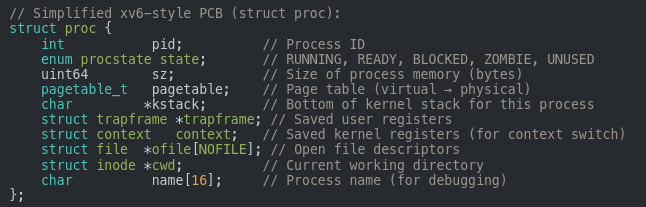
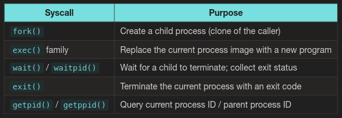
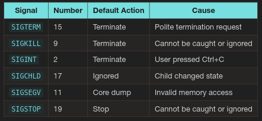
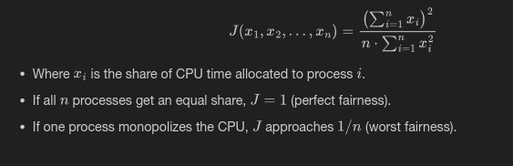
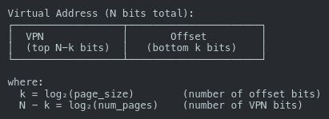

# Processes

We already saw that one of the most important abstractions that the OS provides is the process.

More precisely, a process is a collection of:
- Program code
- Value of the PC
- CPU registers
- A private virtual address space
- Open file descriptors
- Unique process ID (a *PID*)

When a process is started, the OS:
1. Reads the binary
2. Loads code into RAM\*
3. Allocates a stack and heap
4. Sets up file descriptors (stdin, stdout, stderr)
5. Jumps to entrypoint
    \*A program can be loaded either *eagerly* or *lazily*:
    - Eager loading loads the entire binary into memory before starting executino
    - Lazy loading only loads the instructions needed at the current point in execution. If the program tries to access an unloaded instruction, a page fault is generated, causing the OS to load the part of the binary that contains the requested instruction.

The state of a newly started process is as follows:
- The stack contains `argc`, `argv[]`, `envp[]`
- The heap is empty
- The PC points to the first instruction of `main`
- I/O file descriptors are open and connected to the terminal

## Process state

A process can be in one of these states:
- Ready
    The process is ready to execute instructions and is waiting for the CPU
- Running
    The process' instructions are being executed by the CPU. Only 1 process per core can be running at once.
- Blocked
    The process is waiting for I/O or for an event

The OS *scheduler* is responsible for managing process' states.

## Process Control Block

We mentioned that a process contains some information. This information is stored in a *process control block*.

*Simplified PCB.*

When the CPU does a context switch, it saves the current process' information in a PCB and loads a different one.

The OS keeps a table of all processes with their associated PCBs. This table is used by the scheduler.

## Process Hierarchy

On UNIX systems, processes are organized in a *tree*. The tree is rooted at PID 1, with a program known as the *init system* (usually `systemd`). The init system is the first user-space program executed after the kernel, and is responsible for starting all other processes after boot.

If a process is orphaned, it is adopted by the init system.

If the init system dies, the kernel panics as there is nothing left to manage user-space.

# UNIX Process API

Process management is done by the OS, so to create programs that interact with processes we must use system calls.

The main function for spawning processes if `fork()`. This function creates an *exact copy* of the current process. Then this copied process can run `exec()` to *replace* its running program.

The API is designed this way to give more flexibility ("Do one thing, and do it well").

## `fork()`

To spawn a new process (on UNIX), you use `fork()`. `fork()` creates an exact copy of the process, with the only difference being its return value: 0 in the child, and the PID of the child in the parent (or negative for errors).

### Copy-on-Write

Instead of naively copying the entire address space on fork, modern OSes use a technique called *copy on write*: the child and parent processes intially **share** the same address space as read-only, then when one of them tries to write to the shared memory a page fault is generated and a copy of the requested data is created for the process to write to.

## `wait()`

When a child process exits, it becomes a "zombie": its data is freed but its PCB is kept with status `ZOMBIE`. The parent process is responsible for cleaning up its children via `wait()`.

`wait()` blocks (unless there are no children, in which case it returns an error) the current process until a child process exits, then returns that process' PID. This way, we can enforce an execution order between the parent and child.

`waitpid()` lets you wait for a specific child process. It takes 3 arguments, see man for info.

There are some macros to inspect the exit status of a child; see man maybe? are they on there

## `exec()`

The `exec` syscall *replaces* the current process' program with a new program. This means that all code after the `exec` call (if it is successful) is never executed.

One of the few things that is kept after `exec` is the parent process' environment.

## Other APIs

### Signals

Processes can listen to signals sent by other processes:

Programs can then register a handler function to respond to these signals.

### Priority

Processes can have different priorities. This priority is controlled by a process' *niceness* value, adjustable via the `nice()` syscall.

### Pipes

You can create a communication channel with the `pipe()` syscall. This function takes an array of 2 integers, and creates a writable and readable pair of pipes, putting the file descriptors for those pipes in the array.

To work with file descriptors, you can use the `dup2()` syscall, which replicates input/output on a file descriptor to another.

# Scheduling

We've mentioned that the scheduler is the part of the OS that decides what program gets to execute next. Next, we'll see at how it works.

## Workload

To evaluate or design a scheduling policy, we need to understand how much compute each process will need. For this, we model processes as a workload. This model describes the amount of processes running, when they start, how long they need to complete, and whether they perform I/O.

To start, let's simplify by making some (unrealistic) assumptions:
1. Every job requires the same time to execute
2. Every job starts at the same time
3. Every job runs to completion
4. No jobs perform I/O
5. We know the exact runtime of every job

## Metrics

To evaluate a policy, we need metrics. We'll use 2 metrics: turnaround time and response time:
> Turnaround time is the total time that passes between when a job arrives and when it completes.

> Response time is the time between when a job arrives and when it is first scheduled.

These 2 metrics are on opposite ends of a scale: optimizing for one necessarily worsens the other.

fainess?

To evaluate fairness, we use Jain's Fairness index:

## Naive policies

The simplest scheduling policy is just using a FIFO queue.

### FIFO

Using the assumptions above, let's say we have 3 jobs that each need to execute for 10 seconds. We get an average turnaround time of 20 seconds.

Now let's discard the equal run-time assumption, setting the first process' run-time to 100 seconds. The average turnaround is now 110 seconds. Also, the other 2 jobs are stuck waiting for the first job to complete. This is known as the *Convoy effect*.

To remedy the Convoy effect, we can enact a different policy: *shortest job first* (SJF).

### SJF

We can use this policy since we are assuming the scheduler knows each job's runtime. With this policy, the average turnaround time drops to 50 seconds. In fact, SJF is the mathematically optimal policy for optimizing turnaround time (assuming all jobs arrive at the same time).

If we discard the equal arrival assumption, SJF breaks down (assuming non-preemptiveness), since if a long running job arrives first, subsequent short jobs must again wait for the long job to finish.

## Preemption

To solve the Convoy effect, we need to discard the assumption that all jobs run to completion. In other words, we need a *preemptive* scheduler.

### Shortest time-to-complete first

This policy is a preemptive version of SJF: when a new job arrives, the scheduler checks if the new job is shorter than the current job's remaining time, and if true moves execution to the new job.

STCF is once again optimal for optimizing turnaround time. It has a problem though: if new short jobs keep getting scheduled, a long running job may never get execution time. This is known as *starvation*.

STCF relies on the last assumption that the scheduler knows the exact runtime of each job. Later, we'll see what happens when we look for a policy that doesn't rely on this assumption.

### Round Robin

Both SJF and STCF have a latency issue: the only time the scheduler moves execution is when a shorter job arrives.

To remedy this, the round robin approach gives each job a set amount of time to execute before switching to the next one. The amount of time should be big enough to not have too much of the percentage of CPU time spent switching contexts, but short enough to maintain interactivity.

This policy improves response time, but turnaround time suffers.

## Considering I/O

When a process starts an I/O operation the scheduler should shedule a different process while the operation executes. By overlapping execution like this, we can reduce the CPU's idle time, increasing throughput and latency.

To represent this in a scheduling algorithm, we divide each job in different sub-jobs, with I/O waits in between.

*Summary of the policies we've seen so far.*

# Memory

Initially, memory wasn't abstracted: computers only ran a single program at a time other than the operating system. This meant that a program could accidentally (or intentionally) write over the operating system's memory and corrupt it.

To safely allow multiple processes running at once, the operating system must abstract memory by limiting the addresses any given process has access to.

A well implemented memory abstraction has 3 main properties:
1. Transparency
    Processes believe they have their own individual address space  
2. Efficiency
    It doesn't impact speed or size. To achieve this hardware support is necessary
3. Protection
    Processes can't access other process' memory in any way

## Static Relocation

A simple implementation of memeory virtualization is *static relocation*.

This is a purely software based solution: the OS loader rewrites all absolute addresses in the binary *before executing the program*, remapping them usually by applying an offset.

The linker generates a list of all memory addresses to be modified for the OS loader to use.

This approach is very simple and requires no hardware, but has problems:
1. No protection for other processes
2. Processes can't be relocated after load

## MMU

The hardware component that translates virtual addresses to physical is the *memory management unit* (MMU).

The simplest form of hardware translation is *base and bounds*. With this system, the CPU has 2 special registers: the *base register* holds the starting physical address of the process' address space, and the *bounds register* holds the size of the address space. The base offset is applied to each address generated by the process, and virtual addresses are checked against the bounds register to make sure they're valid.

These checks and additions are done in-hardware: the MMU intercepts memory accesses generated by the execution core.

These registers must be updated every time the CPU context switches.

This approach permits dynamically relocating a process, since the only change needed is the process' base register's value.

The OS keeps a list of free physical addresses for processes. There's 3 different policies for picking a slot for a process: (assuming differently sized process allocation)
1. First-fit
    Scan the list and pick the first found. Leaves fragments near the front.
2. Best-fit
    Find the smallest region that fits the slot. Leaves many small fragments.
3. Worst-fit
    Use the largest region. Leaves larger fragments which may be able to be filled later.

Fragmentation causes issues since base and bounds necessitates contigous regions of memory for process allocation.

Base and bounds also suffers from internal fragmentation: the gap between the heap and stack is always physically allocated, even when unused. This breaks down with larger address spaces and multiple processes.

Additionally, base and bounds prohibits a potential optimization of sharing code data blocks for multiple active copies of the same program

---

We'll now see how to resolve fragmentation.

Internal fragmentation is caused by the fact that the whole program's address space is treated as one indivisible block. We can split up this block into multiple segments and keep a base/bounds register pair for each segment. This strategy is known as *segmentation*.

## Segmentation

A basic segmentation strategy is to split the address space into static, stack and heap. Then when a program accesses one of these segments, the memory access is translated using the segments' base and bounds registers.

This eliminates internal fragmentation: the operating system can allocate the individual segments instead of the whole address space.

Each segment can also have its own read/write permissions. This increases security.

Another advantage is that now different instances of the same program can share the executable's data in memory.

To select the memory segment to access, we can use the top 2 bits of the address, since they can represent a total of 4 values (one of these is considered invalid).

The OS must take some actions to work with segmented memory:
1. Process creation
2. Process termination
    Potentially compacts nearby allocated memory (expensive)
3. Context switch
    Save each segment's base/bounds registers and load the new ones
4. Growing segments
    The `sbrk()` syscall extends the heap, extending the existing segment if there's adjacent free memory or reallocating in a different location otherwise
5. Handle faults

---

Segmentation introduces a different problem: external fragmentation. There could be a large amount of total free but *not contiguous* memory, causing allocations to fail.

External fragmentation happens because every segment allocation takes up a different amount of memory. To resolve it, we must use allocate fixed-size units of memory.

These fixed-size blocks of memory are called *pages* in virtual memory, and *frames* in physical memory.

## Paging

The first question we must ask is: what is the size of a page?

On modern systems, pages are usually between 2-8kb. Frames inherit the page size.

Virtual pages can be allocated in any physical frame in memory. Each process then gets a *page table* that maps the virtual pages to physical frames and keeps permission flags. This setup eliminates the need for contiguity in physical memory for adjacent virtual pages.

With paging, each virtual address is divided in *page number* and offset: the most significant bits represent the page number, and the rest represent an offset within that page.

*Virtual addresses with paging*.

To translate a page number and offset to a physical address:
1. Get the associated frame's index from the page table
2. Multiply the frame index by the page size
3. Add the offset

Paging does have some downsides:
1. It introduces a small amount of internal fragmentations.
2. Every process needs to keep a page table (can have a lot of entries)
3. Every memory access is actually doubled: we must first access the page table (in memory) before accessing the requested address (mitigated by caching)
