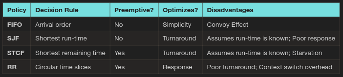

# Processes

We already saw that one of the most important abstractions that the OS provides is the process.

More precisely, a process is a collection of:
- Program code
- Value of the PC
- CPU registers
- A private virtual address space
- Open file descriptors
- Unique process ID (a *PID*)

When a process is started, the OS:
1. Reads the binary
2. Loads code into RAM\*
3. Allocates a stack and heap
4. Sets up file descriptors (stdin, stdout, stderr)
5. Jumps to entrypoint
    \*A program can be loaded either *eagerly* or *lazily*:
    - Eager loading loads the entire binary into memory before starting executino
    - Lazy loading only loads the instructions needed at the current point in execution. If the program tries to access an unloaded instruction, a page fault is generated, causing the OS to load the part of the binary that contains the requested instruction.

The state of a newly started process is as follows:
- The stack contains `argc`, `argv[]`, `envp[]`
- The heap is empty
- The PC points to the first instruction of `main`
- I/O file descriptors are open and connected to the terminal

## Process state

A process can be in one of these states:
- Ready
    The process is ready to execute instructions and is waiting for the CPU
- Running
    The process' instructions are being executed by the CPU. Only 1 process per core can be running at once.
- Blocked
    The process is waiting for I/O or for an event

The OS *scheduler* is responsible for managing process' states.

## Process Control Block

We mentioned that a process contains some information. This information is stored in a *process control block*.

*Simplified PCB.*

When the CPU does a context switch, it saves the current process' information in a PCB and loads a different one.

The OS keeps a table of all processes with their associated PCBs. This table is used by the scheduler.

## Process Hierarchy

On UNIX systems, processes are organized in a *tree*. The tree is rooted at PID 1, with a program known as the *init system* (usually `systemd`). The init system is the first user-space program executed after the kernel, and is responsible for starting all other processes after boot.

If a process is orphaned, it is adopted by the init system.

If the init system dies, the kernel panics as there is nothing left to manage user-space.

# UNIX Process API

Process management is done by the OS, so to create programs that interact with processes we must use system calls.

The main function for spawning processes if `fork()`. This function creates an *exact copy* of the current process. Then this copied process can run `exec()` to *replace* its running program.

The API is designed this way to give more flexibility ("Do one thing, and do it well").

## `fork()`

To spawn a new process (on UNIX), you use `fork()`. `fork()` creates an exact copy of the process, with the only difference being its return value: 0 in the child, and the PID of the child in the parent (or negative for errors).

### Copy-on-Write

Instead of naively copying the entire address space on fork, modern OSes use a technique called *copy on write*: the child and parent processes intially **share** the same address space as read-only, then when one of them tries to write to the shared memory a page fault is generated and a copy of the requested data is created for the process to write to.

## `wait()`

When a child process exits, it becomes a "zombie": its data is freed but its PCB is kept with status `ZOMBIE`. The parent process is responsible for cleaning up its children via `wait()`.

`wait()` blocks (unless there are no children, in which case it returns an error) the current process until a child process exits, then returns that process' PID. This way, we can enforce an execution order between the parent and child.

`waitpid()` lets you wait for a specific child process. It takes 3 arguments, see man for info.

There are some macros to inspect the exit status of a child; see man maybe? are they on there

## `exec()`

The `exec` syscall *replaces* the current process' program with a new program. This means that all code after the `exec` call (if it is successful) is never executed.

One of the few things that is kept after `exec` is the parent process' environment.

## Other APIs

### Signals

Processes can listen to signals sent by other processes:

Programs can then register a handler function to respond to these signals.

### Priority

Processes can have different priorities. This priority is controlled by a process' *niceness* value, adjustable via the `nice()` syscall.

### Pipes

You can create a communication channel with the `pipe()` syscall. This function takes an array of 2 integers, and creates a writable and readable pair of pipes, putting the file descriptors for those pipes in the array.

To work with file descriptors, you can use the `dup2()` syscall, which replicates input/output on a file descriptor to another.

# Scheduling

We've mentioned that the scheduler is the part of the OS that decides what program gets to execute next. Next, we'll see at how it works.

## Workload

To evaluate or design a scheduling policy, we need to understand how much compute each process will need. For this, we model processes as a workload. This model describes the amount of processes running, when they start, how long they need to complete, and whether they perform I/O.

To start, let's simplify by making some (unrealistic) assumptions:
1. Every job requires the same time to execute
2. Every job starts at the same time
3. Every job runs to completion
4. No jobs perform I/O
5. We know the exact runtime of every job

## Metrics

To evaluate a policy, we need metrics. We'll use 2 metrics: turnaround time and response time:
> Turnaround time is the total time that passes between when a job arrives and when it completes.

> Response time is the time between when a job arrives and when it is first scheduled.

These 2 metrics are on opposite ends of a scale: optimizing for one necessarily worsens the other.

fainess?

To evaluate fairness, we use Jain's Fairness index:

## Naive policies

The simplest scheduling policy is just using a FIFO queue.

### FIFO

Using the assumptions above, let's say we have 3 jobs that each need to execute for 10 seconds. We get an average turnaround time of 20 seconds.

Now let's discard the equal run-time assumption, setting the first process' run-time to 100 seconds. The average turnaround is now 110 seconds. Also, the other 2 jobs are stuck waiting for the first job to complete. This is known as the *Convoy effect*.

To remedy the Convoy effect, we can enact a different policy: *shortest job first* (SJF).

### SJF

We can use this policy since we are assuming the scheduler knows each job's runtime. With this policy, the average turnaround time drops to 50 seconds. In fact, SJF is the mathematically optimal policy for optimizing turnaround time (assuming all jobs arrive at the same time).

If we discard the equal arrival assumption, SJF breaks down (assuming non-preemptiveness), since if a long running job arrives first, subsequent short jobs must again wait for the long job to finish.

## Preemption

To solve the Convoy effect, we need to discard the assumption that all jobs run to completion. In other words, we need a *preemptive* scheduler.

### Shortest time-to-complete first

This policy is a preemptive version of SJF: when a new job arrives, the scheduler checks if the new job is shorter than the current job's remaining time, and if true moves execution to the new job.

STCF is once again optimal for optimizing turnaround time. It has a problem though: if new short jobs keep getting scheduled, a long running job may never get execution time. This is known as *starvation*.

STCF relies on the last assumption that the scheduler knows the exact runtime of each job. Later, we'll see what happens when we look for a policy that doesn't rely on this assumption.

### Round Robin

Both SJF and STCF have a latency issue: the only time the scheduler moves execution is when a shorter job arrives.

To remedy this, the round robin approach gives each job a set amount of time to execute before switching to the next one. The amount of time should be big enough to not have too much of the percentage of CPU time spent switching contexts, but short enough to maintain interactivity.

This policy improves response time, but turnaround time suffers.

## Considering I/O

When a process starts an I/O operation the scheduler should shedule a different process while the operation executes. By overlapping execution like this, we can reduce the CPU's idle time, increasing throughput and latency.

To represent this in a scheduling algorithm, we divide each job in different sub-jobs, with I/O waits in between.

*Summary of the policies we've seen so far.*
